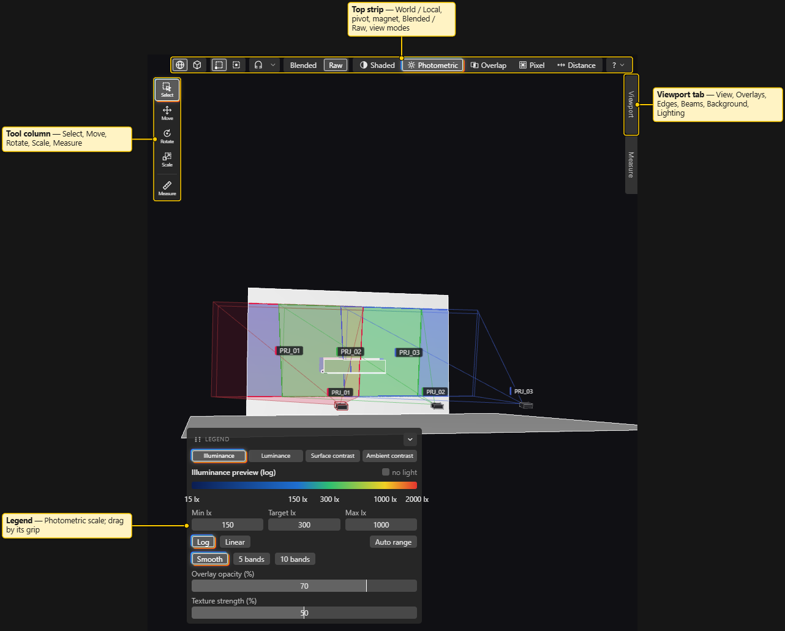

# 3D View

The 3D view is where you see the venue, the projectors, people and cameras, and where you move things.

## Navigating

The mouse works like Blender.

| Action | How |
|---|---|
| Orbit | Hold the **middle mouse button** and drag. With the Move, Rotate or Scale tool, the left button orbits too. |
| Pan | Hold the **right mouse button** and drag. |
| Zoom | Mouse wheel. |
| Select | Click an object. `Shift+click` adds, `Ctrl+click` toggles. |
| Box select | With the Select tool (`Q`), drag a box on empty space. `Shift` adds to the selection, `Ctrl` removes. |
| Pin the probe | `Alt+click` a surface. See [Summary and History](Summary-and-History.md). |

There is no camera smoothing: the view stops when you stop.

Box select picks objects whose centre falls inside the box. Hidden and locked objects are skipped. A camera is only picked while **Labels** is on.

### Viewpoints and the numpad

Use the numpad (Blender's keys) or the **View** button on the right edge.

- `Numpad 1` Front, `Ctrl+Numpad 1` Back
- `Numpad 3` Right, `Ctrl+Numpad 3` Left
- `Numpad 7` Top, `Ctrl+Numpad 7` Bottom
- `Numpad 5` switches Perspective and Orthographic

A viewpoint keeps your target and distance. In the installed app window the `Ctrl+Numpad` keys work; a normal Chrome tab may use them for tab switching.

### Orthographic

The **Persp / Ortho** button, **View > Orthographic** or `Numpad 5` switches the projection. A small **Ortho** chip shows in the view while it is on.

### Frame selected

`F` or **View > Frame selected** moves the view to the selection. With nothing selected, it frames everything.

## Looking through a camera or projector

- A **camera** is a saved viewpoint. Create one with **View > Viewpoint > Save view as camera…**, which asks for a name. Cameras are listed under **Viewpoint** and in the Outliner.
- Click a camera in **Viewpoint**, the **Look through** toggle on its Outliner row, or **Look through** in Properties to see through it. A chip shows its name, projection and field of view. Click again to leave.
- Do the same on a **projector** to see what it sees. This is a view action, not an edit, so it works on a locked projector.
- **Lock camera to view** (**View** menu, or the **Lock** button that appears while you look through a camera): orbit, pan and zoom then move the camera itself. It is greyed out with a reason when the camera is locked or the window is read-only.
- Properties > Camera has **Update from view** to store the current view in the camera. **File > Export > Camera images (PNG)…** writes images from the cameras.

## Display toggles (right edge)

- **Labels**: names of projectors, people and cameras, and camera glyphs.
- **Tex** (**View > Textures**): textures on surfaces. See [Textures](Textures.md).
- **Grid**: ground grid.
- **Wire** (**View > Wireframe**): **Off**, **Feature edges**, **All edges**. The button switches Off and the last mode. "Building wireframe…" shows while it is made for a big model.
- **View > Background**: **Dark**, **Grey**, **Black**, **Night gradient**.
- **View > Statistics**: text at the top left with the view name (for example `User Perspective`), project and variation name, Objects, Projectors (with how many are in the analysis), Triangles, and the frame rate.

## Lighting

The **Lighting** button (or **View > Lighting…**) opens a popover for how the **Shaded** view is lit. It changes the picture only, not the numbers.

- Mode: **Headlight** (light from the camera, the default), **Sun** (fixed direction; set **Azimuth** and **Elevation**), **Flat** (no shading).
- **Scene light (%)** and **Pattern (%)** sliders.
- **Pattern kind**: the test pattern of the project. See [Test Patterns](Test-Patterns.md).
- **Reset lighting**.

## Transform tools (left edge)

**Select** (`Q`), **Move** (`W`), **Rotate** (`E`), **Scale** (`R`) put a gizmo on the selection. **World** or **Local** sets the gizmo axes. **Origin** or **Box ctr** sets the pivot. With a mix of objects the pivot may be forced to the box centre; the view says so. These keys work with the focus in the 3D view or the Outliner.

## Mode buttons (top right)

**Shaded**, **Lux**, **Overlap**, **Pixel** (`1` to `4`), **Blended** / **Raw**, and **?**. See [View Modes](View-Modes.md).

During a gizmo drag the controls are inactive on purpose.

See also: [View Modes](View-Modes.md), [Keyboard Shortcuts](Keyboard-Shortcuts.md), [Menus](Menus.md), [Measure Tools](Measure-Tools.md)
