# 3D View

The 3D view shows the venue, projectors, people and saved cameras. Use it to move them.

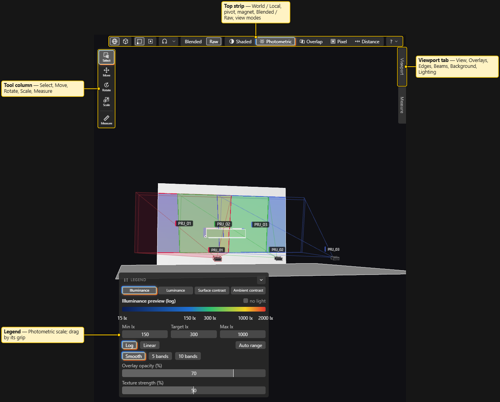

## Navigating

The mouse works like Blender.

| Action | How |
|---|---|
| Orbit | Hold the **middle mouse button** and drag (in every tool). With the Move, Rotate or Scale tool, the left button also orbits. |
| Pan | Hold the **right mouse button** and drag. |
| Zoom | Turn the mouse wheel. |
| Select | Click an object. `Shift+click` adds to the selection. `Ctrl+click` toggles. |
| Box select | With the Select tool (`Q`), drag a box on empty space. `Shift` adds to the selection. `Ctrl` removes. |
| Pin the probe | `Alt+click` a surface. See [Summary and History](Summary-and-History.md). |

The view has no camera smoothing. It stops when you stop.

Box select picks objects whose centre is inside the box. It also picks measurements whose label centre is inside the box. It skips hidden and locked objects. It picks a saved camera only while **Labels** is on.

### Viewpoints and the numpad

Use the numpad (the same keys as Blender) or the **View** button on the right edge.

- `Numpad 1` shows Front. `Ctrl+Numpad 1` shows Back.
- `Numpad 3` shows Right. `Ctrl+Numpad 3` shows Left.
- `Numpad 7` shows Top. `Ctrl+Numpad 7` shows Bottom.
- `Numpad 5` switches between Perspective and Orthographic.

A viewpoint keeps your target and distance. The `Ctrl+Numpad` keys work in the app window.

### Orthographic

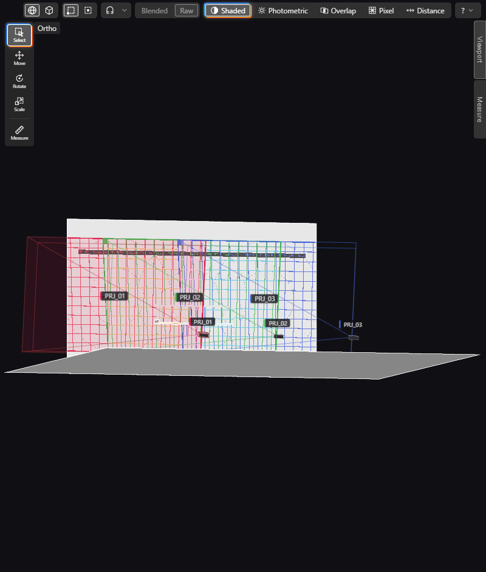

The **Persp** / **Ortho** button, **View > Orthographic** and `Numpad 5` switch the projection. A small **Ortho** chip shows in the view while orthographic projection is on.

### Frame selected

Press `F` or choose **View > Frame selected**. The view frames the selection. It frames everything when nothing is selected.

## Looking through a camera or projector

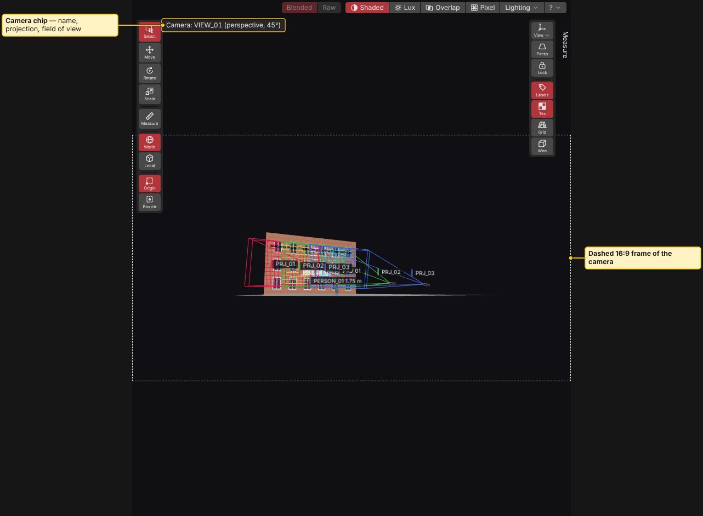

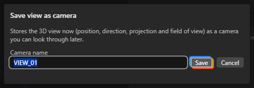

- A **saved camera** is a stored view. To make one, choose **View > Viewpoint > Save view as camera…**. The dialog asks for a name. Saved cameras are listed under **Viewpoint** and in the Outliner.
- To see through a saved camera, click it in **Viewpoint**. You can also click the **Look through** toggle on its Outliner row, or click **Look through** in Properties. A chip shows its name, projection and field of view. Click again to leave.
- Do the same on a projector to see what the projector sees. This is a view action, not an edit. It works on a locked projector.
- **Lock camera to view** is in the **View** menu. The **Lock** button appears while you look through a camera. With the lock on, orbit, pan and zoom move the camera itself. The lock is greyed out, with a reason, when the camera is locked or the window is read-only.
- Properties > Camera has **Update from view**. It stores the current view in the saved camera.
- **File > Export > Camera images (PNG)…** writes one image for each visible saved camera.

The right-hand button column moves left while the **Measure** sidebar (`N`) is open. The two never overlap. **Measure** is a tab on the right edge of the 3D view.

## Viewport fold-out (right edge)

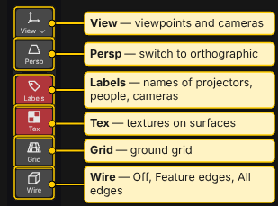

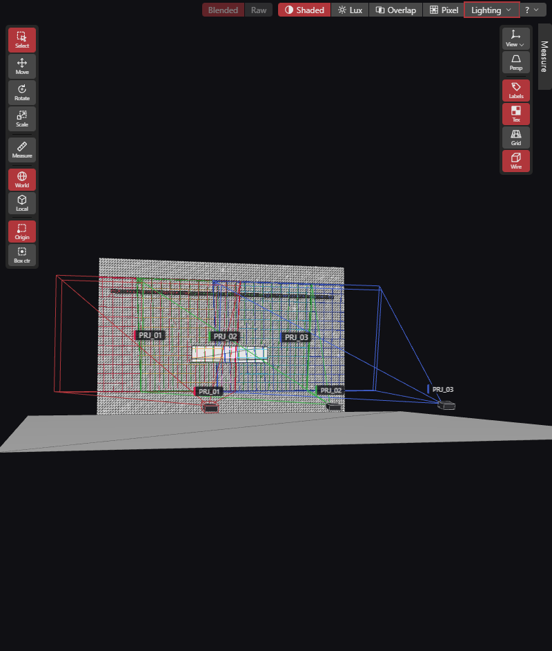

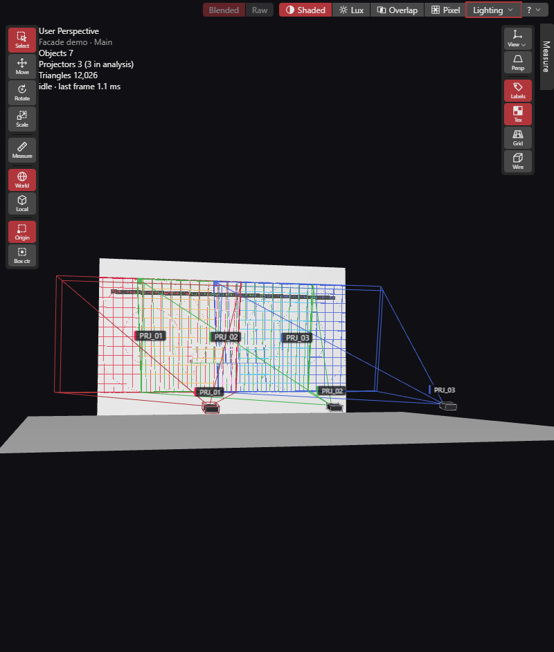

The **Viewport** tab on the right edge of the 3D view opens a panel with the view settings. Only one of **Viewport** and **Measure** is open at a time. These settings change the picture. They do not change any number. The sections are:

- **View**: **View** (the viewpoint list and the saved cameras), **Persp** / **Ortho**, and **Lock** while you look through a camera.
- **Overlays**: **Labels** (names of projectors, people and cameras, and camera glyphs), **Tex** (the same as **View > Textures**, see [Textures](Textures.md)) and **Grid** (the ground grid).
- **Grid**: **Cell size (m)**, **Subdivisions (cells per major line)** and **Extent (cells, 0 = auto)**. With extent 0, the grid follows the camera. A fixed extent draws a square grid on the file origin. The grid fades out at its edge.
- **Edges**: **Highlight** puts light grey lines where the depth or the surface direction jumps. It works in every view mode. **Texture** adds edges found in the base texture. It needs **Highlight** and **Tex**. **Edge strength (%)** sets how strong the lines are. **Object edges** (also **View > Object edges**) draws the mesh lines of the venue. The choices are **Off**, **Feature edges** and **All edges**. The button switches between Off and the last mode. The text "Building wireframe…" shows while a large model builds. Edge highlight shows in the 3D view only. It does not show in report pictures.
- **Surfaces**: six switches. All are on by default, except **Grey**.
  - **Specular**: a soft sheen on shaded surfaces.
  - **Soft light**: softer Headlight shading.
  - **Smooth**: the view averages several frames when the camera is still.
  - **Occlusion**: darker corners in the Shaded view.
  - **Perceptual**: colour overlays mix in linear light.
  - **Grey** (material override): every object takes the default grey in the Shaded view, and textures are hidden.
- **Beams**: **Selected** (lines for every projector, fill on the selected projectors), **All** (fill on every beam) or **None**. **Beam visibility (%)** sets the strength. A value of 0 hides lines and fill. **Images** (**Show projector images**) paints the test pattern of each projector on the surfaces in every view mode. The Shaded view always shows it. **Pattern (%)** in Lighting sets its strength.
- **Background**: **Studio gradient** (the default), **Dark**, **Grey**, **Black**, **Night gradient**, **Flat colour** and **Gradient**. **Flat colour** has a colour picker, **Colour**. **Gradient** has **Top colour** and **Bottom colour**. **View > Background** has the same choices.
- **Lighting**: see [Lighting](#lighting).

The default surface is a dark grey with a soft highlight. Coloured overlays stay easy to read on it. The default background is **Studio gradient**. A machine that still had the old default background (**Dark**) moves to **Studio gradient** once. Other choices stay. Beam lines are pale and thin. The grid is faint and fades out. The app keeps the grid, the background colours, the other look settings above and the place of the legend for each machine. It does not keep them in the project file. `Ctrl+Z` does not undo them.

**View > Statistics** shows text at the top left of the 3D view. The text has the view name (for example `User Perspective`), the project name and the variation name. It also has the number of objects and the number of projectors, with the number in the analysis. The last items are the triangle count and the frame rate.

## Lighting

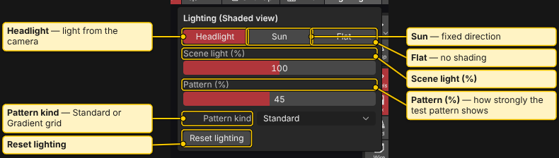

The **Lighting** section of the **Viewport** fold-out sets how the Shaded view is lit. **View > Lighting…** opens the fold-out. These settings change the picture. They do not change any number. The Shaded view dims surface colours so the projections stand out. A projection never covers a surface by more than the **Overlay opacity (%)** of the Photometric legend.

- Mode: **Headlight** (light from the camera, the default), **Sun** (fixed direction) or **Flat** (no shading). In Sun mode, set **Azimuth (°)** and **Elevation (°)**.
- **Ambient (%)** is the base light on every surface. The default is 25 %. It never changes a number. It is not the same as **Site ambient lx**, which the Photometric view uses.
- **Directional (%)** sets the strength of the headlight or the sun. It was called Scene light in 1.0.
- **Pattern (%)** sets how strong the test patterns show in the Shaded view.
- **Pattern kind** sets the test pattern of the project. See [Test Patterns](Test-Patterns.md).
- **Reset lighting** puts the lighting back to its defaults.

## Transform tools (left edge)

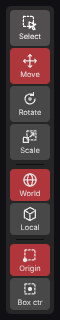

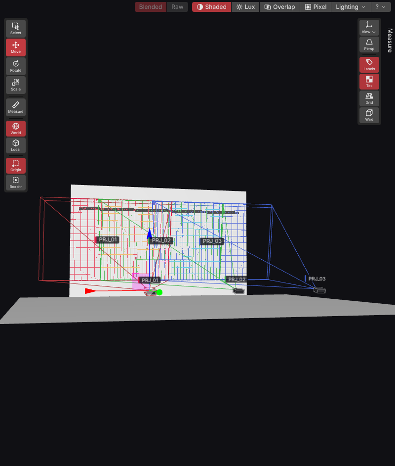

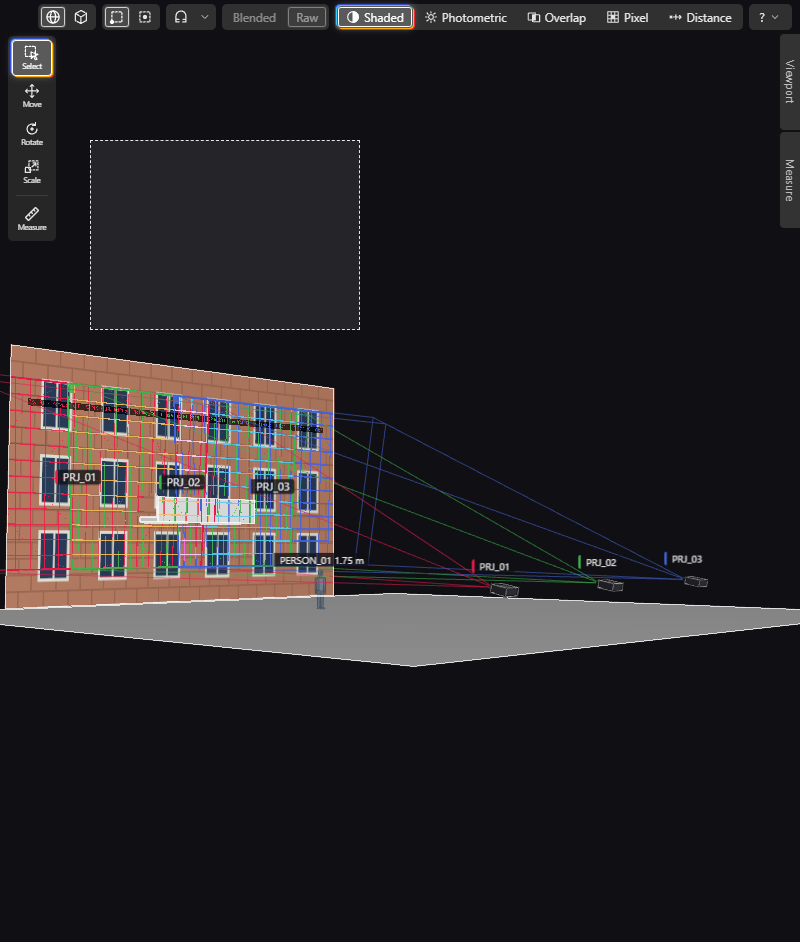

**Select** (`Q`), **Move** (`W`), **Rotate** (`E`) and **Scale** (`R`) put a gizmo on the selection. **Measure** (`M`) sits below a divider. It places distances and notes. See [Measure Tools](Measure-Tools.md).

**World** or **Local** sets the gizmo axes. **Origin** or **Box centre** sets the pivot. With mixed objects, the app can force the pivot to the box centre. The view then says so. These keys work when the focus is in the 3D view or the Outliner.

### Snapping (magnet)

The **Magnet** button turns on snapping for the Move, Rotate and Scale gizmos. It is in the top strip of the 3D view, between the pivot buttons and **Blended** / **Raw**. The small arrow beside it opens **Snap steps**:

- **Move (m)**: default 0.1.
- **Rotate (deg)**: default 5.
- **Scale (factor)**: default 0.1.

Type a value and press `Enter`. The same popover holds the snap targets of the Measure tool: **Vertex**, **Edge**, **Lens**, **Bounding box** and **Surface**. Choose one at a time. The choice lasts for this session only. See [Measure Tools](Measure-Tools.md#snapping).

- Magnet **on**: every gizmo drag snaps. Hold `Ctrl` to move freely.
- Magnet **off** (the default on a fresh machine): a drag is free. Hold `Ctrl` to snap.
- **Move** also snaps to vertices and edges of the venue meshes. The targets are the nearest corner, edge end, edge middle or point on a feature edge within 12 pixels of the pointer. Then it snaps to the step. It never snaps to the lens of a projector.
- **Rotate** and **Scale** snap to their steps only. Scale never goes below its step.
- `Esc` during a drag puts the object back. One drag is one undo step.
- The magnet does not affect Measure, orbit or placing with a click.
- The app keeps the magnet state and the steps for each machine. It does not keep them in the project file.

## Mode buttons (top right)

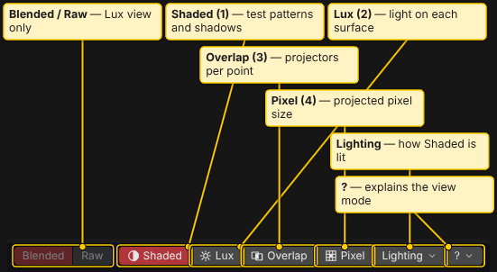

The top strip has the buttons **Shaded**, **Photometric**, **Overlap**, **Pixel** and **Distance** (keys `1` to `5`). It also has **Blended** / **Raw** and **?**. See [View Modes](View-Modes.md).

The controls are inactive during a gizmo drag. This is on purpose.

See also: [View Modes](View-Modes.md), [Keyboard Shortcuts](Keyboard-Shortcuts.md), [Menus](Menus.md), [Measure Tools](Measure-Tools.md)
