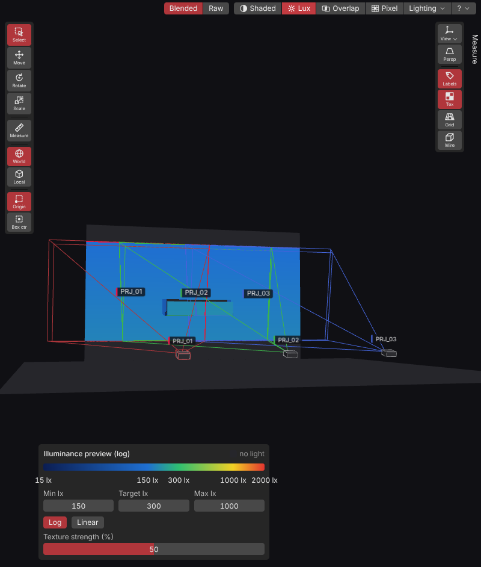
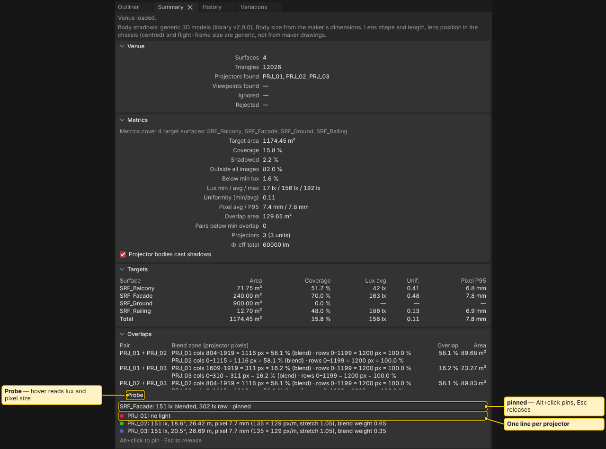

# Analysis

> **Planning aid.** LUMAMATTERS is a planning aid. Its numbers (lux, pixel size, throw distance, overlap) come from maker data and simplified models and can be wrong. No guarantee of correct data is given. Check critical values against the maker's spec sheets and on site.

LUMAMATTERS computes light, brightness, contrast, overlap, pixel size and distance for every surface in your venue. Results show as colours in the 3D view and as numbers in the **Summary** panel. For the view-mode buttons in general, see [View Modes](View-Modes.md). For formulas and limits, see [Physics Model](Physics-Model.md).

Numbers update after every edit. Switch the view with the buttons at the top right of the 3D view, with **View > Shading**, or with keys `1` to `5` above the letters (the numpad sets viewpoints).

## Photometric

Key `2` (called **Lux** before 1.1.0; only the label changed). A switch in the legend picks the quantity.

- **Illuminance**: light arriving on each surface, in lux. It comes from lumens, distance and angle of incidence, with blocked light removed. It does not include surface reflectance, so it is not how bright a surface looks.
- **Luminance**: how bright a surface looks from a viewpoint, in cd/m². L = ρ × E / π, with E the illuminance and ρ the reflectance of the surface (Properties > Surface > Reflectance, else the **Default ρ** of the legend, 1.00 until you change it). It is an estimate that treats every surface as a matte (Lambertian) one. Surfaces the viewpoint cannot see are greyed; the viewpoint is the current camera or a saved camera, picked in the legend.
- **Surface contrast**: for each target object, the ratio of its brightest to its darkest lit part (p99 / p1 of the lit samples; with fewer than 100 lit samples, max / min). Bands: below 5:1, 5:1 to 10:1, 10:1 and above. These are rules of thumb. It is one number per object, so the view colours the whole object in its band.
- **Ambient contrast**: (projector light + site ambient) / site ambient, with one **Site ambient lx** value for every surface (an estimate). It shows n/a while the site ambient is under 0.01 lx. Marks at 5:1 and 10:1 on the bar.

- **Blended** (default) applies the blend ramps between projectors, like a media server edge blend. Weights add up to 1 where one or more projectors cover a point. Summary numbers always use blended light.
- **Raw** is the plain sum of all projectors. It shows the hot overlap.
- Switch with the **Blended | Raw** buttons or **View > Light**. They work only in the Photometric view and are greyed out ("Photometric view only") in the others.

### Photometric legend

The legend is the floating **Legend** card (drag it by its grip; see [View Modes](View-Modes.md#legends)).

- **Min**, **Target** and **Max** are editable for Illuminance (lx), Luminance (cd/m²) and Ambient contrast (ratio). The colour bands change at once. The defaults are 50 / 100 / 300 cd/m² for Luminance and 5 / 10 / 50 for Ambient contrast, both on a log scale.
- **Log** or **Linear** sets the colour scale.
- **Auto range** sets Min and Max from the 1st and 99th percentile of the lit target surfaces, weighted by area. Nothing lit: "Nothing lit to fit". Ambient contrast without a site ambient: "Set a site ambient value".
- **Smooth**, **5 bands** and **10 bands** step the colour bar (view only, not saved).
- "no light" marks surfaces that receive none.
- While the analysis runs, the legend says "blend pending". The blend ramps in the view are a placeholder until it finishes.
- **Overlay opacity (%)** sets how strongly the colour covers the shaded surface. **Texture strength (%)** sets how much of a texture's detail shows under the colours. See [Textures](Textures.md).

Luminance also works out which surfaces the viewpoint sees. That takes a short extra step after the camera stops moving.

## Overlap and blend

Key `3`. How many projectors light each point, and the blend zones between projector pairs. The ramp spans the full overlap of each pair, like a media server edge blend set to the overlap. It uses the unoccluded images (as a media server does), so a shadow inside an overlap shows as a dark stripe.

Legend entries: **outside all images**, **shadowed (inside an image, blocked)**, **1 projector**, **2 projectors**, **3 projectors**, **4+ projectors**. Stripes mark a projector whose image covers the point but whose light is blocked, in that projector's colour.

**Warn below overlap (%)** in the legend sets the minimum overlap. The Summary counts pairs under it as **Pairs below min overlap**.

## Pixel density

Key `4`. The size of one projected pixel on each surface, from native resolution, distance and angle. It shows the worst axis on a log colour scale.

Legend: **too coarse (above the maximum)** and **grazing (above the angle)**. Two fields set the limits:

- **Max pixel (mm)** is the coarsest pixel you accept.
## Distance

Key `5`. The distance from each surface to the nearest projector that lights it, in metres, with the same coverage test as the Overlap view. Surfaces no projector covers keep the grey of the shaded view. The legend (**Distance to the nearest projector (m)**) fits its range to the shown projectors. Distance is a view only: it has no Summary number.

## Probe

Hover a surface in the 3D view. The **Probe** section at the bottom of the **Summary** panel shows that point:

- The surface name, with lux **blended** and **raw**. "(preliminary)" means the exact number is still computing.
- In the Overlap view: "Lit by n of m covering projectors", and which are blocked.
- In the Pixel view: the worst pixel size and whether it is fine or too coarse.
- In the Photometric view, one more line for the chosen quantity: **Luminance** (cd/m², with ρ), **Ambient contrast** (ratio, or n/a without a site ambient), or **Surface contrast** of the object (ratio, its band and its lit share).
- A grazing warning where the angle is steep.
- One line per projector: lux (or "blocked" or "no light"), incidence angle, distance, pixel size, blend weight and warnings.

`Alt+click` pins the probe to a point. `Esc` releases it.

## Summary numbers

The **Summary** panel (see [Summary and History](Summary-and-History.md)) collects results:

- **Metrics** for the target surfaces: **Target area**, **Coverage**, **Shadowed**, **Outside all images**, **Below min lux**, **Lux min / avg / max**, **Uniformity (min/avg)**, **Pixel avg / P95**, **Overlap area**, **Pairs below min overlap**, **Projectors**, **Φ_eff total**.
- **Photometry** (Photometric view only): **Luminance min / avg / max** and **Visible lit area** (Luminance quantity), and **Ambient contrast min / max**.
- **Targets**: the same numbers per surface. In the Photometric view the table adds the columns **ρ** (reflectance), **Lum. avg** (Luminance quantity), **Surf. CR** (surface contrast, its band as a tooltip) and **Lit** (share of the surface that is lit).
- **Overlaps**: a table of projector pairs.

Only surfaces with the role Target are counted. A "stale" badge means the numbers are being recomputed.

## Analysing bar and Statistics

- **Analysing…** with a small progress bar shows in the header while numbers recompute. It appears after about 0.3 seconds, so quick updates flash nothing. You can keep working.
- **View > Statistics** shows plain text at the top left of the 3D view: view name, project and variation name, object, projector (and how many are in the analysis) and triangle counts, and a frame-rate line. It describes the view, not lighting.

## What is not modelled

No black level and no real surface finish: luminance assumes a matte surface and a reflectance you set (default 1.00). Ambient light is one site value for the whole scene, not a model of the room, and it is not in the lux numbers. Surfaces are double-sided. Brightness ratings are treated as ANSI lumens. See [Physics Model](Physics-Model.md).

## See also

[View Modes](View-Modes.md), [Physics Model](Physics-Model.md), [Summary and History](Summary-and-History.md), [Variations and Compare](Setups-and-Compare.md)
