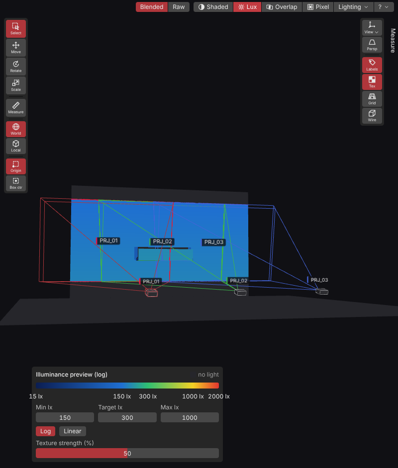
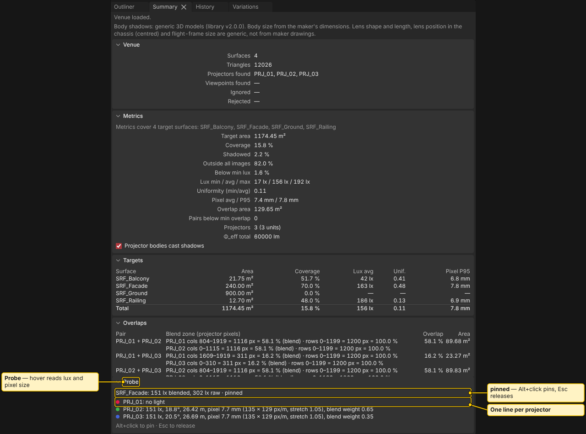

# Analysis

> **Planning aid.** LUMAMATTERS is a planning aid. Its numbers (illuminance, pixel size, throw distance, overlap) come from maker data and simplified models. They can be wrong. No guarantee of correct data is given. Check critical values against the maker's spec sheets and on site.

LUMAMATTERS works out light, brightness, contrast, overlap, pixel size and distance for every surface in your venue. The results show as colours in the 3D view. They also show as numbers in the **Summary** panel. For the view mode buttons, see [View Modes](View-Modes.md). For formulas and limits, see [Physics Model](Physics-Model.md).

The numbers update after every edit. To switch the view mode, use the buttons at the top right of the 3D view, **View > Shading**, or the keys `1` to `5` above the letters. The numpad sets viewpoints, not modes.

## Photometric

Key `2`. The Photometric view shows light on the surfaces of your venue. It has four quantities. You choose one at a time in the legend. Each quantity answers a different question.

- **Illuminance** is the light that arrives on a surface, in lx. It comes from lumens, distance and angle of incidence. Light that geometry blocks is removed. Illuminance does not include the reflectance of the surface. It does not tell you how bright the surface looks.
- **Luminance** is how bright a surface looks from a viewpoint, in cd/m². The formula is L = ρ × E / π. E is the illuminance. ρ is the reflectance of the surface. Set the reflectance in Properties > Surface > Reflectance. If an object has no value, the app uses **Default ρ** from the legend. **Default ρ** starts at 1.00. The result is an estimate that treats every surface as matte (Lambertian). Surfaces that the viewpoint cannot see are grey. The viewpoint is the current camera or a saved camera. You choose it in the legend.
- **Surface contrast** shows how evenly one object is lit. For each target object, it is the brightest part divided by the darkest part. The app uses p99 / p1 of the lit samples. With fewer than 100 lit samples, it uses max / min. The bands are below 5:1, 5:1 to 10:1, and 10:1 and above. These bands are rules of thumb. The app gives one number for each object, so the view colours the whole object in its band.
- **Ambient contrast** shows how well the projection stands out against the light of the site. It is (projector light + site ambient) / site ambient. **Site ambient lx** is one value for all surfaces, and it is an estimate. A new project starts at 10 lx. The view shows n/a while the site ambient is below 0.01 lx. The colour bar has marks at 5:1 and 10:1.

Site ambient is not part of Illuminance, Luminance or Surface contrast. It only changes Ambient contrast.

The Light switch has two settings:

- **Blended** (the default) applies the blend ramps between projectors, like an edge blend in a media server. Where projectors overlap, the weights add up to 1. The Summary numbers always use blended light.
- **Raw** is the plain sum of all projectors. It shows the hot overlap.

To switch, click **Blended** or **Raw**, or use **View > Light**. They work only in the Photometric view. In the other view modes they are greyed out ("Photometric view only").

### Photometric legend

The legend is the floating **Legend** card. Drag it by its grip. See [View Modes](View-Modes.md#legends).

- **Min**, **Target** and **Max** are editable for Illuminance (lx), Luminance (cd/m²) and Ambient contrast (ratio). The colour bands change at once.
- The defaults are 100 / 200 / 500 lx for Illuminance, 30 / 60 / 150 cd/m² for Luminance, and 5 / 20 / 50 for Ambient contrast. All use a log scale.
- **Log** or **Linear** sets the scale of the colour bar.
- **Auto range** sets Min and Max from the 1st and 99th percentile of the lit target surfaces, weighted by area. If nothing is lit, the legend says "Nothing lit to fit". For Ambient contrast without a site ambient, it says "Set a site ambient value".
- **Reset defaults** returns the shown quantity to the range of the reference scene. It keeps **Site ambient lx**.
- **Smooth**, **5 bands** and **10 bands** step the colour bar. This is a view setting. The app does not save it.
- **no light** marks surfaces that receive no light.
- While the analysis runs, the legend says "blend pending". The blend ramps in the view are a placeholder until the analysis ends.
- **Overlay opacity (%)** sets how strongly the colour covers the shaded surface. **Texture strength (%)** sets how much texture detail shows under the colours. See [Textures](Textures.md).

For Luminance, the app also works out which surfaces the viewpoint sees. This takes a short extra step after the camera stops moving.

## Overlap and blend

Key `3`. This view shows how many projectors light each point. It also shows the blend zones between projector pairs. The ramp covers the full overlap of each pair, like an edge blend that a media server sets to the overlap. The ramp uses the images without blockers, as a media server does. A shadow inside an overlap therefore shows as a dark stripe.

The legend entries are **outside all images**, **shadowed (inside an image, blocked)**, **1 projector**, **2 projectors**, **3 projectors** and **4+ projectors**. Stripes mark a projector whose image covers the point but whose light is blocked. The stripes use the colour of that projector.

**Warn below overlap (%)** in the legend sets the minimum overlap. The Summary counts the pairs below it as **Pairs below min overlap**.

## Pixel density

Key `4`. This view shows the size of one projected pixel on each surface. It comes from the native resolution, the distance and the angle. The view shows the worst axis on a log colour scale.

The legend has the entries **too coarse (above the maximum)** and **grazing (above the angle)**. Two fields set the limits:

- **Max pixel (mm)** is the coarsest pixel that you accept.
- **Grazing above (°)** is the angle from which a surface counts as grazing.

## Distance

Key `5`. This view shows the distance from each surface to the nearest projector that lights it, in m. It uses the same coverage test as the Overlap view. Surfaces that no projector covers keep the grey of the Shaded view. The legend, **Distance to the nearest projector (m)**, fits its range to the shown projectors. Distance is a view only. It has no number in the Summary.

## Probe

Hover over a surface in the 3D view. The **Probe** section at the bottom of the **Summary** panel shows that point:

- The surface name, with the illuminance **blended** and **raw**. "(preliminary)" means that the exact number is still computing.
- In the Overlap view: "Lit by n of m covering projectors", and which projectors are blocked.
- In the Pixel view: the worst pixel size, and whether it is fine or too coarse.
- In the Photometric view: one more line for the chosen quantity. For **Luminance**, it shows cd/m² and ρ. For **Ambient contrast**, it shows the ratio, or n/a without a site ambient. For **Surface contrast**, it shows the ratio of the object, its band and its lit share.
- A grazing warning where the angle is steep.
- One line for each projector: the illuminance (or "blocked" or "no light"), incidence angle, distance, pixel size, blend weight and warnings.

`Alt+click` pins the probe to a point. `Esc` releases it.

## Summary numbers

The **Summary** panel collects the results. See [Summary and History](Summary-and-History.md). Some row labels in the app still say "lux". They show illuminance in lx.

- **Metrics** for the target surfaces. The rows are **Target area**, **Coverage**, **Shadowed**, **Outside all images**, **Below min lux**, **Lux min / avg / max**, **Uniformity (min/avg)**, **Pixel avg / P95**, **Overlap area**, **Pairs below min overlap**, **Projectors** and **Φ_eff total**.
- **Photometry** (Photometric view only): **Luminance min / avg / max** and **Visible lit area** (Luminance quantity), and **Ambient contrast min / max**.
- **Targets**: the same numbers for each surface. In the Photometric view, the table adds these columns: **ρ** (reflectance), **Lum. avg** (Luminance quantity), **Surf. CR** (surface contrast, with its band as a tooltip) and **Lit** (the share of the surface that is lit).
- **Overlaps**: a table of projector pairs.

The app counts only surfaces with the role Target. A "stale" badge means that the app is recomputing the numbers.

## Analysing bar and Statistics

- **Analysing…** with a small progress bar shows in the header bar while the numbers recompute. It appears after about 0.3 seconds, so quick updates show nothing. You can keep working.
- **View > Statistics** shows plain text at the top left of the 3D view. The text has the view name, the project and variation name, and the counts of objects, projectors (and how many are in the analysis) and triangles. It also has a frame-rate line. It describes the view, not the light.

## What is not modelled

The app has no black level. It does not model the native contrast of a projector. Luminance assumes a matte surface and one reflectance for each object. Site ambient is one value for the whole project. It is not a model of the room. Surfaces are double-sided. The app reads brightness ratings as ANSI lumens. See [Physics Model](Physics-Model.md).

## See also

[View Modes](View-Modes.md), [Physics Model](Physics-Model.md), [Summary and History](Summary-and-History.md), [Variations and Compare](Setups-and-Compare.md)
