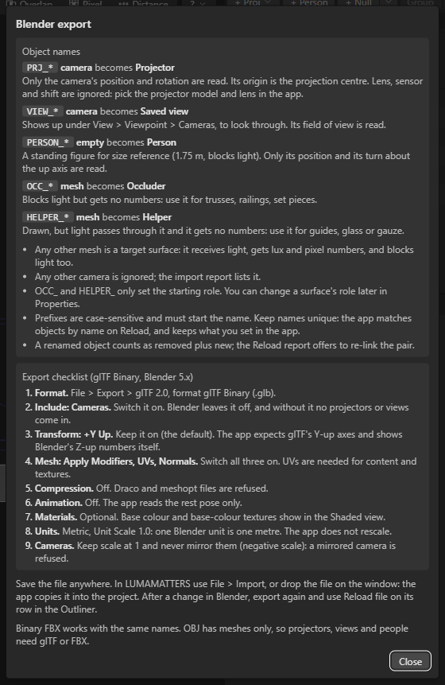
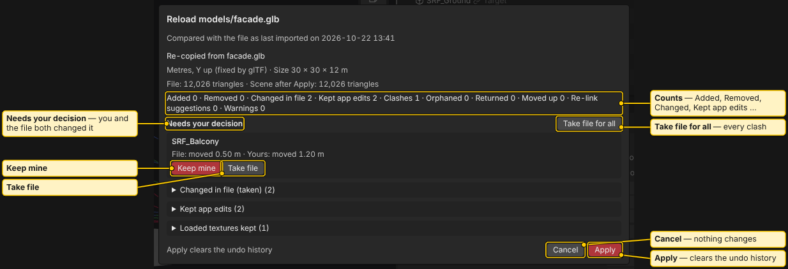

# Blender Export and Import

LUMAMATTERS does not need Blender. But if you model your venue in Blender, this page shows how to name objects, export the file and bring it into a project. You can also import FBX and OBJ files from other tools.

The same rules are inside the app: **Help > Blender export…** shows the name prefixes and the export checklist.

## Units and axes

- One Blender unit is one metre. The app does not rescale a glTF file.
- Blender is Z-up. glTF is Y-up. Keep Blender's **+Y Up** export option on (it is the default). The app shows Blender's Z-up numbers itself.

## Name objects with a prefix

The app reads the start of each object name. Prefixes are case-sensitive and must start the name.

| Prefix | Blender object | Becomes in LUMAMATTERS | Notes |
|---|---|---|---|
| `PRJ_` | camera | Projector | Only position and rotation are read. The camera origin is the projection centre. Lens, sensor and shift are ignored: pick the projector model and lens in the app. |
| `VIEW_` | camera | Saved view | Appears under **View > Viewpoint > Cameras**, so you can look through it. Its field of view is read. |
| `PERSON_` | empty | Person | A standing figure for size reference (1.75 m, blocks light). Only position and turn about the up axis are read. |
| `OCC_` | mesh | Occluder | Blocks light but gets no numbers. Use it for trusses, railings, set pieces. |
| `HELPER_` | mesh | Helper | Drawn, but light passes through. Gets no numbers. Use it for guides, glass or gauze. |

Names without a prefix:

- Any other mesh is a target surface. It receives light, gets lux and pixel numbers, and blocks light too.
- Any other camera is ignored. The import report lists it.
- `OCC_` and `HELPER_` only set the starting role. You can change a surface's role later in **Properties**.
- Keep names unique. The app matches objects by name on Reload and keeps what you set in the app.
- A renamed object counts as removed plus new. The Reload report offers to re-link the pair.

## Export checklist (Blender 5.x, glTF Binary)

1. **Format.** **File > Export > glTF 2.0**, format glTF Binary (.glb).
2. **Include: Cameras.** Switch it on. Blender leaves it off, and without it no projectors or views come in.
3. **Transform: +Y Up.** Keep it on.
4. **Mesh: Apply Modifiers, UVs, Normals.** Switch all three on. UVs are needed for content and textures.
5. **Compression.** Off. Draco and meshopt files are refused.
6. **Animation.** Off. The app reads the rest pose only.
7. **Materials.** Optional. Base colour and base-colour textures show in the Shaded view (see [Textures](Textures.md)).
8. **Units.** Metric, Unit Scale 1.0.
9. **Cameras.** Keep scale at 1 and never mirror them (negative scale). A mirrored camera is refused.

Save the file anywhere. You do not have to put it in the project folder.

## Supported formats

- glTF: `.glb` and `.gltf`.
- FBX: binary FBX works with the same names.
- OBJ: meshes only, so projectors, views and people need glTF or FBX.

You can import several model files into one project.

## Import a file

There are three ways in:

- **File > Import**, then **glTF / GLB…**, **FBX…** or **OBJ…**.
- The **Import** button in the [Outliner](Outliner.md) toolbar (same three choices).
- Drag one or more files onto the app window.

Details:

- The app copies the file into the project's `models` folder. Your original stays where it is.
- The app remembers where the file came from, on this machine only.
- You can select several files in one go. You get one combined report. You can also bring the `.bin` and texture files that belong to a `.gltf` or `.obj`.
- A drop onto the window with no project open creates a new project named after the file.
- Folders and other non-model files in a drop are skipped, and one message names them. A `.luma` project file is not imported: use **File > Open** for projects.
- Files over 512 MiB are refused. Files from 256 MiB up get a memory warning.
- A copy over 100 MB is kept out of git (it is added to the project's `.gitignore`). The file row in the Outliner shows a **not in git** badge. Other machines then need their own copy (OneDrive or a local copy). See [Several Machines](Several-Machines.md).

Nothing is written until you press **Apply** in the import report.

For FBX and OBJ, the file row menu has **Settings…** for unit and up axis. A glTF is fixed to metres, Y up.

## Reload after you change the file in Blender

Reload is manual, one file at a time. There is no file watching and nothing reloads by itself.

1. Export from Blender again.
2. In the Outliner **Files** section, press **Reload file** on that file's row. A **source changed** badge tells you the original is newer.
3. Read the report, then press **Apply**.

Other controls in the Files section:

- **Reload files ▾** lists every file, with **Reload all changed**. A file that needs your click (for a permission or a file) is left for its own **Reload file**.
- The row menu (**⋯**) has **Settings…**, **Change file…**, **Locate textures…**, **Copy file path** and **Remove from project**.
- **Change file…** points the row at a different file. If the app has lost the original (or you work on another machine), **Reload file** asks you to pick the source file.

### The reload report

The report compares the new file with your project. Your edits in the app win by default:

- **Added**, **Removed**, **Changed in file**, **Kept app edits**, **Orphaned**, **Returned**, **Moved up**, **Warnings**.
- **Needs your decision** lists clashes, where you and the file both changed an object. For each, choose **Keep mine** or **Take file**. **Take file for all** switches every clash.
- **Re-link suggestions** offers to pair a removed object with a new one nearby (it shows the distance in metres).
- **Apply (overwrites n of your edits)** tells you how many of your edits it will replace. **Apply** clears the undo history.

If a texture changed both in the file and in the project folder, you can pick **Keep the project copies** or **Use the source files**.

## See also

[Outliner](Outliner.md), [Placing Projectors](Placing-Projectors.md), [Textures](Textures.md), [Projects and Snapshots](Projects-and-Snapshots.md)
