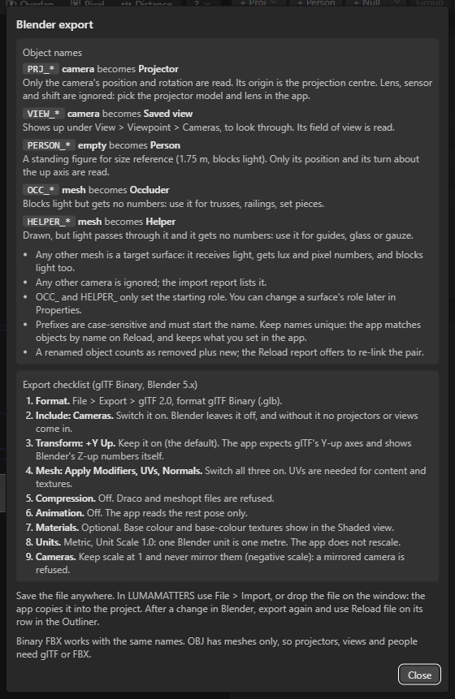
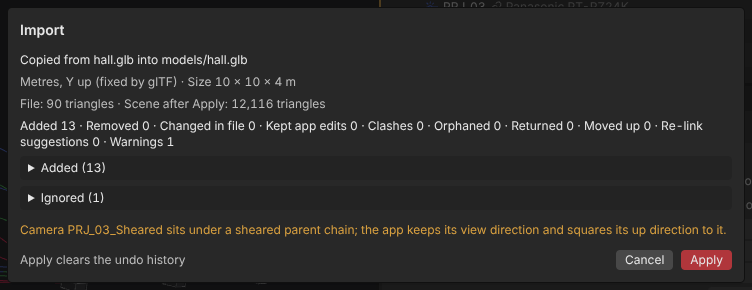
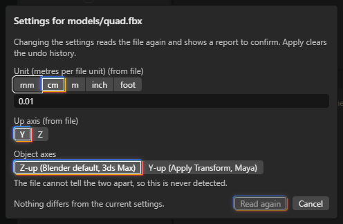
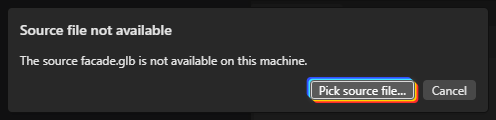
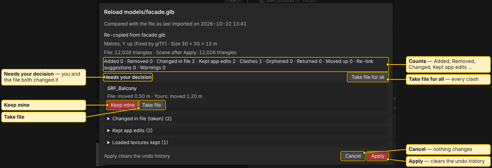

# Blender Export and Import

Model your venue in Blender, name the objects, export the file and import it into a project. LUMAMATTERS does not need Blender. It also imports FBX and OBJ files from other tools.

**Help > Blender export…** shows the same prefixes and the same checklist inside the app.

## Units and axes

- One Blender unit is one metre. The app does not rescale a glTF file.
- Blender is Z-up. glTF is Y-up. Keep the Blender export option **+Y Up** on. It is on by default.
- The app shows the Z-up numbers of Blender.

## Name objects with a prefix

Prefixes are case-sensitive. A prefix must start the name.

| Prefix | Blender object | Becomes in LUMAMATTERS | Notes |
|---|---|---|---|
| `PRJ_` | camera | Projector | The app reads only position and rotation. The camera origin is the projection centre. The app ignores lens, sensor and shift. Pick the projector model and the lens in the app. |
| `VIEW_` | camera | Saved camera | It appears under **View > Viewpoint > Cameras**, so you can look through it. The app reads its field of view. |
| `PERSON_` | empty | Person | A standing figure for size reference. It is 1.75 m tall and blocks light. The app reads only the position and the turn about the up axis. |
| `OCC_` | mesh | Occluder | It blocks light but gets no numbers. Use it for trusses, railings and set pieces. |
| `HELPER_` | mesh | Helper | The app draws it, but light passes through. It gets no numbers. Use it for guides, glass or gauze. |

Names without a prefix:

- Any other mesh is a target surface. It receives light, gets illuminance and pixel numbers, and also blocks light.
- The app ignores any other camera. The import report lists it.
- `OCC_` and `HELPER_` set only the starting role. You can change the role of a surface later in **Properties**.
- Keep names unique. Reload matches objects by name and keeps what you set in the app.
- A renamed object counts as one removed object plus one new object. The reload report offers to link the pair again.

## Export checklist (Blender 5.x, glTF Binary)

1. **Format.** Choose **File > Export > glTF 2.0**. Set the format to glTF Binary (.glb).
2. **Include: Cameras.** Switch it on. Blender leaves it off. Without it, no projectors or saved cameras come in.
3. **Transform: +Y Up.** Keep it on.
4. **Mesh: Apply Modifiers, UVs, Normals.** Switch all three on. Textures need UVs.
5. **Compression.** Switch it off. The app refuses Draco and meshopt files.
6. **Animation.** Switch it off. The app reads only the rest pose.
7. **Materials.** This option is optional. Base colour and base-colour textures show in the Shaded view. See [Textures](Textures.md).
8. **Units.** Use metric, with Unit Scale 1.0.
9. **Cameras.** Keep the scale at 1. Never mirror a camera (negative scale). The app refuses a mirrored camera.

Save the file in any folder. It does not need to be in the project folder.

## Supported formats

- glTF: `.glb` and `.gltf`.
- FBX: binary FBX works with the same names.
- OBJ: meshes only. Projectors, saved cameras and people need glTF or FBX.

You can import several model files into one project.

## Import a file

There are three ways to import:

- Choose **File > Import**, then **glTF / GLB…**, **FBX…** or **OBJ…**.
- Click the **Import** button in the [Outliner](Outliner.md) toolbar. It offers the same three choices.
- Drag one or more files onto the app window.

Details:

- The app copies the file into the `models` folder of the project. Your original file stays where it is.
- The app remembers where the file came from. It remembers this on this machine only.
- You can select several files at once. You then get one combined report. Add the `.bin` and texture files that belong to a `.gltf` or `.obj`.
- If you drop a file when no project is open, the app creates a new project. The project has the name of the file.
- The app skips folders and other files that are not model files. One message names them.
- The app does not import a `.luma` project file. Use **File > Open** for projects.
- The app refuses files over 512 MiB. Files from 256 MiB up get a memory warning.
- A scene of more than 500,000 triangles gets a warning, because the analysis is slower.
- A copy over 100 MB stays out of git. The app adds it to the `.gitignore` file of the project. The file row in the Outliner shows a **not in git** badge. Other machines need their own copy, for example through OneDrive. See [Several Machines](Several-Machines.md).

The app writes nothing until you click **Apply** in the import report.

### Settings for FBX and OBJ

The file row menu of an FBX or OBJ file has **Settings…**. The dialog sets these values:

- **Unit presets**: mm, cm, m, inch or foot. You can also type a number of metres per file unit.
- **Up axis**: Y or Z.
- **Object axes** (FBX only): "Z-up (Blender default, 3ds Max)" or "Y-up (Apply Transform, Maya)". The app never detects the object axes by itself.

Click **Read again** to read the file with the new settings. The app then shows a report to confirm. A glTF file is fixed to metres and Y up, so it has no unit settings.

## Reload after you change the file in Blender

Reload is manual and works on one file at a time. Nothing reloads by itself. The app does not watch files.

1. Export from Blender again.
2. In the **Files** section of the Outliner, click **Reload file** on the row of that file. A **source changed** badge shows when the original is newer.
3. Read the report.
4. Click **Apply**.

Other controls in the **Files** section:

- **Reload files ▾** lists every file and offers **Reload all changed**. A file that needs your action (a permission or a file pick) stays for its own **Reload file**.
- The row menu (**⋯**) has **Settings…**, **Change file…**, **Locate textures…**, **Copy file path** and **Remove from project**.
- **Change file…** points the row at a different file. If the app lost the original, or you work on another machine, **Reload file** asks you to pick the source file.
- **Remove from project** shows a dialog first. It names the objects that go and the objects of yours that move up. The copy stays in the project folder. Removing a file clears the undo history.

### The reload report

The report compares the new file with your project. Your app edits win by default. The report has these lists:

- **Added**, **Removed**, **Changed in file**, **Kept app edits**, **Orphaned**, **Returned**, **Moved up** and **Warnings**.
- **Needs your decision** lists clashes. A clash is an object that you and the file both changed. For each clash, choose **Keep mine** or **Take file**. **Take file for all** switches every clash.
- **Re-link suggestions** offers to pair a removed object with a new object nearby. It shows the distance in metres.

The **Apply** button shows how many of your edits it replaces, for example **Apply (overwrites n of your edits)**. **Apply** clears the undo history. A reload that changes only textures keeps the undo history.

If a texture changed both in the file and in the project folder, choose **Keep the project copies** or **Use the source files**.

## See also

[Outliner](Outliner.md), [Placing Projectors](Placing-Projectors.md), [Textures](Textures.md), [Projects and Snapshots](Projects-and-Snapshots.md)
