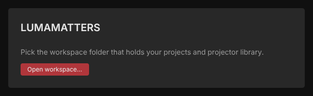
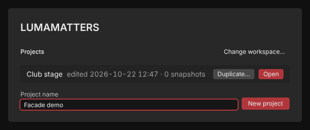
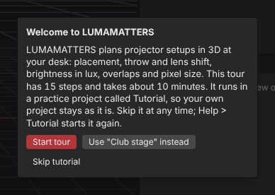
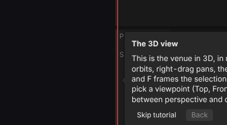

# First Start and Workspace

## The workspace folder

Your work lives in one folder you choose, the **workspace**. It holds your projects and the projector library. Pick it once; the app remembers it.

Use a folder on a local drive, or inside a git repository (see [Several Machines](Several-Machines.md)). Avoid a folder that a cloud-sync program changes all the time.

The app creates two folders inside it: `projects` and `library`. It also writes a marker file, `lumamatters-workspace.json`, and a managed block in `.gitignore`. Existing files are kept.

## First start

1. Start LUMAMATTERS. The start screen shows the title and the line **Pick the workspace folder that holds your projects and projector library.**
2. Click **Open workspace…** and choose a folder.
3. If the folder is empty, it becomes a workspace at once.
4. If the folder has files but no marker, the app asks **Set up workspace?**. Existing files are kept and a managed block is added to `.gitignore`. Click **Set up** to continue or **Cancel** to choose another folder.

The desktop app has its own storage, separate from the browser version. On first start the recent list is empty and you pick the workspace once. Your project files on disk are the same either way.

## The project list

The start screen shows **Projects**. Each row shows the project name, the last edit time and the snapshot count. A new workspace says **No projects yet.**

- **Open** opens a project.
- **Duplicate…** copies a project to a new name. The copy is marked in the list. It does not open.
- **Project name** + **New project** creates an empty project and opens it.
- **Change workspace…** picks another workspace folder.

A row that cannot be read shows the reason instead of the date. The list refreshes when you return to the window, for example after a `git pull`.

## Next start

The app reopens the remembered workspace by itself. If it needs a permission click again, the start screen shows **Continue with <folder name>**. Click it. Nothing is lost.

## Change workspace from inside the app

Use **File > Change workspace…** and pick the new folder. If a project is open, the app finishes saving it first. It asks **Save changes to <name>?** only if something could not be written. Then the new workspace opens.

## Recent list

**File > Open Recent** lists the last 10 projects you opened, newest first. The open project is marked **(open)**. The list is kept per machine and per workspace. It is not part of the project, so git does not share it. **File > Open…** shows the full project list of the workspace.

## Tutorial

On a fresh install, your first new project shows a welcome card with a guided tour. Choose **Start tour** or **Skip tutorial**.

- It has 15 steps and takes about 10 minutes.
- It runs in a practice project called **Tutorial**, so your own project stays unchanged. If a project is open, the card can also offer **Use "<name>" instead**.
- It covers the 3D view, importing a venue, the Outliner, adding and aiming a projector, lens and readouts, the Lux view, overlap and blends, test patterns, the Summary, and saving and snapshots.
- Skip at any time. Start again with **Help > Tutorial**. If you left midway, the app offers **Resume the tutorial?**.

**Help > Tutorial** needs an open project. Without one, the entry is greyed out with the tooltip "Open a project first."

## Other Help entries

**Help > View modes…**, **Help > Keyboard shortcuts**, **Help > Blender export…** and **Help > About LUMAMATTERS** open short dialogs. See [View Modes](View-Modes.md), [Keyboard Shortcuts](Keyboard-Shortcuts.md) and [Blender Export and Import](Blender-Export-and-Import.md).

See also: [Install](Install.md), [Projects and Snapshots](Projects-and-Snapshots.md), [Interface Tour](Interface-Tour.md), [Menus](Menus.md)
