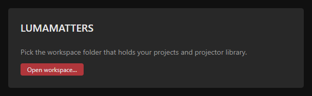
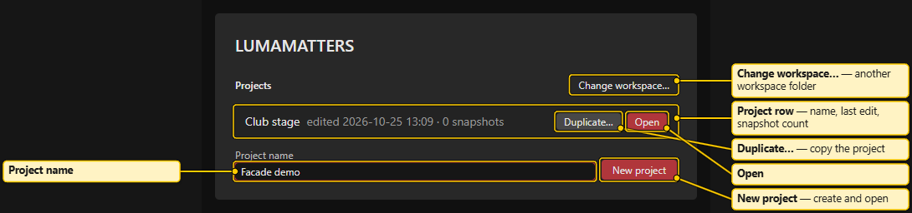
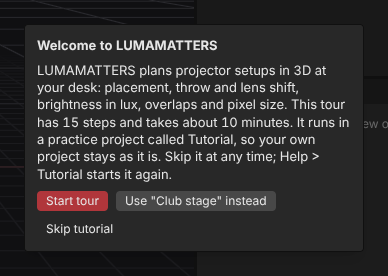
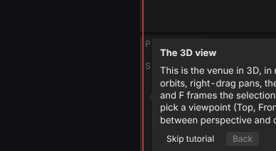

# First Start and Workspace

## The workspace folder

Your work lives in one folder that you choose: the **workspace**. It holds your projects and the projector library. Pick it once. The app remembers it.

Use a folder on a local drive, or inside a git repository (see [Several Machines](Several-Machines.md)). Do not use a folder that a cloud-sync program changes all the time.

The app creates two folders inside the workspace: `projects` and `library`. It also writes a marker file, `lumamatters-workspace.json`, and a managed block in `.gitignore`. The app keeps all existing files.

## First start

1. Start LUMAMATTERS. The start screen shows the title and the line **Pick the workspace folder that holds your projects and projector library.**
2. Click **Open workspace…** and choose a folder.
3. If the folder is empty, it becomes a workspace at once.
4. If the folder has files but no marker, the app asks **Set up workspace?**. The app keeps the existing files and adds a managed block to `.gitignore`. Click **Set up** to continue, or click **Cancel** to choose another folder.

The desktop app has its own storage. On the first start, the recent list is empty and you pick the workspace once. Your project files stay in the workspace folder on disk.

## The project list

The start screen shows **Projects**. Each row shows the project name, the last edit time and the snapshot count. A new workspace shows **No projects yet.**

- **Open** opens a project.
- **Duplicate…** copies a project to a new name. The copy is marked in the list. It does not open.
- **Project name** and **New project** create an empty project and open it.
- **Change workspace…** picks another workspace folder.

A row that the app cannot read shows the reason instead of the date. The list refreshes when you return to the window, for example after a `git pull`.

## Next start

The app reopens the remembered workspace by itself. Sometimes the app needs your permission again. Then the start screen shows **Continue with <folder name>**. Click it. Nothing is lost.

## Change workspace from inside the app

1. Choose **File > Change workspace…**.
2. Pick the new folder.

If a project is open, the app finishes writing it first. It asks **Save changes to <name>?** only if something could not be written. Then the new workspace opens.

## Recent list

**File > Open Recent** lists the last 10 projects that you opened, newest first. The open project is marked **(open)**. The app keeps the list per machine and per workspace. The list is not part of the project, so git does not share it. **File > Open…** shows the full project list of the workspace.

## Tutorial

The Tutorial is a guided tour of the app. The first time you create a project on a fresh install, a welcome card appears. Click **Start tour** or **Skip tutorial**.

- The Tutorial has 40 cards. It runs straight through, with no pause and no part 2.
- The chapters are: The basics, More elements, Measuring with snapping, Viewport and measurement settings, Grouping, The projector database, Projector properties, Ambient light and surfaces, Photometric analysis, and Report and projector perspectives.
- More elements covers Measure, Variations, the Report and Send feedback.
- The last card is **You are ready**. It has the button **Finish**.
- The Tutorial runs in a practice project called **Tutorial**, so your own project stays unchanged. If a project is open, the welcome card can also offer **Use "<name>" instead**.
- The basics cover the 3D view, importing a venue, the Outliner, adding and aiming a projector, lens and readouts, the Photometric view, overlap and blends, test patterns, the Summary, and saving and snapshots.
- You can skip the Tutorial at any time. Start it again with **Help > Tutorial**. If you leave it midway, the app offers **Resume the tutorial?**.

**Help > Tutorial** needs an open project. Without one, the entry is greyed out. Its tooltip says "Open a project first."

## Other Help entries

**Help > View modes…**, **Help > Keyboard shortcuts**, **Help > Blender export…** and **Help > About LUMAMATTERS** open short dialogs. See [View Modes](View-Modes.md), [Keyboard Shortcuts](Keyboard-Shortcuts.md) and [Blender Export and Import](Blender-Export-and-Import.md).

See also: [Install](Install.md), [Projects and Snapshots](Projects-and-Snapshots.md), [Interface Tour](Interface-Tour.md), [Menus](Menus.md)
