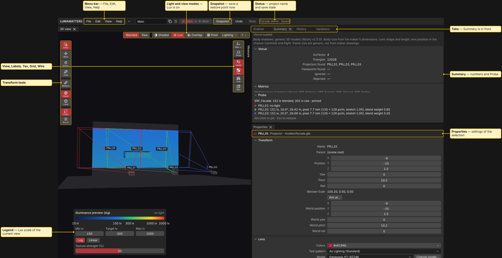

# LUMAMATTERS

LUMAMATTERS is a desk planner for projection mapping. Load a 3D model of the venue, place projectors from a maker database, and see where the light lands, how bright it is, where images overlap and how big the pixels are. It runs offline on your own Windows PC. No accounts, no cloud, no telemetry. Your projects are plain files in a folder you choose.

> **Planning aid.** LUMAMATTERS is a planning aid. Its numbers (lux, pixel size, throw distance, overlap) come from maker data and simplified models and can be wrong. No guarantee of correct data is given. Check critical values against the maker's spec sheets and on site.

## Who it is for

Projection-mapping, LED and AV people who plan shows at the desk: pick projectors and lenses, find positions, check brightness and blends, hand a report to a client or crew.

## What it is

- A planner for 1 to 8 projectors at full speed, up to 16 with a slow-performance warning.
- A 3D view of your venue model (from Blender or any tool that exports glTF / GLB, FBX or OBJ), up to about 500,000 triangles.
- Throw, lens shift, lux, overlap and pixel-density views based on Panasonic and Epson spec data.
- Variations (versions of the projector rig in one venue) with a side-by-side Compare.
- A report editor that prints to PDF.

## What it is not

- Not a media server. No video goes to projectors; no live output.
- Not an on-site calibration or warping tool.
- Not a light-physics renderer: no surface reflectance, no contrast or black level. See [Physics model and limits](Physics-Model.md).
- Not an LED planner yet.

## Pages

**Getting started**
- [Install](Install.md)
- [First start and workspace](First-Start-and-Workspace.md)
- [Projects and snapshots](Projects-and-Snapshots.md)
- [Working on several machines](Several-Machines.md)

**Interface**
- [Interface tour](Interface-Tour.md)
- [Menus](Menus.md)
- [Outliner](Outliner.md)
- [Properties](Properties.md)
- [Summary and History](Summary-and-History.md)
- [3D view](3D-View.md)
- [View modes](View-Modes.md)
- [Keyboard shortcuts](Keyboard-Shortcuts.md)

**Workflow**
- [Blender export and import](Blender-Export-and-Import.md)
- [Placing projectors](Placing-Projectors.md)
- [Analysis: lux, overlap, pixels](Analysis.md)
- [Variations and Compare](Setups-and-Compare.md)
- [Measure tools](Measure-Tools.md)
- [Textures](Textures.md)
- [People](People.md)
- [Report and PDF](Report-and-PDF.md)
- [Test patterns](Test-Patterns.md)

**Reference**
- [Projector database](Projector-Database.md)
- [Physics model and limits](Physics-Model.md)
- [Project files](Project-Files.md)
- [FAQ and troubleshooting](FAQ.md)
- [Glossary](Glossary.md)

New here? Start with [Install](Install.md), then run **Help > Tutorial** in the app.

See also: [Install](Install.md), [Interface Tour](Interface-Tour.md), [FAQ](FAQ.md), [Glossary](Glossary.md)
