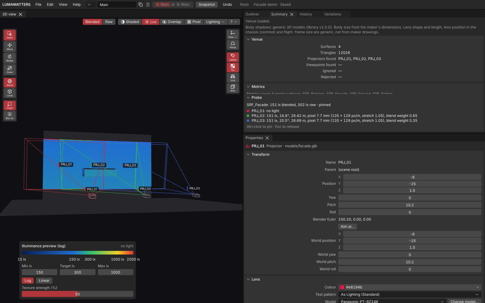

# LUMAMATTERS

LUMAMATTERS is a desk planner for projection mapping. Load a 3D model of the venue and place projectors from a maker database. Then see where the light lands, how bright it is, where images overlap and how big the pixels are. It is a Windows desktop program that runs offline on your own PC. It has no accounts, no cloud and no telemetry. Your projects are plain files in a folder you choose.

This manual describes version 1.1.0, a free beta. LUMAMATTERS will always stay free in one form or another, with all features available. See [What's new](Whats-New.md) for the changes since 1.0.0.

> **Planning aid.** LUMAMATTERS is a planning aid. Its numbers (illuminance, pixel size, throw distance, overlap) come from maker data and simplified models. They can be wrong. No guarantee of correct data is given. Check critical values against the maker's spec sheets and on site.

## Who it is for

This manual is for projection-mapping, LED and AV people who plan shows at the desk. You pick projectors and lenses, find positions and check brightness and blends. Then you hand a report to a client or crew.

## What it is

- A Windows desktop app (installer or portable exe). Once installed, it needs no browser, no server and no network.
- A planner for 1 to 8 projectors at full speed. Up to 16 projectors work, with a slow-performance warning.
- A 3D view of your venue model, up to about 500,000 triangles. The model comes from Blender or from any tool that exports glTF / GLB, FBX or OBJ.
- Throw, lens shift and a lens finder, based on Panasonic and Epson spec data.
- Five view modes:
  - **Shaded**: the venue with test patterns, overlaps and body shadows.
  - **Photometric**: light on each surface. Choose a quantity: Illuminance, Luminance, Surface contrast or Ambient contrast. Luminance and contrast use a Reflectance per object and a Site ambient value.
  - **Overlap**: how many projectors light each point, and the blend zones.
  - **Pixel**: the size of one projected pixel on each surface.
  - **Distance**: the distance to the nearest projector.
- Variations (versions of the projector rig in one venue) with a side-by-side Compare.
- Measure tools with snapping, for distances and notes in the 3D view.
- People, to show scale and to block light.
- Test patterns, and your own picture as a projector image.
- A report editor that prints to PDF.
- A view-only scene: a page that opens in a web browser without LUMAMATTERS. See [Share a view-only scene](Share-a-view-only-scene.md).
- A Tutorial with 40 cards, started with **Help > Tutorial**.

## What it is not

- Not a media server. No video goes to projectors. There is no live output.
- Not an on-site calibration or warping tool.
- Not a full light-physics renderer. The program has no black level. Surfaces are matte, and blockers are fully opaque. See [Physics model and limits](Physics-Model.md).
- Not an LED planner yet.

## Pages

**Getting started**
- [What's new](Whats-New.md)
- [Install](Install.md)
- [First start and workspace](First-Start-and-Workspace.md)
- [Projects and snapshots](Projects-and-Snapshots.md)
- [Working on several machines](Several-Machines.md)

**Interface**
- [Interface tour](Interface-Tour.md)
- [Menus](Menus.md)
- [Outliner](Outliner.md)
- [Properties](Properties.md)
- [Summary and History](Summary-and-History.md)
- [3D view](3D-View.md)
- [View modes](View-Modes.md)
- [Keyboard shortcuts](Keyboard-Shortcuts.md)

**Workflow**
- [Blender export and import](Blender-Export-and-Import.md)
- [Placing projectors](Placing-Projectors.md)
- [Analysis](Analysis.md)
- [Variations and Compare](Setups-and-Compare.md)
- [Measure tools](Measure-Tools.md)
- [Textures](Textures.md)
- [People](People.md)
- [Report and PDF](Report-and-PDF.md)
- [Share a view-only scene](Share-a-view-only-scene.md)
- [Test patterns](Test-Patterns.md)

**Reference**
- [Projector database](Projector-Database.md)
- [Physics model and limits](Physics-Model.md)
- [Project files](Project-Files.md)
- [FAQ and troubleshooting](FAQ.md)
- [Glossary](Glossary.md)

New here? Start with [Install](Install.md). Then run **Help > Tutorial** in the app.

Is something wrong or missing? Choose **Help > Send feedback…** in the app. It builds a short report that you can read, copy or open in your mail program. See [Menus](Menus.md#send-feedback).

See also: [Install](Install.md), [Interface Tour](Interface-Tour.md), [FAQ](FAQ.md), [Glossary](Glossary.md)

---

© 2026 LumaLux. Free to use during the beta. LUMAMATTERS will always stay free in one form or another, with all features available. See [Install](Install.md#licence) for the licence summary.

Panasonic, Epson and other product names are trademarks of their owners. They are used only to identify compatible products. LUMAMATTERS is not affiliated with them and not endorsed by them. Projector data comes from public spec sheets and may contain errors.

[Download](https://github.com/LMXtinker/LUMAMATTERS-releases/releases) (coming soon: the first beta build is not published yet) · [Impressum](https://lmxtinker.github.io/LUMAMATTERS-manual/impressum.html) · [Privacy](https://lmxtinker.github.io/LUMAMATTERS-manual/privacy.html)
