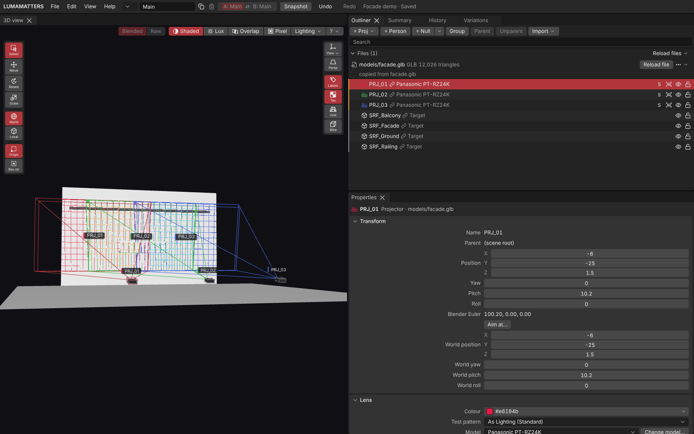
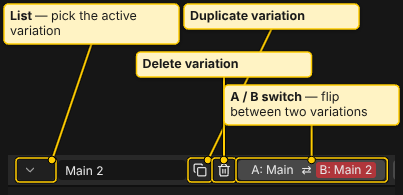
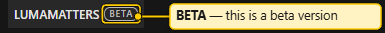

# Interface Tour

Each area of the project window has its own page with details.

## The layout

The project window is split into panels. This is the default layout:

- The **3D view** fills the left half.
- On the right, at the top, are the tabs **Outliner**, **Summary**, **History** and **Variations**. The **Outliner** tab is in front.
- On the right, below those tabs, is **Properties**.

Drag a tab to move it. Drag a panel border to resize it. Close a panel with its tab button. The app keeps the layout on this machine.

The **Report** tab is not in the default layout. Open it with **File > Export > Report…**, **View > Report**, the **Report** button in the header bar, or `Ctrl+P`. When it is in front, it fills the whole window. See [Report and PDF](Report-and-PDF.md).

### Panels menu and Reset layout

- **View > Panels** lists the six panels: **3D view**, **Outliner**, **Summary**, **History**, **Variations** and **Properties**. A tick means the panel is open. Click an entry to open or close the panel. A reopened panel returns to its usual place.
- **View > Reset layout** puts all panels back in the default places.

## The header bar

The thin bar at the top holds these items, from left to right:

- The app name **LUMAMATTERS**, followed by a small **BETA** mark while the app is a beta build. You cannot click the mark. The same mark is on every report page. See [What's new](Whats-New.md).

- The menus **File**, **Edit**, **View** and **Help**. See [Menus](Menus.md).
- The variation selector. It has a list button, the name of the active variation, **Duplicate variation** and **Delete variation**. Click the name to rename the variation. The **Switch variation A / B** button sits beside them. A variation is one rig of projectors on the shared venue. See [Variations and Compare](Setups-and-Compare.md).
- **Snapshot**. It does the same as `Ctrl+S`.
- **Report**. It opens the Report tab.
- **Manual**. It opens the online manual in your web browser.
- **Undo** and **Redo**. They are greyed out when there is nothing to undo or redo.
- The status line, for example `My project · Saved`. It can also say `Saving…`, `Paused: changed on disk` or `Not saved: <reason>`. After the status, it names the snapshot your work is based on (`· snapshot 0012`). See [Projects and Snapshots](Projects-and-Snapshots.md).
- **Analysing…** with a small bar while the app recomputes the numbers. A second bar shows while textures load.

Banners can appear under the header bar:

- A slow-view warning when 9 to 16 projectors are in the analysis.
- A notice that a file changed on disk.
- An error banner when the analysis failed.

## The 3D view

The 3D view shows the venue, projectors, people and cameras. Controls sit on top of it.

- **Left edge:** the tools **Select** (`Q`), **Move** (`W`), **Rotate** (`E`) and **Scale** (`R`). Below a divider is the **Measure** tool (`M`).
- **Top strip, right end, in order:**
  - World or Local (the space of the gizmo axes).
  - Origin or Box centre (the pivot).
  - The **Magnet** and the **Snap steps** arrow beside it.
  - Light **Blended** or **Raw**.
  - The five view-mode buttons: **Shaded**, **Photometric**, **Overlap**, **Pixel** and **Distance**.
  - The **?** help button.
- **Right edge:** the **Viewport** tab opens the view settings. The sections are **View** (viewpoints and cameras), the overlays **Labels**, **Tex** and **Grid**, the grid settings, **Edges**, **Surfaces**, **Beams**, **Background** and **Lighting**. A **Lock** button appears while you look through a camera.
- **Right edge, below Viewport:** the **Measure** tab opens the Measure sidebar (`N`). Only one of the two side tabs is open at a time. See [Measure Tools](Measure-Tools.md).
- **Floating legend:** a card that shows the legend of the current view mode (Photometric, Overlap, Pixel or Distance). It starts at the lower left. Drag it by its grip. Double-click the grip to put it back.

Details: [3D View](3D-View.md) and [View Modes](View-Modes.md).

## The Outliner

The Outliner lists the whole project as a tree. The tree holds model files, venue objects, projectors, nulls, people and cameras. The **Measurements** group is at the end. At the top are a toolbar and a search field. The toolbar has **+ Proj**, **+ Person**, **+ Null** (with an arrow for a venue null), **Group**, **Parent**, **Unparent** and **Import**. See [Outliner](Outliner.md).

## Properties

Properties shows the settings of the selection. It can show transform, projector lens and zoom, surface role and reflectance, texture, person and camera. See [Properties](Properties.md).

## Summary and History

**Summary** shows the venue status, the numbers of the analysis and the probe. **History** lists the snapshots of the project. See [Summary and History](Summary-and-History.md).

## Variations

The **Variations** tab lists the variations of the project. It also compares them. See [Variations and Compare](Setups-and-Compare.md).

## Dialogs, toasts and tooltips

- A greyed-out menu entry or button shows a tooltip. The tooltip says why you cannot use it, for example "Open a project first." or "Nothing to undo."
- Short messages appear as toasts.
- The **Help** menu opens its dialogs over the window: **View modes…**, **Keyboard shortcuts**, **Blender export…**, **Send feedback…** and **About LUMAMATTERS**. See [Menus](Menus.md#help).
- Menus and header buttons are inactive during a drag or a file operation. This is on purpose.
- If another window has the same project open, this window is read-only. The header bar shows `Read-only: open in another window`.

## Look and feel

The look follows Blender: a dark theme, foldable panel sections and number fields you drag. The app uses its own code and icons. The Outliner works like the Outliner in Maya. Number fields have a Value Ladder, as in TouchDesigner. See [Properties](Properties.md).

See also: [Menus](Menus.md), [3D View](3D-View.md), [Outliner](Outliner.md), [Keyboard Shortcuts](Keyboard-Shortcuts.md), [Measure Tools](Measure-Tools.md)
