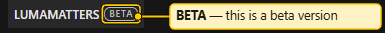

# Interface Tour

Each area of the project window has its own page with details.

## The layout

The project window is split into panels. Default layout:

- The **3D view** fills the left half.
- On the right, at the top, you see tabs: **Outliner**, **Summary**, **History** and **Variations**. The Outliner is the tab in front.
- On the right, below those tabs, is **Properties**.

Drag a tab to move it, drag panel borders to resize, and close a panel with its tab button. The layout is kept on this machine.

The **Report** tab is not in the default layout. Open it with **File > Export > Report…**, **View > Report** or `Ctrl+P`. It fills the whole window when in front. See [Report and PDF](Report-and-PDF.md).

### Panels menu and Reset layout

- **View > Panels** lists the six panels (**3D view**, **Outliner**, **Summary**, **History**, **Variations**, **Properties**). A tick means the panel is open. Click an entry to open or close it. A reopened panel returns to its usual place.
- **View > Reset layout** puts all panels back in the default places.

## The header bar

The thin bar at the top holds, left to right:

- The app name **LUMAMATTERS**, followed by a small **BETA** pill while the app is a beta build. The pill is only a label: you cannot click it. The same pill sits next to the name on every report page. See [What's new](Whats-New.md).

- The menus **File**, **Edit**, **View** and **Help**. See [Menus](Menus.md).
- The variation selector: a list button, the name of the active variation (click to rename), and buttons to duplicate or delete it. An A/B switch button sits beside it. A variation is one rig of projectors on the shared venue. See [Variations and Compare](Setups-and-Compare.md).
- **Snapshot**, **Undo** and **Redo** buttons. **Snapshot** does the same as `Ctrl+S`. Undo and Redo are greyed out when there is nothing to undo or redo.
- The status line, for example `My project · Saved`. It can also say `Saving…`, `Paused: changed on disk` or `Not saved: <reason>`. It shows the snapshot your work is based on (`· snapshot 0012`). See [Projects and Snapshots](Projects-and-Snapshots.md).
- **Analysing…** with a small bar while the numbers are recomputed, and a bar while textures load.

Banners can appear under the header: a slow-view warning when 9 to 16 projectors are in the analysis, a notice that a file changed on disk, and an error banner if the analysis failed.

## The 3D view

The 3D view shows the venue, projectors, people and cameras. Controls sit on top of it:

- **Left edge:** the transform tools (Select, Move, Rotate, Scale), the **Measure** tool below a divider, World or Local space, and the pivot (**Origin** or **Box ctr**, the centre of the bounding box).
- **Top strip:** the pivot (**Origin** or **Box ctr**), the **magnet** (snapping, with its step sizes), Light **Blended** or **Raw**, the view-mode buttons **Shaded**, **Photometric**, **Overlap**, **Pixel**, **Distance** and a **?** help button.
- **Right edge:** the **Viewport** tab unfolds the view settings: **View** (viewpoints and cameras), Perspective or Orthographic, the overlays **Labels**, **Tex** and **Grid**, the grid settings, **Edges** (edge highlight and object edges), **Surfaces**, **Beams**, **Background** and **Lighting**. A **Lock** button appears while you look through a camera.
- **Right edge, below Viewport:** the **Measure** tab. It unfolds the Measure sidebar (`N`); only one of the two panels is open at a time. See [Measure Tools](Measure-Tools.md).
- **Floating legend:** the **Legend** card shows the legend of the current view mode (Photometric, Overlap, Pixel, Distance). It starts at the lower left. Drag it by its grip; double-click the grip to put it back.

Details: [3D View](3D-View.md) and [View Modes](View-Modes.md).

## The Outliner

The Outliner lists the whole project as a tree: model files, venue objects, projectors, nulls, people and cameras, and at the end the **Measurements** group. At the top is a toolbar (**+ Proj**, **+ Person**, **+ Null** with a small arrow beside it for a venue null, **Group**, **Parent**, **Unparent**, **Import**) and a search field. See [Outliner](Outliner.md).

## Properties

Properties shows the settings of the selection: transform, projector lens and zoom, surface role, texture, person, camera. See [Properties](Properties.md).

## Summary and History

**Summary** shows the venue status, the numbers of the analysis and the probe. **History** lists the snapshots of the project. See [Summary and History](Summary-and-History.md).

## Variations

The **Variations** tab lists the variations of the project and compares two of them. See [Variations and Compare](Setups-and-Compare.md).

## Dialogs, toasts and tooltips

- A greyed-out menu entry or button shows a tooltip that says why it is not available, for example "Open a project first." or "Nothing to undo."
- Short messages appear as toasts.
- The **Help** menu opens its dialogs over the window: **View modes…**, **Keyboard shortcuts**, **Blender export…**, **Send feedback…** and **About LUMAMATTERS**. See [Menus](Menus.md#help).
- Menus and header buttons are inactive on purpose during a drag or file operation.
- If the same project is open in another window, this window is read-only. The header shows `Read-only: open in another window`.

## Look and feel

The look follows Blender (dark theme, foldable panel sections, draggable number fields) but uses its own code and icons. The Outliner works like Maya's. Number fields have a TouchDesigner-style Value Ladder. See [Properties](Properties.md).

See also: [Menus](Menus.md), [3D View](3D-View.md), [Outliner](Outliner.md), [Keyboard Shortcuts](Keyboard-Shortcuts.md), [Measure Tools](Measure-Tools.md)
