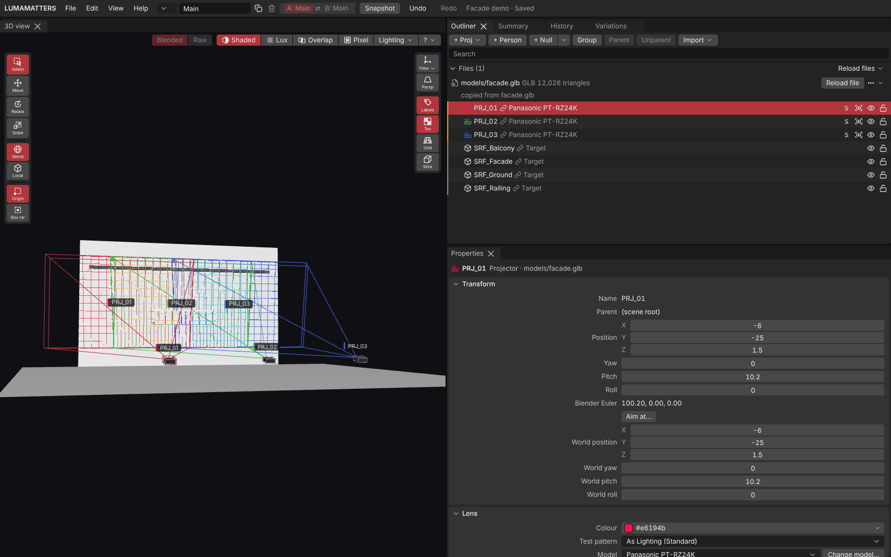

# Interface Tour

This page shows you where everything is in the project window. Each area has its own page with the details.

## The layout

The project window is split into panels. By default:

- The **3D view** fills the left half.
- On the right, at the top, you see tabs: **Outliner**, **Summary**, **History** and **Variations**. The Outliner is the tab in front.
- On the right, below those tabs, is **Properties**.

You can drag a tab to another place, drag the borders between panels to resize them, and close a panel with its tab button. The layout is kept on this machine and comes back the next time you open the app.

The **Report** tab is not part of the default layout. It opens from **File > Export > Report…**, **View > Report** or `Ctrl+P`. When the Report tab is in front, it fills the whole window. See [Report and PDF](Report-and-PDF.md).

### Panels menu and Reset layout

- **View > Panels** lists the six panels (**3D view**, **Outliner**, **Summary**, **History**, **Variations**, **Properties**). A tick means the panel is open. Click an entry to open or close that panel. A panel you bring back returns to its usual place.
- **View > Reset layout** puts all panels back where they were at the start.

## The header bar

The thin bar at the top holds, from left to right:

- The app name **LUMAMATTERS**.
- The menus **File**, **Edit**, **View** and **Help**. See [Menus](Menus.md).
- The variation selector: a list button, the name of the active variation (click to rename), and buttons to duplicate or delete it. A button for the A/B switch is there too. A variation is one rig of projectors on the shared venue. See [Variations and Compare](Setups-and-Compare.md).
- **Snapshot**, **Undo** and **Redo** buttons. **Snapshot** does the same as `Ctrl+S`. Undo and Redo are greyed out when there is nothing to undo or redo.
- The status line, for example `My project · Saved`. It can also say `Saving…`, `Paused: changed on disk` or `Not saved: <reason>`, and it shows the snapshot your work is based on (`· snapshot 0012`). See [Projects and Snapshots](Projects-and-Snapshots.md).
- **Analysing…** with a small bar while the numbers are recomputed, and a bar while textures load.

Under the header, banners can appear: a warning that the live view may be slow when 9 to 16 projectors are in the analysis, a notice that a file changed on disk, and an error banner if the analysis failed.

## The 3D view

The 3D view shows the venue, projectors, people and cameras. It has controls drawn on top of it:

- **Left edge:** the transform tools (Select, Move, Rotate, Scale), World or Local space, and the pivot (Origin or Box centre).
- **Top right:** Light **Blended** or **Raw**, the view-mode buttons **Shaded**, **Lux**, **Overlap**, **Pixel**, **Lighting** and a **?** help button.
- **Right edge:** **View** (viewpoints and cameras), Perspective or Orthographic, then the toggles **Labels**, **Tex**, **Grid** and **Wire**. A **Lock** button appears while you look through a camera.
- **Bottom left:** the legend of the current view mode.

Details are on [3D View](3D-View.md) and [View Modes](View-Modes.md).

## The Outliner

The Outliner lists everything in the project as a tree: model files, venue objects, projectors, nulls, people and cameras. At the top is a toolbar (**+ Proj**, **+ Person**, **+ Null**, **Group**, **Parent**, **Unparent**, **Import**) and a search field. See [Outliner](Outliner.md).

## Properties

Properties shows the settings of what you selected: transform, projector lens and zoom, surface role, texture, person, camera. See [Properties](Properties.md).

## Summary and History

**Summary** shows the venue status, the numbers of the analysis and the probe. **History** lists the snapshots of the project. See [Summary and History](Summary-and-History.md).

## Variations

The **Variations** tab lists the variations of the project and compares two of them. See [Variations and Compare](Setups-and-Compare.md).

## Dialogs, toasts and tooltips

- A greyed-out menu entry or button shows a tooltip that says why it is not available, for example "Open a project first." or "Nothing to undo."
- Short messages appear as toasts.
- While a drag or a file operation is running, the menus and header buttons are inactive on purpose.
- If the same project is open in another window, this window is read-only. The header shows `Read-only: open in another window`.

## Look and feel

The look follows Blender's conventions (dark theme, foldable panel sections, number fields you can drag) but uses its own code and icons. The Outliner works like Maya's. Number fields have a TouchDesigner-style Value Ladder. See [Properties](Properties.md).

See also: [Menus](Menus.md), [3D View](3D-View.md), [Outliner](Outliner.md), [Keyboard Shortcuts](Keyboard-Shortcuts.md)
