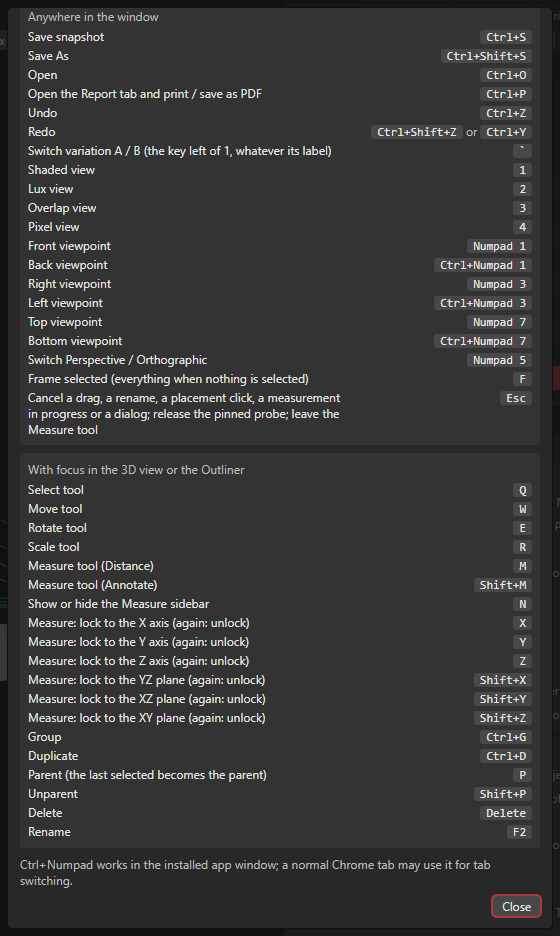

# Keyboard Shortcuts

**Help > Keyboard shortcuts** shows the same list inside the app.

## Rules

- Keys marked "anywhere" work in the whole project window.
- Keys marked "panels" work only when the focus is in the 3D view or the Outliner.
- No key acts while you type in a text field. No key acts while a menu, list, popover or dialog is open. Text fields keep their own keys, undo included.
- Letter and number keys use the physical key position. They work on other keyboard layouts. `Ctrl+Z` and the file keys use the label on the key.
- `Ctrl+Numpad` works in the app window.

## Anywhere in the window

| Key | Action |
|---|---|
| `Ctrl+S` | Save snapshot |
| `Ctrl+Shift+S` | Save As |
| `Ctrl+O` | Open |
| `Ctrl+P` | Open the Report tab and print / save as PDF |
| `Ctrl+Z` | Undo |
| `Ctrl+Shift+Z` or `Ctrl+Y` | Redo |
| `` ` `` (the key left of `1`) | Switch variation A / B |
| `1` | Shaded view |
| `2` | Photometric view |
| `3` | Overlap view |
| `4` | Pixel view |
| `5` | Distance view |
| `Numpad 1` | Front viewpoint |
| `Ctrl+Numpad 1` | Back viewpoint |
| `Numpad 3` | Right viewpoint |
| `Ctrl+Numpad 3` | Left viewpoint |
| `Numpad 7` | Top viewpoint |
| `Ctrl+Numpad 7` | Bottom viewpoint |
| `Numpad 5` | Switch Perspective / Orthographic |
| `F` | Frame selected (everything when nothing is selected) |
| `Esc` | Cancel a drag, a rename, a placement click, a measurement in progress or a dialog; release the pinned probe; leave the Measure tool |

## With focus in the 3D view or the Outliner

| Key | Action |
|---|---|
| `Q` | Select tool |
| `W` | Move tool |
| `E` | Rotate tool |
| `R` | Scale tool |
| `M` | Measure tool (Distance) |
| `Shift+M` | Measure tool (Annotate) |
| `N` | Show or hide the Measure sidebar |
| `X`, `Y`, `Z` | Measure: lock to the X, Y or Z axis (press again to unlock) |
| `Shift+X`, `Shift+Y`, `Shift+Z` | Measure: lock to the YZ, XZ or XY plane (press again to unlock) |
| `Ctrl+G` | Group |
| `Ctrl+D` | Duplicate |
| `P` | Parent (the last selected object becomes the parent) |
| `Shift+P` | Unparent |
| `Delete` | Delete |
| `F2` | Rename |

The lock keys work while you place point B of a measurement or drag an end. Two axis keys together lock the plane of both axes: `X` then `Y` gives the XY plane, the same as `Shift+Z`. A third key replaces the older of the two. The lock keys use the label on the key, so they follow your keyboard layout. On a German keyboard, `Z` is the key with the label Z.

## Esc order

Each `Esc` cancels one thing. The order is:

1. A drag.
2. A rename.
3. A placement click (this includes point A of a measurement).
4. A dialog.
5. The pinned probe.
6. The search field of the Outliner.
7. The Measure tool (back to Select).

## Mouse and number fields

- Middle mouse button in the 3D view: orbit. Right mouse button: pan. Wheel: zoom. See [3D View](3D-View.md).
- `Alt+click` on a surface: pin the probe.
- Gizmo drags (Move, Rotate, Scale): with the **Magnet** off, `Ctrl` snaps. With the **Magnet** on, `Ctrl` means free movement. See [3D View](3D-View.md#snapping-magnet). The **Magnet** has no key.
- Number fields: drag with the left button. `Shift` gives fine steps. `Ctrl` snaps. The middle button opens the Value Ladder. See [Properties](Properties.md).
- While you edit a number field, `Ctrl+S` first commits what you typed.

## Other keys

- `Ctrl+N` is not used. The web engine inside the app keeps it.
- In the History panel, the arrow keys, `Home` and `End` move between the snapshot rows.

The Measure keys are explained in [Measure Tools](Measure-Tools.md).

See also: [Menus](Menus.md), [Measure Tools](Measure-Tools.md), [3D View](3D-View.md), [Outliner](Outliner.md), [Interface Tour](Interface-Tour.md)
