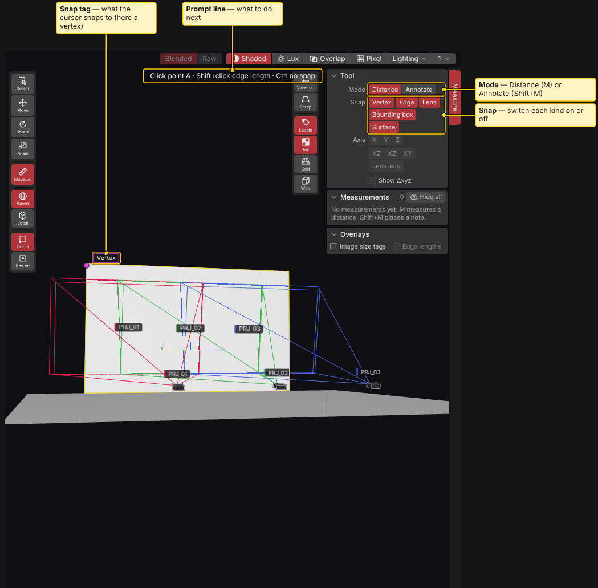
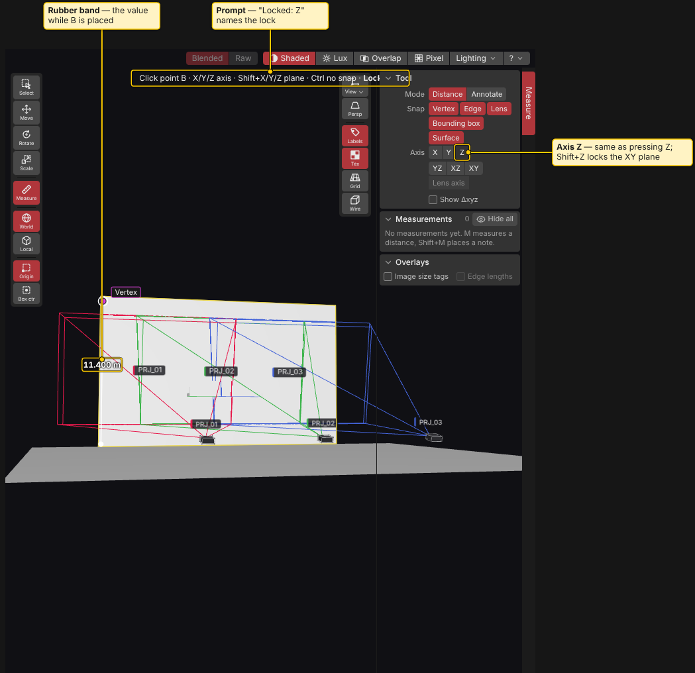
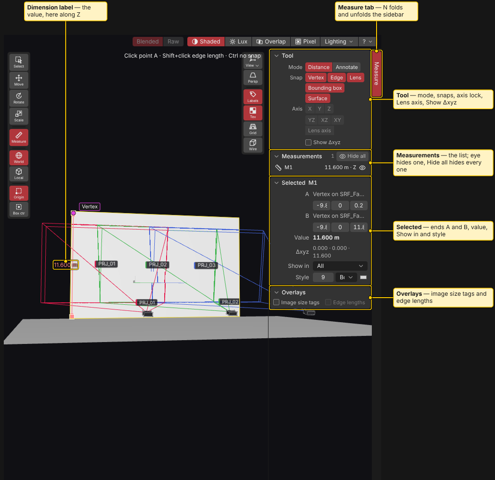
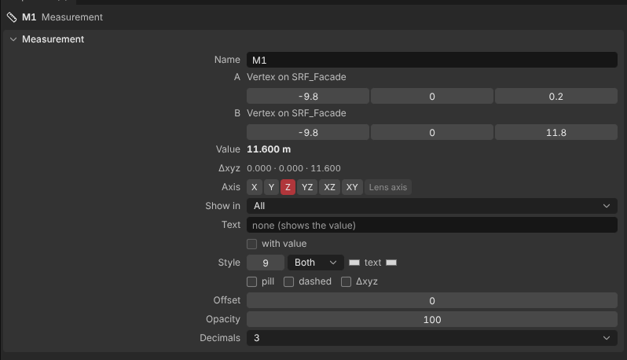
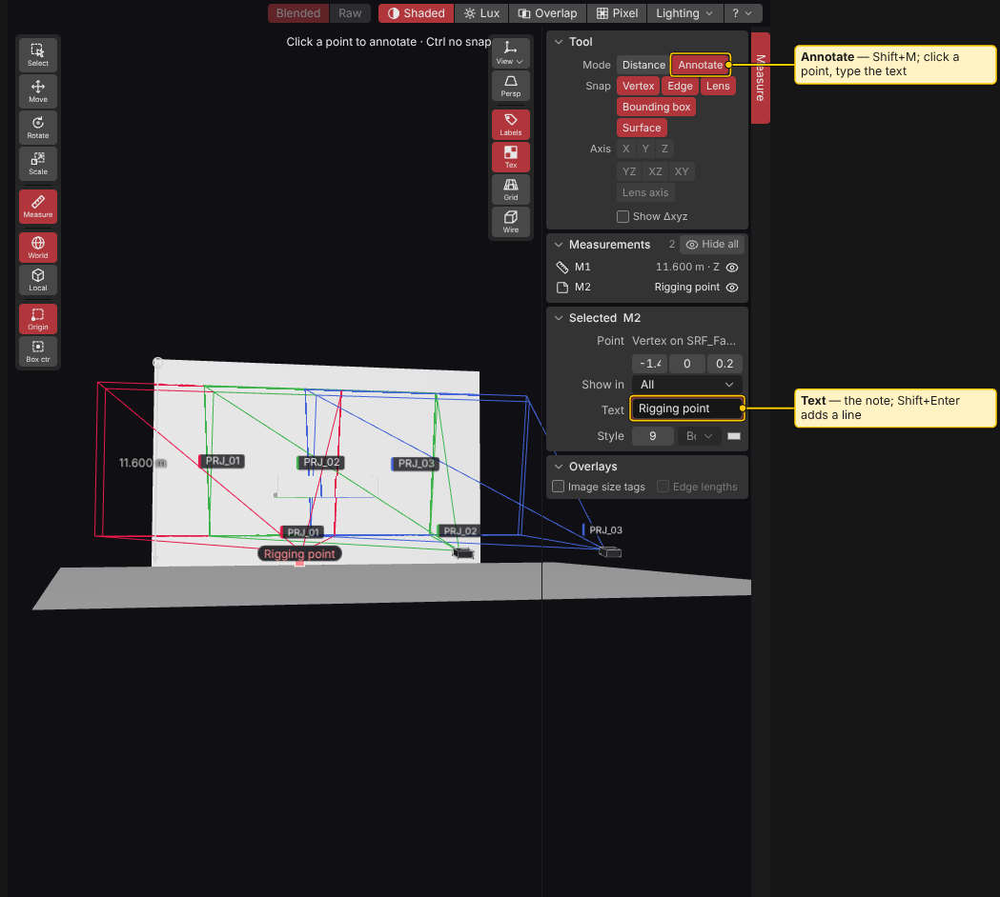
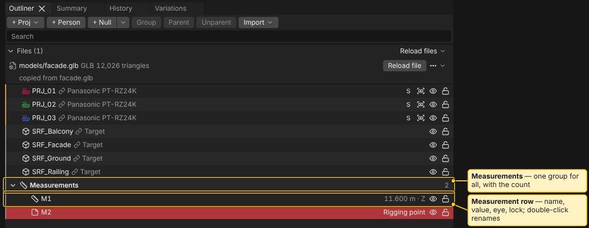

# Measure Tools

> **Planning aid.** LUMAMATTERS is a planning aid. Its numbers (lux, pixel size, throw distance, overlap) come from maker data and simplified models and can be wrong. No guarantee of correct data is given. Check critical values against the maker's spec sheets and on site.

Draw dimension lines and notes in the 3D view: projector height, wall width, distance from a lens to a surface. Dimensions are measured by hand with snapping, not filled in automatically.

## Status in this build

Measure tools work in the 3D view, the Outliner and Properties. Not built yet: dimensions on report pictures and a **Measurements** table in the report. The report editor already lists a **Measurements** table source, but it cannot be picked yet. Measurements are not in the PDF in this build.

## Start

- Click **Measure** in the tool column (left edge of the 3D view), press `M`, or use **View > Measure**. `Shift+M` starts in **Annotate** mode.
- The **Measure sidebar** opens on the right edge of the 3D view. `N` folds and unfolds it. Drag its left edge to resize it; double-click the edge to reset the width.
- A prompt line at the top centre says what to do next, for example "Click point A".
- `Esc` leaves the tool and goes back to Select. See the Esc order below.

The Measure tool needs an open project. It works in every tool's navigation: middle mouse orbits, right mouse pans, the wheel zooms, `F` frames, the numpad switches views.

## Measure a distance

1. Move the cursor over the model. A tag names what it snaps to, for example **Vertex**, **Edge midpoint**, **Surface**, or a projector's **lens centre**.
2. Click for point A. A rubber-band line with the value follows the cursor.
3. Click for point B. The measurement is created and selected, and the tool stays on for the next one.

While you place B:

- `X`, `Y` or `Z` locks the line to that axis (the app's Z is up, as in Blender). Press it again to unlock. The line and the value then use only that component.
- `Shift+X`, `Shift+Y` or `Shift+Z` locks to the plane across that axis (YZ, XZ or XY).
- The **Axis** buttons in the sidebar do the same. They are active only while you place B.
- `Ctrl` turns snapping off for that click.
- `Shift+click` on an edge measures the edge's length in one click.
- `Esc` drops point A.

**Lens axis**: when point A is a lens centre or a projection centre, the **Lens axis** button measures along the projector's centre ray to the first surface it hits. The value follows when you re-aim the projector. With no hit it shows "no hit".

Values are in metres with 3 decimals (for example `11.600 m`). A label can also show **Show Δxyz**: the difference in X, Y and Z.

## Snapping

The **Snap** buttons in the sidebar switch each kind on or off (for this session only):

| Snap | Snaps to |
|---|---|
| **Vertex** | A corner of a mesh. |
| **Edge** | The end or middle of a feature edge: a border or a real crease. Flat-face diagonals are ignored. |
| **Lens** | A projector's lens centre and its projection centre. |
| **Bounding box** | The centre, corners, edge middles and face centres of the object's box, or of a projector body. |
| **Surface** | Any point on a visible surface (the fallback). |

When two candidates are close, the nearest on screen wins. Hidden objects are not snap targets.

## Edit a measurement

- Click a dimension line or its label to select it, in any tool.
- With the Measure tool, the selected measurement shows handles at A and B. Drag a handle to snap that end somewhere else. `X`, `Y`, `Z` work during the drag. One drag is one undo step.
- `Delete` deletes, `Ctrl+D` duplicates, and `F` frames the selected measurements. Delete and Duplicate act on the whole selection (objects and measurements) as one undo step.
- A measurement is anchored to the objects it snapped to. Move or re-aim the object and the measurement follows. Undo restores both.
- Typing a value in the A or B position fields turns that end into a free point. It no longer follows an object.
- Measurements belong to the project, not to a variation. A measurement on a projector is hidden in a variation that does not have that projector.

## The sidebar panels

- **Tool**: **Mode** (**Distance** or **Annotate**), **Snap**, **Axis**, **Lens axis**, **Show Δxyz** (default for new measurements).
- **Measurements**: the list with name, value, a **check** badge and an eye. Click selects (`Shift` and `Ctrl` as elsewhere). Double-click renames. **Hide all** hides every measurement in the 3D view.
- **Selected**: for the selected measurement: where A and B are snapped, the X, Y and Z of each end, the **Value**, **Δxyz**, **Show in** and a short **Style** row (font size, line ends, colour).
- **Overlays**: **Image size tags** writes each projector's image width x height at its aim distance beside its name (needs **Labels** on). **Edge lengths** draws the four image edges on the venue with their lengths (only while the size tags are on).

## Properties of a measurement

With only measurements selected, Properties shows the full fields:

- **Name**, **A** and **B** with X, Y, Z (metres), **Value**, **Δxyz**.
- **Axis**: **X**, **Y**, **Z**, **YZ**, **XZ**, **XY**, **Lens axis**. A button is greyed out with a reason when it does not apply.
- **Show in**: **All**, or one camera. Looking through a camera shows only the measurements for that camera and the ones set to All.
- **Text**: replaces the number in the label. **with value** shows both.
- **Style**: font size (pt), line ends (**Both**, **Start**, **End**, **None**, **Ticks**), line colour, text colour, **pill** (label background), **dashed**, **Δxyz**, **Offset** (m), **Opacity** (%), **Decimals** (0 to 3).
- **Mark checked** appears when a **check** flag is set.

## Annotations

An annotation is a text tag on a leader line.

1. Press `Shift+M` (or choose **Annotate** in the sidebar).
2. Click a point. Snapping works as for a distance.
3. Type the text. `Enter` confirms, `Shift+Enter` adds a line.

Drag the tag to move it. An annotation has the same style, **Show in**, visibility, lock and follow behaviour as a distance. It shows no number.

## In the Outliner

All measurements sit in one group, **Measurements**, at the end of the Outliner, with the count. Each row has a name, the value (for example `11.600 m · Z`), an eye and a lock. Double-click or `F2` renames. A locked measurement cannot be edited or deleted. Selecting a measurement in the 3D view opens the group.

## After a reload

Measurements follow objects that moved in the model file. If the geometry under a snapped point changed (no match within 1 mm), or the object was removed, the measurement gets an amber **check** badge. A removed object leaves a free point at the last position. The reload report lists the newly flagged measurements. Check the position, then press **Mark checked**, or move an end, to clear the flag. See [Blender Export and Import](Blender-Export-and-Import.md).

## Keys

| Key | Action |
|---|---|
| `M` | Measure tool (Distance) |
| `Shift+M` | Measure tool (Annotate) |
| `N` | Fold or unfold the sidebar |
| `X`, `Y`, `Z` | Lock to an axis while placing B |
| `Shift+X`, `Shift+Y`, `Shift+Z` | Lock to a plane while placing B |
| `Ctrl` (held) | No snapping for that click |
| `Shift+click` an edge | Measure the edge's length |
| `Esc` | Drop point A; next press leaves the tool |

`M`, `N` and the tool keys work with the focus in the 3D view or the Outliner. They do not act while you type in a field. A dimension is drawn on top of the geometry and is not hidden by it. The Alt+click probe pin keeps working. See [Keyboard Shortcuts](Keyboard-Shortcuts.md).

## What the tools do not do

- No angles, and no area of free polygons.
- No automatic mount-height or distance readouts. For the numbers the app already shows, use **Properties > Readouts** (**Aim distance**, **Throw distance (maker)**, **Image W × H**) and the Summary probe. See [Placing Projectors](Placing-Projectors.md) and [Analysis](Analysis.md).
- Measurements never change the analysis numbers.

## See also

[3D View](3D-View.md), [Outliner](Outliner.md), [Properties](Properties.md), [Report and PDF](Report-and-PDF.md), [Keyboard Shortcuts](Keyboard-Shortcuts.md)
