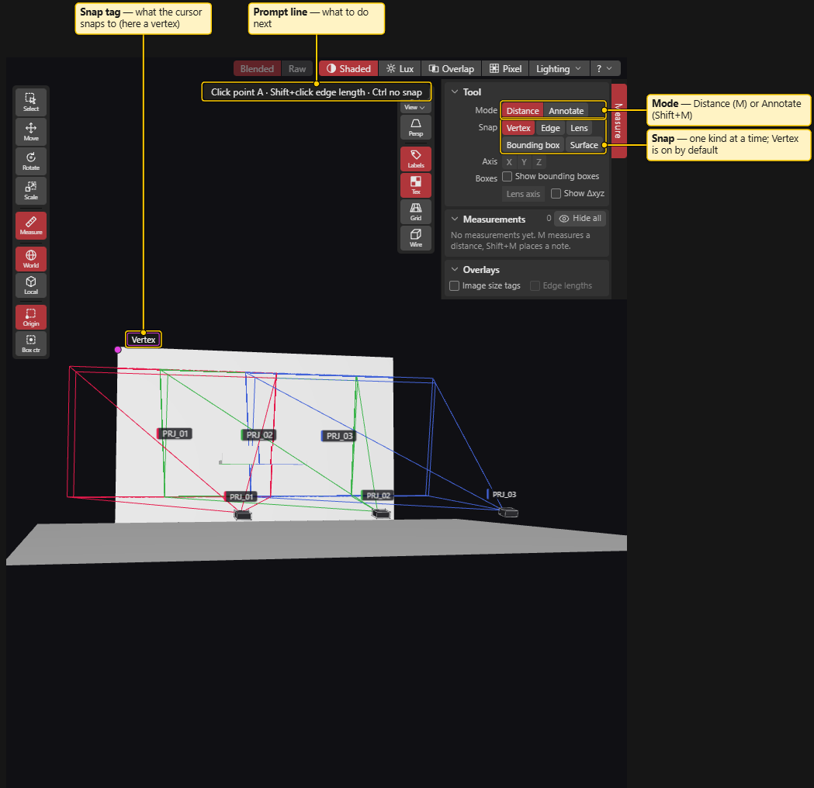
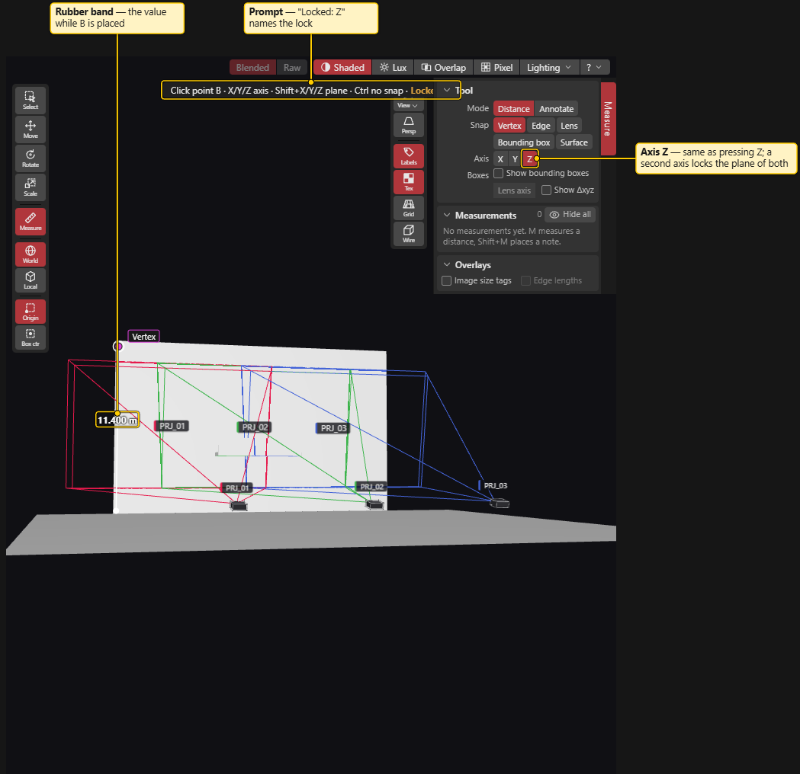
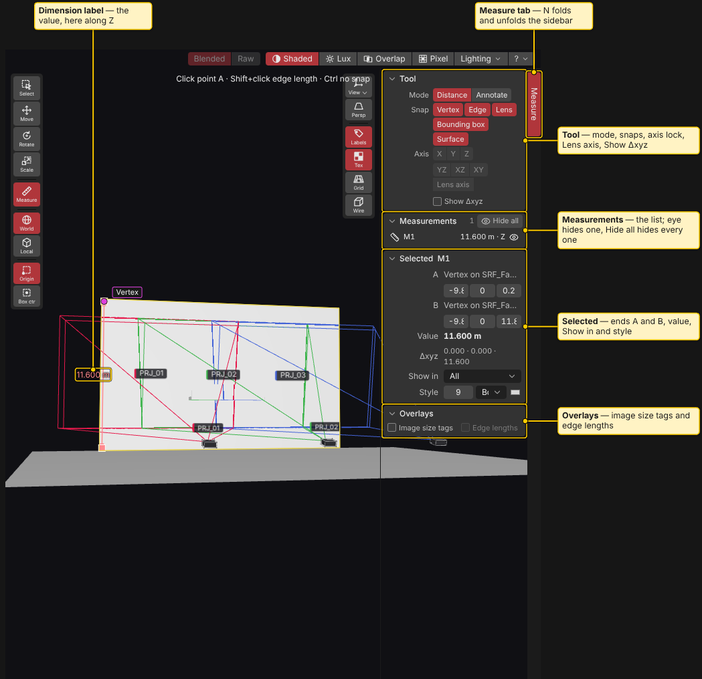
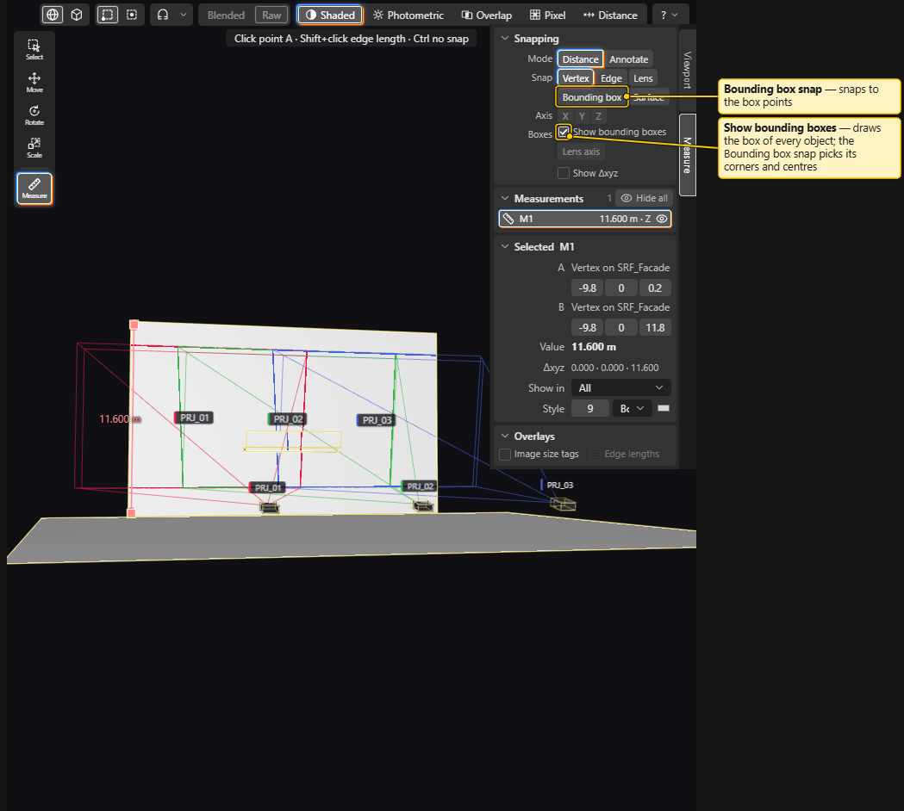
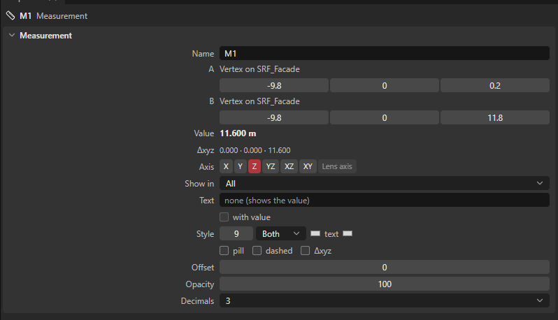
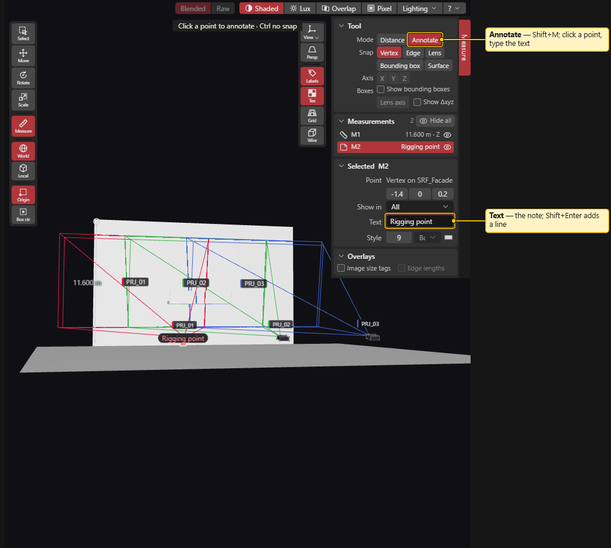
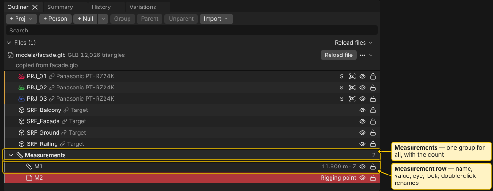
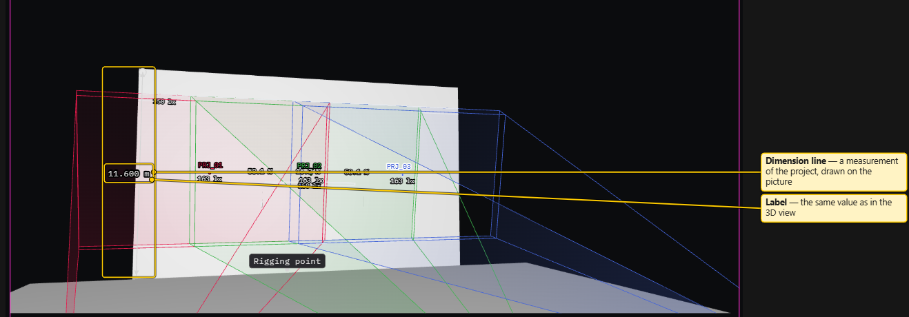
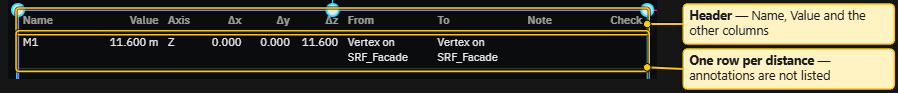

# Measure Tools

> **Planning aid.** LUMAMATTERS is a planning aid. Its numbers (illuminance, pixel size, throw distance, overlap) come from maker data and simplified models. They can be wrong. No guarantee of correct data is given. Check critical values against the maker's spec sheets and on site.

Use the **Measure tool** to draw dimension lines and notes in the 3D view. Typical uses are projector height, wall width and the distance from a lens to a surface. You place each dimension by hand, with snapping. The app does not fill in dimensions automatically. Dimensions show in the 3D view, in the Outliner and in Properties. They also show on report pictures and in a report table.

## Start

- Click **Measure** in the tool column. The column is on the left edge of the 3D view, and **Measure** is set apart from the transform tools.
- You can also press `M` or choose **View > Measure**.
- Press `Shift+M` to start in **Annotate** mode.
- The **Measure** sidebar unfolds on the right edge of the 3D view. It floats over the view. The view keeps its full size.
- Leaving the tool does not fold the sidebar.
- When the sidebar is folded, it is a small vertical **Measure** tab. Click the tab or press `N` to unfold or fold it.
- Drag the left edge of the sidebar to resize it. The width is 240 to 480 px, and the 3D view keeps at least 320 px.
- Double-click the edge to reset the width. The project does not save the width.
- A prompt line at the top centre says what to do next. For example: "Click point A · Shift+click edge length · Ctrl no snap".
- After point A, the prompt line shows the lock keys. The active lock is in bold, for example "Locked: Z" or "Locked: plane XY".
- Press `Esc` to leave the tool and go back to Select. The keys table below shows the order of the `Esc` steps.

The Measure tool needs an open project. Navigation works as in every tool. The middle mouse button orbits. The right mouse button pans. The wheel zooms. `F` frames the selection. The numpad switches viewpoints.

## Measure a distance

1. Move the cursor over the model. A tag names the snap target, for example **Vertex**, **Edge midpoint**, **Surface**, **Lens centre**, **Projection centre** or **Box corner**.
2. Click for point A. A rubber-band line with its value follows the cursor.
3. Click for point B. The app creates and selects the measurement.
4. The tool stays on, so you can place the next measurement.

While you place point B, you can use these controls:

- Press `X`, `Y` or `Z` to lock the line to that axis. The Z axis is up, as in Blender. The line and the value then use only that component. Press the same key again to unlock.
- Press two axis keys to lock to the plane of both. For example, `X` then `Z` gives the XZ plane. A third axis replaces the older of the two.
- Press `Shift+X`, `Shift+Y` or `Shift+Z` to lock to the plane across that axis (YZ, XZ or XY) in one press. Press the same keys again to unlock.
- Click the **X**, **Y** and **Z** buttons in the **Axis** row of the sidebar. They work like the keys. They are active only while you place point B or drag an end.
- Hold `Ctrl` to turn snapping off for that click.
- Press `Shift+click` on an edge to measure the length of the edge in one click. This needs **Edge** snapping (see Snapping below).
- Press `Esc` to drop point A.

**Lens axis.** Point A can be a lens centre or a projection centre. Then the **Lens axis** button measures along the centre ray of the projector to the first surface it hits. The value follows when you aim the projector again. If the ray hits nothing, the value shows "no hit".

Values are in metres with three decimals, for example `11.600 m`. A label can also show the difference in X, Y and Z. To see it, switch on **Show Δxyz**.

## Snapping

The Measure snap targets are in the **Snap steps** popover of the 3D view. Open it with the small arrow beside the **Magnet** button in the top strip. The targets are below the snap steps. The Measure sidebar has no snap controls. It only shows a one-line hint that points to the magnet menu.

Only one target is on at a time, like radio buttons. When you click another target, the first one turns off. **Vertex** is on when you start the app. The choice is for this session only.

| Snap | Snaps to |
|---|---|
| **Vertex** | A corner of a mesh. This is the default. |
| **Edge** | The end or the middle of a feature edge: a border or a real crease. The app ignores diagonals across flat faces. |
| **Lens** | The lens centre and the projection centre of a projector. |
| **Bounding box** | The centre, corners, edge middles and face centres of the box of an object or of a projector body. |
| **Surface** | Any point on a visible surface. |

- The targets are strict. With only **Vertex** on, a click far from any vertex places nothing. Choose **Surface** to click anywhere on a surface. You can also hold `Ctrl` to get a plain surface point.
- The lens centre and the projection centre of a projector snap in every mode. The **Lens** target is the mode that offers only these two points.
- **Bounding box** snaps to the box points near the cursor. The cursor does not need to point at the model.
- To draw the box of every object and every projector body, switch on **Show bounding boxes**. This option is in the **Tool** panel. It is off by default and lasts for the session. It works while the Measure tool is active.
- When two candidates are close, the one nearest on screen wins.
- Hidden objects are not snap targets.

The **Magnet** button also snaps the **Move**, **Rotate** and **Scale** tools. The default steps are 0.1 m, 5° and a factor of 0.1. The same popover sets the steps. See [3D View](3D-View.md#snapping-magnet).

## Edit a measurement

- Click a dimension line or its label to select it. This works in every tool.
- With the Measure tool, a selected measurement shows handles at A and B. Drag a handle to snap that end to a new place. `X`, `Y` and `Z` work during the drag. One drag is one undo step.
- Press `Delete` to delete the selection. Press `Ctrl+D` to duplicate it. Press `F` to frame the selected measurements. Delete and Duplicate act on the whole selection (objects and measurements) as one undo step.
- A measurement is anchored to the objects it snapped to. When you move or aim an object again, the measurement follows. Undo restores both.
- Type a value in the A or B position fields to turn that end into a free point. The end then no longer follows an object.
- Measurements belong to the project, not to a variation. A measurement on a projector is hidden in a variation that does not have that projector.

## The sidebar panels

- **Tool**: **Mode** (**Distance** or **Annotate**), **Axis** (**X**, **Y**, **Z**), **Boxes** (**Show bounding boxes**), **Lens axis** and **Show Δxyz**. **Show Δxyz** is the default for new measurements.
- **Measurements**: the list. Each row shows a name, a value, a **check** badge and an eye. The header shows the count and **Hide all**. **Hide all** hides every measurement in the 3D view for this session. Click a row to select it (`Shift` and `Ctrl` work as elsewhere). Double-click a name to rename it.
- **Selected**: this panel shows the selected measurement. It shows where A and B are snapped and the X, Y and Z of each end. It also shows **Value**, **Δxyz**, **Show in** and a short **Style** row (font size, line ends, colour).
- **Overlays**: **Image size tags** writes the image width × height of each projector beside its name, at the aim distance. It needs **Labels** on. **Edge lengths** draws the four image edges on the venue with their lengths. It works only while the size tags are on.

## Properties of a measurement

When only measurements are selected, Properties shows all the fields:

- **Name**, **A** and **B** with X, Y, Z (in metres), **Value** and **Δxyz**.
- **Axis**: **X**, **Y**, **Z**, **YZ**, **XZ**, **XY** and **Lens axis**. A button that does not apply is grey and shows a reason.
- **Show in**: **All** or one saved camera. When you look through a camera, the 3D view shows only the measurements for that camera and those set to **All**.
- **Text**: replaces the number in the label. **with value** shows both.
- **Style**: font size (pt) and line ends (**Both**, **Start**, **End**, **None**, **Ticks**). Also line colour, text colour, **pill** (label background), **dashed**, **Δxyz**, **Offset** (m), **Opacity** (%) and **Decimals** (0 to 3).
- **Mark checked** appears when a **check** flag is set.

## Annotations

An annotation is a text note on a leader line.

1. Press `Shift+M`, or choose **Annotate** in the sidebar.
2. Click a point. Snapping works as for a distance. Set the targets in the **Snap steps** popover.
3. Type the text.
4. Press `Enter` to confirm. Press `Shift+Enter` to add a line.

Drag the note to move it. An annotation has the same style, **Show in**, visibility, lock and follow behaviour as a distance. It shows no number.

## In the Outliner

All measurements are in one group, **Measurements**, at the end of the Outliner. The group shows the count. Each row has a name, the value (for example `11.600 m · Z`), an eye and a lock. Double-click a row or press `F2` to rename it. You cannot edit or delete a locked measurement. When you select a measurement in the 3D view, the group opens.

## In the report

You can put dimensions into the report, on pictures and in a table. For the report editor, see [Report and PDF](Report-and-PDF.md).

**On report pictures.** Select a **Render** block. In its Properties, three switches under the picture options control what the picture draws:

- **Measurements**: the dimension lines, notes and labels of the project. This switch is on for new pictures.
- **Image size tags**: the image width × height of each projector at its aim distance. This switch is off for new pictures.
- **Edge lengths**: the four image edges with their lengths. This switch is off for new pictures.

Each dimension keeps its own style: colour, font size, line ends, dashed, pill, offset, opacity and decimals. The picture setting **Label outline** applies to labels without a pill. The picture settings **Label colour** and **Label size** do not apply to dimensions.

A picture shows the measurements that match it:

- A picture whose source is a saved camera shows the measurements set to **All** and those set to that camera.
- A picture from the 3D view or from a projector shows only the measurements set to **All**. This is the **Show in** field above.
- The picture uses the variation of the report. It leaves out a measurement on a projector that is not in that variation.
- The picture does not draw the parts of a dimension that are behind the camera.

To hide single dimensions on one picture, use the **Measurements** list in the Properties of that Render block. The list has one checkbox per measurement. Clear a checkbox to hide that measurement on this picture only. You can also click a dimension in the selected picture. Then click the **Hide <name> on this picture** button that appears in the same list. The measurement stays in the project and on the other pictures. To show it again, tick its checkbox.

A measurement with a **check** flag is amber and dashed in the Report tab, with a "check" badge. The printed copy draws it normally. The report **Check** list names it as a warning.

**In a table.** Insert a **Table** block and choose the source **Measurements**.

The table has fixed columns: **Name**, **Value**, **Axis**, **Δx**, **Δy**, **Δz**, **From**, **To**, **Note** and **Check**. It lists every visible distance measurement that resolves in the variation of the report. The order is the order of the sidebar list. The table does not list annotations. If you hide a measurement on a picture, it stays in the table. The **Show in** setting does not remove it from the table either. **From** and **To** say what each end is snapped to. **Note** holds a text override. A long table continues on new pages, like the other tables.

## After a reload

Measurements follow objects that moved in the model file. Two cases give a measurement an amber **check** badge:

- The geometry under a snapped point changed, and no match is within 1 mm.
- The object was removed. The measurement then keeps a free point at the last position.

The reload report lists the newly flagged measurements. Check the position. Then press **Mark checked**, or move an end, to clear the flag. See [Blender Export and Import](Blender-Export-and-Import.md).

## Keys

| Key | Action |
|---|---|
| `M` | Measure tool (Distance) |
| `Shift+M` | Measure tool (Annotate) |
| `N` | Fold or unfold the sidebar |
| `X`, `Y`, `Z` | Lock to an axis while placing B. Two axes lock to their plane. |
| `Shift+X`, `Shift+Y`, `Shift+Z` | Lock to the YZ, XZ or XY plane while placing B |
| `Ctrl` (held) | No snapping for that click |
| `Shift+click` an edge | Measure the length of the edge |
| `Esc` | Drop point A and the lock. A second press leaves the tool. |

`M`, `N` and the tool keys work when the focus is in the 3D view or the Outliner. They do not act while you type in a field. A dimension is drawn on top of the geometry. The geometry does not hide it. The `Alt+click` probe pin keeps working. See [Keyboard Shortcuts](Keyboard-Shortcuts.md).

## What the tools do not do

- They do not measure angles or the area of free polygons.
- They do not give automatic mount-height or distance readouts. For the numbers the app already shows, use **Properties > Readouts** (**Aim distance**, **Throw distance (maker)**, **Image W × H**) and the probe in Summary. See [Placing Projectors](Placing-Projectors.md) and [Analysis](Analysis.md).
- Measurements never change the analysis numbers.

## See also

[3D View](3D-View.md), [Outliner](Outliner.md), [Properties](Properties.md), [Report and PDF](Report-and-PDF.md), [Keyboard Shortcuts](Keyboard-Shortcuts.md)
