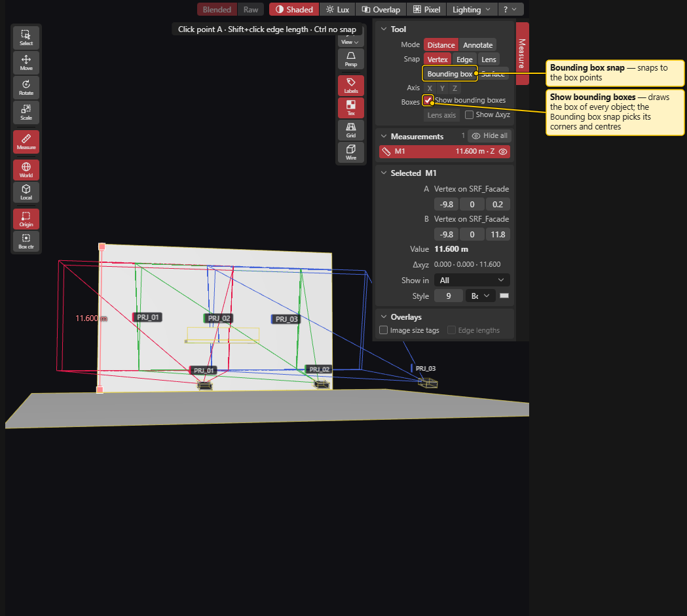

# Measure Tools

> **Planning aid.** LUMAMATTERS is a planning aid. Its numbers (lux, pixel size, throw distance, overlap) come from maker data and simplified models and can be wrong. No guarantee of correct data is given. Check critical values against the maker's spec sheets and on site.

Draw dimension lines and notes in the 3D view: projector height, wall width, distance from a lens to a surface. Dimensions are measured by hand with snapping, not filled in automatically. They show in the 3D view, in the Outliner and Properties, on report pictures and in a report table.

## Start

- Click **Measure** in the tool column (left edge of the 3D view, set apart from the transform tools), press `M`, or use **View > Measure**. `Shift+M` starts in **Annotate** mode.
- The **Measure sidebar** unfolds on the right edge of the 3D view. It floats over the view: the view keeps its full size and stays usable beside and below the panel. Leaving the tool does not fold the sidebar again.
- Folded, the sidebar is a small vertical **Measure** tab on the right edge of the 3D view. Click the tab or press `N` to unfold and fold it.
- Drag the sidebar's left edge to resize it (240 to 480 px, and the 3D view keeps at least 320 px). Double-click the edge to reset the width. The width is not saved with the project.
- A prompt line at the top centre says what to do next, for example "Click point A · Shift+click edge length · Ctrl no snap". After point A it shows the lock keys, and the active lock in bold, for example "Locked: Z" or "Locked: plane XY".
- `Esc` leaves the tool and goes back to Select. See the Esc order below.

The Measure tool needs an open project. It works in every tool's navigation: middle mouse orbits, right mouse pans, the wheel zooms, `F` frames, the numpad switches views.

## Measure a distance

1. Move the cursor over the model. A tag names what it snaps to, for example **Vertex**, **Edge midpoint**, **Surface**, **Lens centre**, **Projection centre** or **Box corner**.
2. Click for point A. A rubber-band line with the value follows the cursor.
3. Click for point B. The measurement is created and selected, and the tool stays on for the next one.

While you place B:

- `X`, `Y` or `Z` locks the line to that axis (the app's Z is up, as in Blender). The line and the value then use only that component. Press the same key again to unlock.
- Two axes at once lock to the plane of both: `X` then `Z` gives the XZ plane. Pressing a third axis replaces the older of the two.
- `Shift+X`, `Shift+Y` or `Shift+Z` lock to the plane across that axis (YZ, XZ or XY) in one press. The same key again unlocks.
- The **X**, **Y** and **Z** buttons in the **Axis** row of the sidebar do the same as the keys, including two buttons for a plane. They are active only while you place B or drag an end.
- `Ctrl` turns snapping off for that click.
- `Shift+click` on an edge measures the edge's length in one click (needs **Edge** snapping, see below).
- `Esc` drops point A.

**Lens axis**: when point A is a lens centre or a projection centre, the **Lens axis** button measures along the projector's centre ray to the first surface it hits. The value follows when you re-aim the projector. With no hit it shows "no hit".

Values are in metres with 3 decimals (for example `11.600 m`). A label can also show **Show Δxyz**: the difference in X, Y and Z.

## Snapping

The **Snap** buttons in the sidebar choose what the cursor snaps to. Only one mode is on at a time, like radio buttons: clicking another one turns the first off. **Vertex** is on when you start the app. The choice is for this session only.

| Snap | Snaps to |
|---|---|
| **Vertex** | A corner of a mesh. This is the default. |
| **Edge** | The end or middle of a feature edge: a border or a real crease. Flat-face diagonals are ignored. |
| **Lens** | A projector's lens centre and its projection centre. |
| **Bounding box** | The centre, corners, edge middles and face centres of an object's box, or of a projector body. |
| **Surface** | Any point on a visible surface. |

- The snap modes are strict. With only **Vertex** on, a click far from any vertex places nothing. Pick **Surface** to click anywhere on a surface, or hold `Ctrl` for a plain surface point.
- A projector's lens centre and projection centre snap in every mode. The **Lens** button is the mode that offers only those two points.
- **Bounding box** snaps to the box's own points near the cursor, with or without pointing at the model. Turn on **Show bounding boxes** (own row in the **Tool** panel, off by default, session only) to draw every object's box and projector body box while the Measure tool is active.
- When two candidates are close, the nearest on screen wins. Hidden objects are not snap targets.

## Edit a measurement

- Click a dimension line or its label to select it, in any tool.
- With the Measure tool, the selected measurement shows handles at A and B. Drag a handle to snap that end somewhere else. `X`, `Y`, `Z` work during the drag. One drag is one undo step.
- `Delete` deletes, `Ctrl+D` duplicates, and `F` frames the selected measurements. Delete and Duplicate act on the whole selection (objects and measurements) as one undo step.
- A measurement is anchored to the objects it snapped to. Move or re-aim the object and the measurement follows. Undo restores both.
- Typing a value in the A or B position fields turns that end into a free point. It no longer follows an object.
- Measurements belong to the project, not to a variation. A measurement on a projector is hidden in a variation that does not have that projector.

## The sidebar panels

- **Tool**: **Mode** (**Distance** or **Annotate**), **Snap**, **Axis** (**X**, **Y**, **Z**), **Boxes** (**Show bounding boxes**), **Lens axis** and **Show Δxyz** (default for new measurements).
- **Measurements**: the list with name, value, a **check** badge and an eye. The header shows the count and **Hide all**, which hides every measurement in the 3D view (for this session). Click selects (`Shift` and `Ctrl` as elsewhere). Double-click renames.
- **Selected**: for the selected measurement: where A and B are snapped, the X, Y and Z of each end, the **Value**, **Δxyz**, **Show in** and a short **Style** row (font size, line ends, colour).
- **Overlays**: **Image size tags** writes each projector's image width x height at its aim distance beside its name (needs **Labels** on). **Edge lengths** draws the four image edges on the venue with their lengths (only while the size tags are on).

## Properties of a measurement

With only measurements selected, Properties shows the full fields:

- **Name**, **A** and **B** with X, Y, Z (metres), **Value**, **Δxyz**.
- **Axis**: **X**, **Y**, **Z**, **YZ**, **XZ**, **XY**, **Lens axis**. A button is greyed out with a reason when it does not apply.
- **Show in**: **All**, or one camera. Looking through a camera shows only the measurements for that camera and the ones set to All.
- **Text**: replaces the number in the label. **with value** shows both.
- **Style**: font size (pt), line ends (**Both**, **Start**, **End**, **None**, **Ticks**), line colour, text colour, **pill** (label background), **dashed**, **Δxyz**, **Offset** (m), **Opacity** (%), **Decimals** (0 to 3).
- **Mark checked** appears when a **check** flag is set.

## Annotations

An annotation is a text tag on a leader line.

1. Press `Shift+M` (or choose **Annotate** in the sidebar).
2. Click a point. Snapping works as for a distance.
3. Type the text. `Enter` confirms, `Shift+Enter` adds a line.

Drag the tag to move it. An annotation has the same style, **Show in**, visibility, lock and follow behaviour as a distance. It shows no number.

## In the Outliner

All measurements sit in one group, **Measurements**, at the end of the Outliner, with the count. Each row has a name, the value (for example `11.600 m · Z`), an eye and a lock. Double-click or `F2` renames. A locked measurement cannot be edited or deleted. Selecting a measurement in the 3D view opens the group.

## In the report

Dimensions can go into the report, on pictures and in a table. See [Report and PDF](Report-and-PDF.md) for the report editor itself.

**On report pictures.** Select a **Render** block. In its Properties, three switches under the picture options control what is drawn:

- **Measurements**: the dimension lines, notes and labels of the project. On for new pictures.
- **Image size tags**: each projector's image width x height at its aim distance. Off for new pictures.
- **Edge lengths**: the four image edges with their lengths. Off for new pictures.

Each dimension keeps its own style (colour, font size, line ends, dashed, pill, offset, opacity, decimals). The picture's **Label outline** applies to labels without a pill. The picture's **Label colour** and **Label size** do not apply to dimensions.

A picture shows the measurements that match it:

- A picture whose source is a saved camera shows the measurements set to **All** and those set to that camera. A picture from the 3D view or a projector shows only those set to **All**. This is the **Show in** field above.
- The picture uses the report's variation. A measurement on a projector that is not in that variation is left out.
- Parts of a dimension behind the camera are not drawn.

To hide single dimensions on one picture, use the **Measurements** list in that Render block's Properties: one checkbox per measurement, unchecked = hidden on this picture only. You can also click a dimension in the selected picture and press the **Hide <name> on this picture** button that appears in the same list. This changes only that picture. The measurement stays in the project and on the other pictures. The **Measurements** list shows a measurement again when you tick it.

A measurement with a **check** flag is drawn amber and dashed with a "check" badge in the Report tab. The printed copy draws it normally. The report **Check** list names it as a warning.

**In a table.** Insert a **Table** block and choose the source **Measurements**.

The table has fixed columns: **Name**, **Value**, **Axis**, **Δx**, **Δy**, **Δz**, **From**, **To**, **Note** and **Check**. It lists every visible distance measurement that resolves in the report's variation, in the order of the sidebar list. Annotations are not listed. Hiding a measurement on a picture, or its **Show in** setting, does not remove it from the table. **From** and **To** say what each end is snapped to. **Note** holds a text override. A long table continues on new pages, like the other tables.

## After a reload

Measurements follow objects that moved in the model file. If the geometry under a snapped point changed (no match within 1 mm), or the object was removed, the measurement gets an amber **check** badge. A removed object leaves a free point at the last position. The reload report lists the newly flagged measurements. Check the position, then press **Mark checked**, or move an end, to clear the flag. See [Blender Export and Import](Blender-Export-and-Import.md).

## Keys

| Key | Action |
|---|---|
| `M` | Measure tool (Distance) |
| `Shift+M` | Measure tool (Annotate) |
| `N` | Fold or unfold the sidebar |
| `X`, `Y`, `Z` | Lock to an axis while placing B; two axes lock to their plane |
| `Shift+X`, `Shift+Y`, `Shift+Z` | Lock to the YZ, XZ or XY plane while placing B |
| `Ctrl` (held) | No snapping for that click |
| `Shift+click` an edge | Measure the edge's length |
| `Esc` | Drop point A; next press leaves the tool |

`M`, `N` and the tool keys work with the focus in the 3D view or the Outliner. They do not act while you type in a field. A dimension is drawn on top of the geometry and is not hidden by it. The Alt+click probe pin keeps working. See [Keyboard Shortcuts](Keyboard-Shortcuts.md).

## What the tools do not do

- No angles, and no area of free polygons.
- No automatic mount-height or distance readouts. For the numbers the app already shows, use **Properties > Readouts** (**Aim distance**, **Throw distance (maker)**, **Image W × H**) and the Summary probe. See [Placing Projectors](Placing-Projectors.md) and [Analysis](Analysis.md).
- Measurements never change the analysis numbers.

## See also

[3D View](3D-View.md), [Outliner](Outliner.md), [Properties](Properties.md), [Report and PDF](Report-and-PDF.md), [Keyboard Shortcuts](Keyboard-Shortcuts.md)
