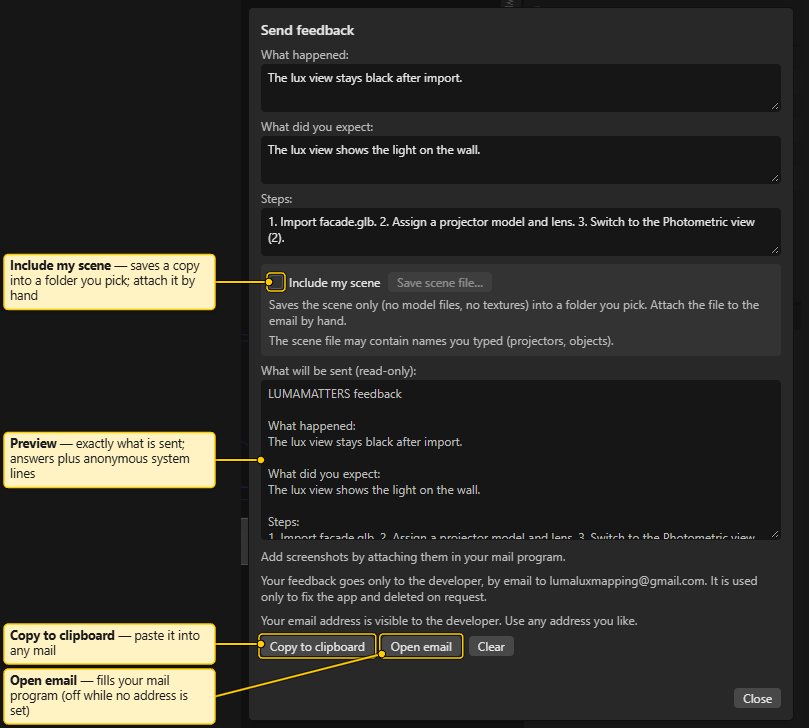

# Menus

The menu bar sits at the top left: **File**, **Edit**, **View**, **Help**. Shortcuts are in the right column.

An entry that cannot be used is greyed out. Hover it to see why. All entries are inactive during a drag or file operation.

## File

| Entry | What it does | Shortcut |
|---|---|---|
| **New…** | Creates a new project. The app asks first if the open project has unsaved changes. | |
| **Open…** | Opens a project from the workspace. | `Ctrl+O` |
| **Open Recent** | Submenu with the last projects opened on this machine. The open one is marked "(open)". Greyed out with "No recent projects." when empty. | |
| **New window** | Opens another app window. Also works in a read-only window. | |
| **Save snapshot** | Takes an unnamed snapshot of the current state at once. | `Ctrl+S` |
| **Save snapshot with name…** | Asks for a name, then takes a snapshot. | |
| **Snapshot history** | Opens and focuses the **History** tab. | |
| **Save As…** | Asks for a new name, writes the current state into a new project, and opens it. | `Ctrl+Shift+S` |
| **Import** | Submenu: **glTF / GLB…**, **FBX…**, **OBJ…**. Copies a model file into the project. | |
| **Export** | Submenu: **Test-pattern PNGs…**, **Camera images (PNG)…**, **Report…**. | |
| **Change workspace…** | Picks another workspace folder. | |

Notes:

- **Save snapshot**, **Save snapshot with name…** and the **Import** entries are greyed out in a read-only window (the project is open in another window). The tooltip says: "This window is read-only: the project is open in another window."
- **Export** entries need an open project. **Camera images (PNG)…** also needs at least one visible camera that has a pose. It writes one 3840 x 2160 PNG per camera.
- Every committed edit is saved automatically. A snapshot is an extra restore point. See [Projects and Snapshots](Projects-and-Snapshots.md).
- More on importing: [Blender Export and Import](Blender-Export-and-Import.md). Test patterns: [Test Patterns](Test-Patterns.md). Report: [Report and PDF](Report-and-PDF.md).
- **New…** has no shortcut: the web engine inside the app keeps `Ctrl+N` for itself.

## Edit

| Entry | What it does | Shortcut |
|---|---|---|
| **Undo** | Undoes the last step. Greyed out with "Nothing to undo." | `Ctrl+Z` |
| **Redo** | Redoes the last undone step. Greyed out with "Nothing to redo." | `Ctrl+Shift+Z` (also `Ctrl+Y`) |
| **Duplicate** | Duplicates the selected objects. | `Ctrl+D` |
| **Delete** | Deletes the selected objects. | `Delete` |
| **Aim at point** | Click mode: aims the selected projectors at the surface point you click. | |
| **Copy specs from active** | Opens the Copy specs popover in Properties: copies chosen specs from the active projector to the other selected projectors. | |

**Duplicate** and **Delete** act on the Outliner selection, measurements included. A tooltip gives the reason when they do not apply. With the Report tab in front, Undo and Redo act on report steps.

## View

| Entry | What it does | Shortcut |
|---|---|---|
| **Shading** | Submenu: **Shaded**, **Lux**, **Overlap**, **Pixel**. | `1`, `2`, `3`, `4` |
| **Light** | Submenu: **Blended**, **Raw**. Greyed out unless the Lux view is on ("Lux view only."). | |
| **Lighting…** | Opens the Lighting popover of the 3D view (how the Shaded view is lit). Needs an open project. | |
| **Labels** | Shows or hides the name labels of projectors, people and cameras. | |
| **Textures** | Shows or hides textures. | |
| **Grid** | Shows or hides the ground grid. | |
| **Wireframe** | Submenu: **Off**, **Feature edges**, **All edges**. | |
| **Statistics** | Shows or hides the statistics text in the 3D view. | |
| **Background** | Submenu: **Dark**, **Grey**, **Black**, **Night gradient**. | |
| **Orthographic** | Switches between perspective and orthographic. | `Numpad 5` |
| **Lock camera to view** | While you look through a camera, orbit, pan and zoom move that camera. Greyed out with a reason when unusable. | |
| **Frame selected** | Frames the selection (everything when nothing is selected). Needs an open project. | `F` |
| **Measure** | Ticks while the Measure tool is on; turns it on (Distance mode) or off (back to Select). Needs an open project. | `M` |
| **Viewpoint** | Submenu, see below. | |
| **Report** | Opens the Report tab. | `Ctrl+P` |
| **Panels** | Submenu with a tick per panel: **3D view**, **Outliner**, **Summary**, **History**, **Variations**, **Properties**. | |
| **Reset layout** | Puts all panels back in the default places. | |

### Viewpoint submenu

- **Top** (`Numpad 7`), **Bottom** (`Ctrl+Numpad 7`), **Front** (`Numpad 1`), **Back** (`Ctrl+Numpad 1`), **Left** (`Ctrl+Numpad 3`), **Right** (`Numpad 3`).
- **Cameras**: the cameras of the project. Click one to look through it. Without cameras it shows "No cameras". A camera without a usable pose is greyed out.
- **Save view as camera…**: asks for a name and stores the current view as a new camera.

The **View** button in the 3D view opens the same list.

## Help

| Entry | What it does |
|---|---|
| **Tutorial** | Starts the guided tour. Needs an open project. |
| **View modes…** | Explains the four view modes and shows the planning-aid notice. See [View Modes](View-Modes.md). |
| **Keyboard shortcuts** | Lists all shortcuts. See [Keyboard Shortcuts](Keyboard-Shortcuts.md). |
| **Blender export…** | Shows the object-name prefixes and the export checklist for Blender. See [Blender Export and Import](Blender-Export-and-Import.md). |
| **Send feedback…** | Opens the feedback dialog, with or without an open project. See [Send feedback](#send-feedback). |
| **About LUMAMATTERS** | Shows the version, licence, third-party notices and what is new. See [About LUMAMATTERS](#about-lumamatters). |

Every Help dialog has a **Close** button. `Esc` closes it too.

### Send feedback

Use **Help > Send feedback…** to report a problem or an idea. The app never sends anything itself and makes no network call. You see the full text first. You then copy it, or open your mail program with the text already filled in, and you press Send there.

**Your three answers.** Three text boxes, in your own words:

- **What happened:**
- **What did you expect:**
- **Steps:** what you did, step by step.

**Anonymous system lines.** The dialog adds these lines under your answers:

- App version, with "(beta)" while the app is a beta build.
- Windows version.
- Number of CPU cores.
- Memory (RAM). The web engine inside the app reports a rounded value, never above 8 GB. The line says so.
- Name of the graphics card.
- Screen size in pixels and the display scaling (pixel ratio).
- With a project open: the number of projectors and the number of visible triangles in the active variation. With no project open: "Scene: no project open".

A value the system does not report shows as "not shown by the browser".

The text never contains your project name, file paths, your Windows user name, your machine name, or the name of your workspace folder.

**What will be sent (read-only).** This box shows the exact text. It is read-only. It is also exactly what **Copy to clipboard** copies and what **Open email** puts into the mail. Read it before you use either button.

**Include my scene.** Off by default. It can only be ticked while a project is open.

1. Tick **Include my scene**.
2. Click **Save scene file…**. A folder picker opens. Pick any folder, for example your Desktop.
3. The app writes one file there, named `lumamatters-feedback-<UTC time>.luma`, for example `lumamatters-feedback-20261024T094120Z.luma`. The dialog shows "Saved <name>. Attach it to your email by hand." The preview text gets one more line with the file name.
4. Attach that file to the email yourself, in your mail program. The app cannot attach files.

The file holds the scene only: projectors, objects, variations, cameras and measurements, with their settings and positions. It holds no model files, no textures and no file paths. The project name is replaced by "Feedback scene". The report's author lines, picture sources and page layout are left out. Any text that looks like a Windows file path is replaced by `[path removed]`. The file may still contain names you typed (projectors, objects, variations, notes) and the object names from the model files. The dialog says so under the tick box.

**Buttons.**

| Button | What it does |
|---|---|
| **Copy to clipboard** | Copies the text from the preview. A line under the buttons says "Copied. Paste it into your mail." |
| **Open email** | Opens your mail program with a new mail. The subject is `LUMAMATTERS feedback <version>`, for example `LUMAMATTERS feedback 1.0.3`. The body is the preview text. The mail is not sent until you send it. |
| **Clear** | Empties your three answers, the **Include my scene** tick and the saved-file line. |
| **Close** | Closes the dialog. |

**Mail link length.** A mail link has a size limit. When the whole link is longer than 8000 characters, **Open email** is greyed out and the dialog says: "Too long for an email link. Use Copy to clipboard and paste into your mail." The text is never cut. The limit counts the encoded link (spaces, line breaks and special characters take three or more characters each), so the text itself can be shorter than 8000 characters. Some mail programs may still cut a long link. The preview shows the full text, and **Copy to clipboard** always works.

**Screenshots.** A mail link cannot carry pictures. The dialog says: "Add screenshots by attaching them in your mail program."

**Your answers are kept.** If you close the dialog (`Esc`, **Close**, or a click outside it), what you typed and the tick stay until you restart the app. Nothing is written to disk. **Clear** empties them at once.

**Anonymity.** Your email address is visible to the developer. Use any address you like.

**Privacy line.** Under the preview the dialog says: "Your feedback goes only to the developer, by email to lumaluxmapping@gmail.com. It is used only to fix the app and deleted on request." The feedback address is `lumaluxmapping@gmail.com`. **Open email** sends the mail to that address.

### About LUMAMATTERS

The dialog shows, top to bottom:

- **LUMAMATTERS version 1.0.3 · Beta.** The version number, with "Beta" while the app is a beta build. Under it, while the app is a beta: "Beta software: may contain errors. Back up your projects."
- The copyright line: "© 2026 LumaLux".
- **Licence (beta)**, three lines: free to download and use, for private and commercial work, during the beta; you may modify the software and use your changes yourself; you may not sell the software, modified versions or access to it, or bundle it into a paid product. Under them: "Full terms: the LICENSE file in the install folder", and a request to share the download page rather than the installer file. The download page is a link: https://github.com/LMXtinker/LUMAMATTERS-releases/releases. It opens in your browser.
- A warning box: LUMAMATTERS is a planning aid. Lux, throw, occlusion and other numbers are estimates: "To the extent permitted by law": no warranty, and no liability for rigging, safety or on-site results.
- A trademark and data line: Panasonic, Epson and other product names are trademarks of their owners, used only to identify compatible products. LUMAMATTERS is not affiliated with or endorsed by them. Projector data comes from public spec sheets and may contain errors. Projector bodies are generic shapes, not maker models.
- **Third-party notices…**, a button. It unfolds a scrollable, read-only list of the licences of the libraries and fonts the app includes. The button then reads **Hide third-party notices**. The same text is in `THIRD_PARTY_NOTICES.txt` in the install folder.
- **Workspace folder:** the name of your workspace folder, or "none".
- "Everything stays on this machine; the app works offline."
- What's new in 1.0.3, 1.0.2, 1.0.1 and 1.0 (newest first), and a note that projects saved with v1.0 features can use a newer file format that older builds refuse. The same notes are on [What's new](Whats-New.md).

See also: [Interface Tour](Interface-Tour.md), [What's new](Whats-New.md), [Keyboard Shortcuts](Keyboard-Shortcuts.md), [Projects and Snapshots](Projects-and-Snapshots.md), [3D View](3D-View.md), [Measure Tools](Measure-Tools.md)
