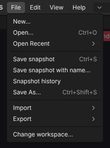
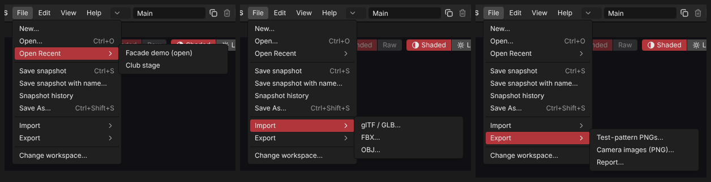
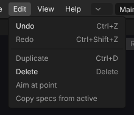
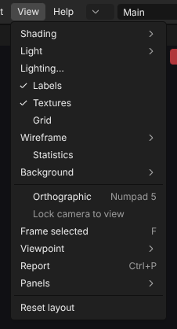
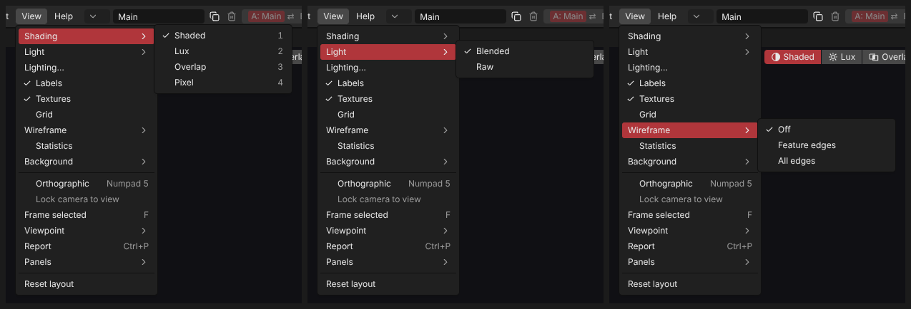
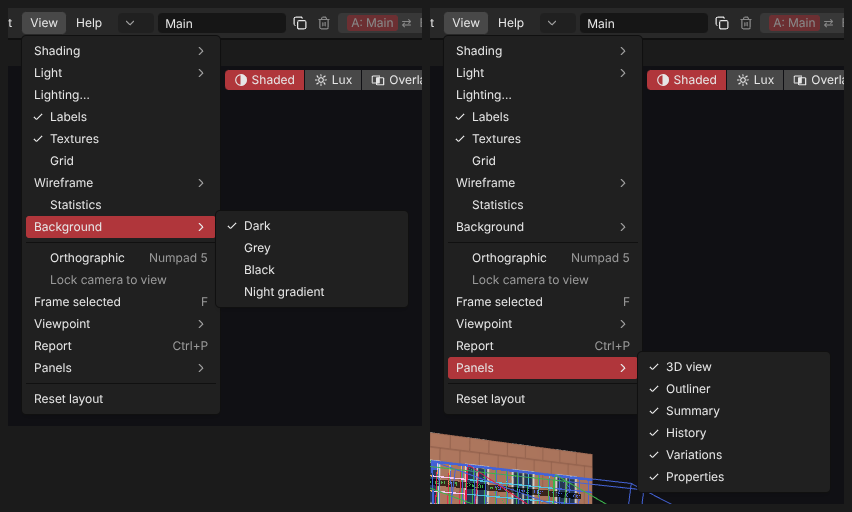
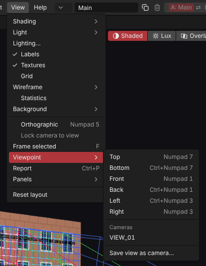
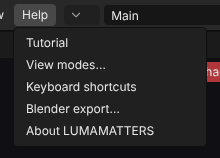
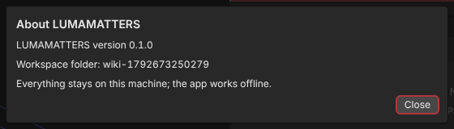

# Menus

The menu bar sits at the top left: **File**, **Edit**, **View**, **Help**. Shortcuts are in the right column.

An entry that cannot be used is greyed out. Hover it to see why. All entries are inactive during a drag or file operation.

## File

| Entry | What it does | Shortcut |
|---|---|---|
| **New…** | Creates a new project. The app asks first if the open project has unsaved changes. | |
| **Open…** | Opens a project from the workspace. | `Ctrl+O` |
| **Open Recent** | Submenu with the last projects opened on this machine. The open one is marked "(open)". Greyed out with "No recent projects." when empty. | |
| **New window** | Opens another app window. Only in the installed desktop app. | |
| **Save snapshot** | Takes an unnamed snapshot of the current state at once. | `Ctrl+S` |
| **Save snapshot with name…** | Asks for a name, then takes a snapshot. | |
| **Snapshot history** | Opens and focuses the **History** tab. | |
| **Save As…** | Asks for a new name, writes the current state into a new project, and opens it. | `Ctrl+Shift+S` |
| **Import** | Submenu: **glTF / GLB…**, **FBX…**, **OBJ…**. Copies a model file into the project. | |
| **Export** | Submenu: **Test-pattern PNGs…**, **Camera images (PNG)…**, **Report…**. | |
| **Change workspace…** | Picks another workspace folder. | |

Notes:

- **Save snapshot**, **Save snapshot with name…** and the **Import** entries are greyed out in a read-only window (the project is open in another window). The tooltip says: "This window is read-only: the project is open in another window."
- **Export** entries need an open project. **Camera images (PNG)…** also needs at least one visible camera that has a pose. It writes one 3840 x 2160 PNG per camera.
- Every committed edit is saved automatically. A snapshot is an extra restore point. See [Projects and Snapshots](Projects-and-Snapshots.md).
- More on importing: [Blender Export and Import](Blender-Export-and-Import.md). Test patterns: [Test Patterns](Test-Patterns.md). Report: [Report and PDF](Report-and-PDF.md).
- **New…** has no shortcut: the browser engine keeps `Ctrl+N` for itself.

## Edit

| Entry | What it does | Shortcut |
|---|---|---|
| **Undo** | Undoes the last step. Greyed out with "Nothing to undo." | `Ctrl+Z` |
| **Redo** | Redoes the last undone step. Greyed out with "Nothing to redo." | `Ctrl+Shift+Z` (also `Ctrl+Y`) |
| **Duplicate** | Duplicates the selected objects. | `Ctrl+D` |
| **Delete** | Deletes the selected objects. | `Delete` |
| **Aim at point** | Click mode: aims the selected projectors at the surface point you click. | |
| **Copy specs from active** | Opens the Copy specs popover in Properties: copies chosen specs from the active projector to the other selected projectors. | |

**Duplicate** and **Delete** act on the Outliner selection. A tooltip gives the reason when they do not apply. With the Report tab in front, Undo and Redo act on report steps.

## View

| Entry | What it does | Shortcut |
|---|---|---|
| **Shading** | Submenu: **Shaded**, **Lux**, **Overlap**, **Pixel**. | `1`, `2`, `3`, `4` |
| **Light** | Submenu: **Blended**, **Raw**. Greyed out unless the Lux view is on ("Lux view only."). | |
| **Lighting…** | Opens the Lighting popover of the 3D view (how the Shaded view is lit). Needs an open project. | |
| **Labels** | Shows or hides the name labels of projectors, people and cameras. | |
| **Textures** | Shows or hides textures. | |
| **Grid** | Shows or hides the ground grid. | |
| **Wireframe** | Submenu: **Off**, **Feature edges**, **All edges**. | |
| **Statistics** | Shows or hides the statistics text in the 3D view. | |
| **Background** | Submenu: **Dark**, **Grey**, **Black**, **Night gradient**. | |
| **Orthographic** | Switches between perspective and orthographic. | `Numpad 5` |
| **Lock camera to view** | While you look through a camera, orbit, pan and zoom move that camera. Greyed out with a reason when unusable. | |
| **Frame selected** | Frames the selection (everything when nothing is selected). Needs an open project. | `F` |
| **Viewpoint** | Submenu, see below. | |
| **Report** | Opens the Report tab. | `Ctrl+P` |
| **Panels** | Submenu with a tick per panel: **3D view**, **Outliner**, **Summary**, **History**, **Variations**, **Properties**. | |
| **Reset layout** | Puts all panels back in the default places. | |

### Viewpoint submenu

- **Top** (`Numpad 7`), **Bottom** (`Ctrl+Numpad 7`), **Front** (`Numpad 1`), **Back** (`Ctrl+Numpad 1`), **Left** (`Ctrl+Numpad 3`), **Right** (`Numpad 3`).
- **Cameras**: the cameras of the project. Click one to look through it. Without cameras it shows "No cameras". A camera without a usable pose is greyed out.
- **Save view as camera…**: asks for a name and stores the current view as a new camera.

The **View** button in the 3D view opens the same list.

## Help

| Entry | What it does |
|---|---|
| **Tutorial** | Starts the guided tour. Needs an open project. |
| **View modes…** | Explains the four view modes and shows the planning-aid notice. See [View Modes](View-Modes.md). |
| **Keyboard shortcuts** | Lists all shortcuts. See [Keyboard Shortcuts](Keyboard-Shortcuts.md). |
| **Blender export…** | Shows the object-name prefixes and the export checklist for Blender. See [Blender Export and Import](Blender-Export-and-Import.md). |
| **About LUMAMATTERS** | Shows the version, the workspace folder, and a note that everything stays on this machine. |

See also: [Interface Tour](Interface-Tour.md), [Keyboard Shortcuts](Keyboard-Shortcuts.md), [Projects and Snapshots](Projects-and-Snapshots.md), [3D View](3D-View.md)
