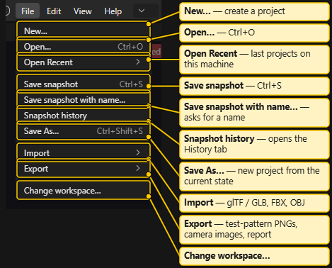
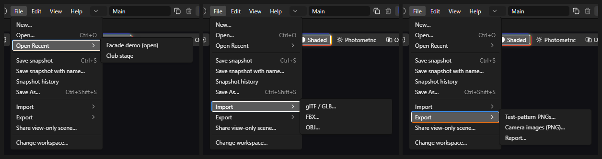
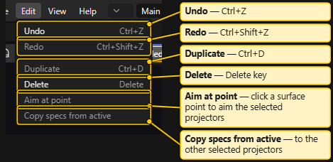
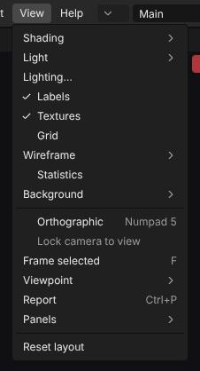
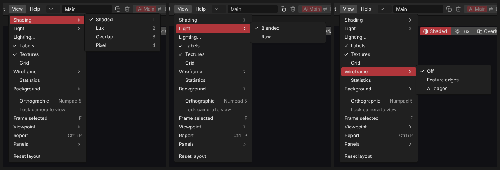
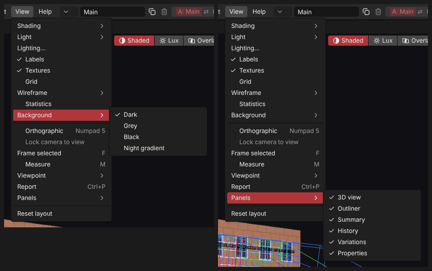
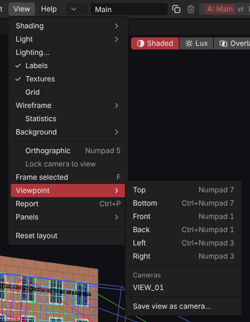
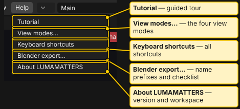
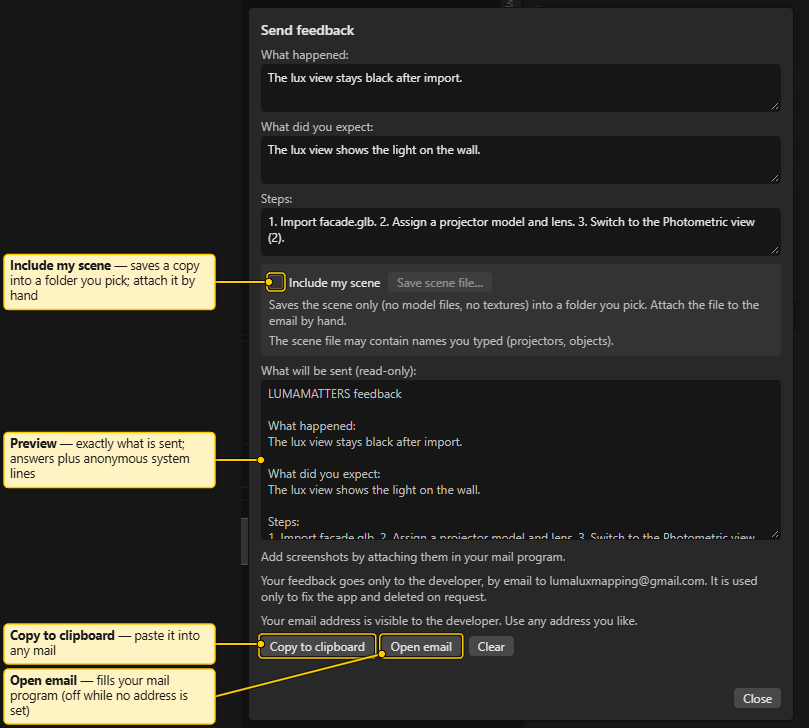
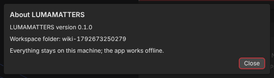

# Menus

The menu bar sits at the top left: **File**, **Edit**, **View**, **Help**. The right column of each table shows the shortcut.

An entry that you cannot use is greyed out. Hover it to see why. All entries are inactive during a drag or a file operation.

## File

| Entry | What it does | Shortcut |
|---|---|---|
| **New…** | Creates a new project. | |
| **Open…** | Opens a project from the workspace. | `Ctrl+O` |
| **Open Recent** | Submenu with the last projects opened on this machine. A "(open)" mark shows the open project. It is greyed out with "No recent projects." when the list is empty. | |
| **New window** | Opens another app window. It also works in a read-only window. | |
| **Save snapshot** | Takes an unnamed snapshot of the current state at once. | `Ctrl+S` |
| **Save snapshot with name…** | Asks for a name, then takes a snapshot. | |
| **Snapshot history** | Opens the **History** tab and puts it in front. | |
| **Save As…** | Asks for a new name, writes the current state into a new project, and opens it. | `Ctrl+Shift+S` |
| **Import** | Submenu: **glTF / GLB…**, **FBX…**, **OBJ…**. Copies a model file into the project. | |
| **Export** | Submenu: **Test-pattern PNGs…**, **Camera images (PNG)…**, **Report…**. | |
| **Share view-only scene…** | Exports the current variation as a page that opens in a web browser. It needs an open project. It also works in a read-only window. See [Share a view-only scene](Share-a-view-only-scene.md). | |
| **Change workspace…** | Picks another workspace folder. | |

Notes:

- **New window** is in the desktop app only.
- **Save snapshot**, **Save snapshot with name…** and the **Import** entries are greyed out in a read-only window. A read-only window is a window whose project is open in another window. The tooltip says: "This window is read-only: the project is open in another window."
- **Export** entries need an open project. **Camera images (PNG)…** also needs at least one visible camera that has a pose. It writes one 3840 × 2160 PNG for each camera.
- The app writes every committed edit to the project file at once. A snapshot is an extra restore point. See [Projects and Snapshots](Projects-and-Snapshots.md).
- More on importing: [Blender Export and Import](Blender-Export-and-Import.md). Test patterns: [Test Patterns](Test-Patterns.md). Report: [Report and PDF](Report-and-PDF.md).
- **New…** has no shortcut. The web engine inside the app keeps `Ctrl+N` for itself.

## Edit

| Entry | What it does | Shortcut |
|---|---|---|
| **Undo** | Undoes the last step. It is greyed out with "Nothing to undo." | `Ctrl+Z` |
| **Redo** | Redoes the last undone step. It is greyed out with "Nothing to redo." | `Ctrl+Shift+Z` (also `Ctrl+Y`) |
| **Duplicate** | Duplicates the selected objects. | `Ctrl+D` |
| **Delete** | Deletes the selected objects. | `Delete` |
| **Aim at point** | Click mode. Aims the selected projectors at the surface point that you click. | |
| **Copy specs from active** | Opens the Copy specs popover in Properties. It copies chosen specs from the active projector to the other selected projectors. | |

**Duplicate** and **Delete** act on the Outliner selection, measurements included. A tooltip gives the reason when they do not apply. With the Report tab in front, Undo and Redo act on report steps.

## View

| Entry | What it does | Shortcut |
|---|---|---|
| **Shading** | Submenu: **Shaded**, **Photometric**, **Overlap**, **Pixel**, **Distance**. | `1`, `2`, `3`, `4`, `5` |
| **Light** | Submenu: **Blended**, **Raw**. Both are greyed out unless the Photometric view is on ("Photometric view only."). | |
| **Lighting…** | Opens the Lighting section of the **Viewport** fold-out. It sets how the 3D view is lit. It needs an open project. | |
| **Labels** | Shows or hides the name labels of projectors, people and cameras. | |
| **Textures** | Shows or hides textures. | |
| **Grid** | Shows or hides the ground grid. | |
| **Object edges** | Submenu: **Off**, **Feature edges**, **All edges**. Before 1.1.0 the setting was called Wireframe. | |
| **Statistics** | Shows or hides the statistics text in the 3D view. | |
| **Background** | Submenu: **Studio gradient**, **Dark**, **Grey**, **Black**, **Night gradient**, **Flat colour**, **Gradient**. | |
| **Orthographic** | Switches between perspective and orthographic. | `Numpad 5` |
| **Lock camera to view** | While you look through a camera, orbit, pan and zoom move that camera. It is greyed out, with a reason, when you cannot use it. | |
| **Frame selected** | Frames the selection. It frames everything when nothing is selected. It needs an open project. | `F` |
| **Measure** | Shows a tick while the Measure tool is on. Click it to turn the tool on (Distance mode) or off (back to Select). It needs an open project. | `M` |
| **Viewpoint** | Submenu. See below. | |
| **Report** | Opens the Report tab. | `Ctrl+P` |
| **Panels** | Submenu with a tick for each panel: **3D view**, **Outliner**, **Summary**, **History**, **Variations**, **Properties**. | |
| **Reset layout** | Puts all panels back in the default places. | |

### Viewpoint submenu

- **Top** (`Numpad 7`), **Bottom** (`Ctrl+Numpad 7`), **Front** (`Numpad 1`), **Back** (`Ctrl+Numpad 1`), **Left** (`Ctrl+Numpad 3`), **Right** (`Numpad 3`).
- **Cameras**: the saved cameras of the project. Click one to look through it. Without cameras, the heading reads "No cameras". A camera without a usable pose is greyed out.
- **Save view as camera…**: asks for a name and stores the current view as a new camera.

The **View** button in the 3D view opens the same list.

## Help

| Entry | What it does |
|---|---|
| **Tutorial** | Starts the Tutorial. It needs an open project. |
| **View modes…** | Explains the five view modes and shows the planning-aid notice. See [View Modes](View-Modes.md). |
| **Keyboard shortcuts** | Lists all shortcuts. See [Keyboard Shortcuts](Keyboard-Shortcuts.md). |
| **Blender export…** | Shows the object-name prefixes and the export checklist for Blender. See [Blender Export and Import](Blender-Export-and-Import.md). |
| **Send feedback…** | Opens the feedback dialog. It works with or without an open project. See [Send feedback](#send-feedback). |
| **About LUMAMATTERS** | Shows the version, licence, third-party notices and what is new. See [About LUMAMATTERS](#about-lumamatters). |

Every Help dialog has a **Close** button. `Esc` closes it too.

### Send feedback

Use **Help > Send feedback…** to report a problem or an idea. The app never sends anything itself. It makes no network call. You see the full text first. You copy it, or you open your mail program with the text already filled in. You press Send in your mail program.

**Your three answers.** The dialog has three text boxes. Write in your own words.

- **What happened:**
- **What did you expect:**
- **Steps:** what you did, step by step.

**Anonymous system lines.** The dialog adds these lines under your answers:

- The app version, with "(beta)" while the app is a beta build.
- The Windows version.
- The number of CPU cores.
- The memory (RAM). The web engine inside the app reports a rounded value, never above 8 GB. The line says so.
- The name of the graphics card.
- The screen size in pixels and the display scaling (pixel ratio).
- With a project open: the number of projectors and the number of visible triangles in the active variation. With no project open: "Scene: no project open".

A value that the system does not report shows as "not shown by the browser".

The text never contains your project name, file paths, Windows user name, machine name, or workspace folder name.

**What will be sent (read-only).** This box shows the exact text. You cannot edit it. **Copy to clipboard** copies this text. **Open email** puts this text into the mail. Read it before you use either button.

**Include my scene.** This tick box is off by default. You can tick it only while a project is open.

1. Tick **Include my scene**.
2. Click **Save scene file…**. A folder picker opens.
3. Pick any folder, for example your Desktop.
4. The app writes one file there. The name is `lumamatters-feedback-<UTC time>.luma`, for example `lumamatters-feedback-20261024T094120Z.luma`.
5. The dialog shows "Saved <name>. Attach it to your email by hand." The preview text gets one more line with the file name.
6. Attach that file to the email yourself, in your mail program. The app cannot attach files.

The file holds the scene only. It holds projectors, objects, variations, cameras and measurements, with their settings and positions. It holds no model files, no textures and no file paths. The project name is replaced by "Feedback scene". The report author lines, picture sources and page layout are left out. Any text that looks like a Windows file path is replaced by `[path removed]`. The file can still contain names that you typed (projectors, objects, variations, notes) and the object names from the model files. The dialog says so under the tick box.

**Buttons.**

| Button | What it does |
|---|---|
| **Copy to clipboard** | Copies the text from the preview. A line under the buttons says "Copied. Paste it into your mail." |
| **Open email** | Opens your mail program with a new mail. The subject is `LUMAMATTERS feedback <version>`, for example `LUMAMATTERS feedback 1.1.0`. The body is the preview text. The mail is not sent until you send it. |
| **Clear** | Empties your three answers, the **Include my scene** tick and the saved-file line. |
| **Close** | Closes the dialog. |

**Mail link length.** A mail link has a size limit. When the whole link is longer than 8000 characters, **Open email** is greyed out. The dialog then says: "Too long for an email link. Use Copy to clipboard and paste into your mail." The app never cuts the text. The limit counts the encoded link. Spaces, line breaks and special characters take three or more characters each. So the text itself can be shorter than 8000 characters. Some mail programs can still cut a long link. The preview shows the full text, and **Copy to clipboard** always works.

**Screenshots.** A mail link cannot carry pictures. The dialog says: "Add screenshots by attaching them in your mail program."

**Your answers are kept.** You can close the dialog with `Esc`, with **Close**, or with a click outside it. Your answers and the tick stay until you restart the app. The app writes nothing to disk. **Clear** empties them at once.

**Anonymity.** The developer can see your email address. Use any address you like.

**Privacy line.** Under the preview the dialog says: "Your feedback goes only to the developer, by email to lumaluxmapping@gmail.com. It is used only to fix the app and deleted on request." The feedback address is `lumaluxmapping@gmail.com`. **Open email** sends the mail to that address.

### About LUMAMATTERS

The dialog shows these items, from top to bottom:

- **LUMAMATTERS version 1.1.0 · Beta.** The version number, with "Beta" while the app is a beta build. Under it, while the app is a beta: "Beta software: may contain errors. Back up your projects."
- The copyright line: "© 2026 LumaLux".
- **Licence (beta)**, three lines:
  - The software is free to download and use during the beta, for private and commercial work.
  - You may modify the software and use your changes yourself.
  - You may not sell the software, modified versions or access to it. You may not bundle it into a paid product.

  Under the three lines: "Full terms: the LICENSE file in the install folder". The dialog also asks you to share the download page, not the installer file. The download page is a link: https://github.com/LMXtinker/LUMAMATTERS-releases/releases. It opens in your web browser.
- A warning box. LUMAMATTERS is a planning aid. Illuminance, throw, occlusion and other numbers are estimates. The box says "To the extent permitted by law" that there is no warranty. It also says there is no liability for rigging, safety or on-site results.
- A trademark and data line. Panasonic, Epson and other product names are trademarks of their owners. The app uses them only to identify compatible products. LUMAMATTERS is not affiliated with these companies and they do not endorse it. Projector data comes from public spec sheets and can contain errors. Projector bodies are generic shapes, not maker models.
- **Third-party notices…**, a button. It opens a scrollable, read-only list of the licences of the libraries and fonts that the app includes. The button then reads **Hide third-party notices**. The same text is in `THIRD_PARTY_NOTICES.txt` in the install folder.
- **Workspace folder:** the name of your workspace folder, or "none".
- "Everything stays on this machine; the app works offline."
- What is new in 1.1.0, 1.0.3, 1.0.2, 1.0.1 and 1.0 (newest first). A note says that a project saved with newer features can use a newer format, and that older builds refuse it. The same notes are on [What's new](Whats-New.md).

See also: [Interface Tour](Interface-Tour.md), [What's new](Whats-New.md), [Keyboard Shortcuts](Keyboard-Shortcuts.md), [Projects and Snapshots](Projects-and-Snapshots.md), [3D View](3D-View.md), [Measure Tools](Measure-Tools.md)
