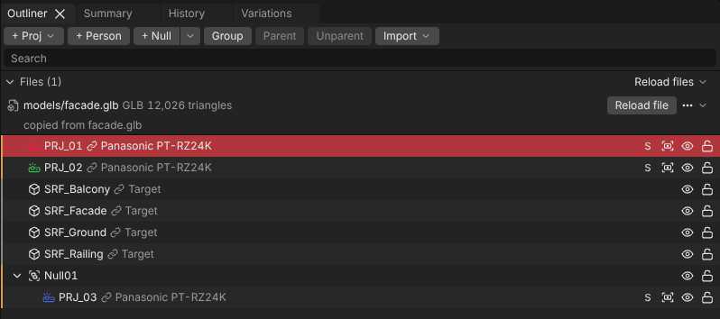
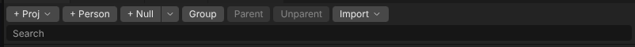
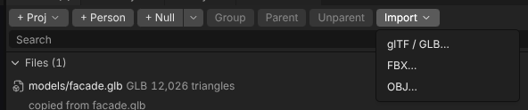
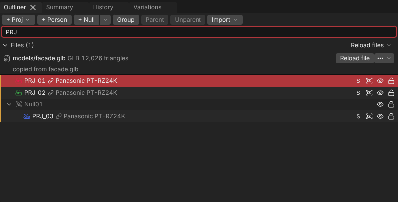
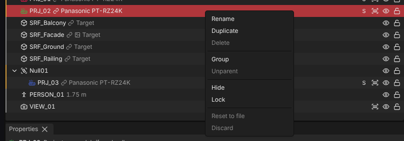
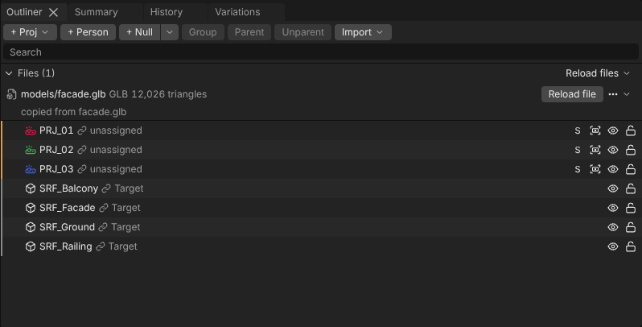
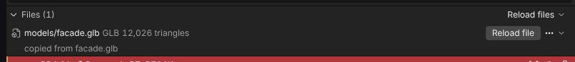
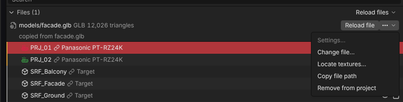
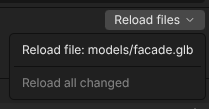

# Outliner

The Outliner is the tree of your project, like the Outliner in Maya. Each object has one row, with children indented under their parent.

## What the rows are

Each row has a type icon, a name and a short second text.

- **Mesh** (a venue surface): second text is its role, **Target**, **Occluder** or **Helper**.
- **Empty** and **null**: transform-only objects that group and move things.
- **Projector**: second text is the maker and model, or `unassigned`. The icon takes the projector's colour.
- **Camera** (a saved view).
- **Person**: second text is the height, for example `1.75 m`.

A thin strip at the left edge of a row shows the layer. Hover it: **Venue: shared by all variations** or **Rig: this variation only**. Venue objects (models, venue nulls) are the same in every variation. Projectors and rig nulls belong to one variation. See [Variations and Compare](Setups-and-Compare.md).

## Toolbar

- **+ Proj** opens the projector picker: choose model, lens and how many. See [Placing Projectors](Placing-Projectors.md).
- **+ Person** adds a 1.75 m person. Click in the 3D view where it stands. `Esc` or a right-click cancels. See [People](People.md).
- **+ Null** adds a null to the rig of the active variation, at the view centre. Its small arrow offers **Venue null (shared by all variations)**.
- **Group** (`Ctrl+G`), **Parent** (`P`) and **Unparent** (`Shift+P`).
- **Import** opens a menu of the three formats (glTF / GLB, FBX, OBJ).
- **Search** filters the tree by name. Rows that do not match are dimmed. `Esc` clears the field.

A toolbar button that does not apply is dimmed, and its tooltip says why. For Parent, select the objects first and the new parent last.

## Selecting

- Click a row to select it. `Ctrl+click` adds or removes a row. `Shift+click` selects a range.
- Selecting in the 3D view selects the same row. The Outliner opens the tree and scrolls to it.
- Click the arrow at the left of a row to expand or collapse it.

## Row buttons

On the right of a row:

- **Solo** (projectors only): shows only this projector. A view setting, not saved as an edit.
- **Look through** (projectors and cameras): the 3D view shows what that projector or camera sees. Click again to leave.
- **Hide / Show** (eye): hides the object. Hidden projectors and surfaces are not in the numbers. Summary shows a "Hidden:" line so numbers never change silently. A tooltip says when it is hidden through a parent.
- **Lock / Unlock**: a locked object cannot be moved or edited. You can still select it in the tree.

## Rename

Press `F2` or double-click the name. `Enter` confirms, `Esc` cancels. The app shows a message for a name it refuses.

## Drag to parent

Drag a row onto another row:

- Middle of a row that can hold children (mesh, empty, null): the dragged object becomes its **child**.
- Top or bottom quarter of a row: it becomes a **sibling** before or after that row.
- Projectors and cameras cannot have children. On them, the top half means "before" and the bottom half "after".
- Drop in empty space to move the object to the scene root.
- Dragging a selected row moves the whole selection. Hover a collapsed row briefly to open it. The list scrolls near its edge. `Esc` cancels.

A line shows where the object lands. The app shows the reason when a drop is not allowed. One drop is one undo step.

## Right-click menu

**Rename**, **Duplicate**, **Delete**, **Group**, **Unparent**, **Hide** (or **Show**), **Lock** (or **Unlock**), **Reset to file**, **Discard**. An entry that does not apply is greyed out with a reason.

- **Reset to file** puts the placement back to what the model file holds.
- **Discard** removes objects that the model file no longer holds (orphans).
- On a model file row, **Copy file path** copies the path of the model's copy in the project.

## Badges and flags

Red badges mean the object is not in the numbers or not in its file. Amber means it is in the numbers with a caveat. Grey is information.

- `orphan`: the model file no longer has this object.
- `not in file`: the loaded file lacks this mesh.
- Projector badges name why it is not analysed, for example `unassigned`, `no lens`, `model missing`, `lens missing`, `hidden`, `mirrored camera`, `not analysed: unsupported lens`, `over the 16-projector limit`.
- Amber: zoom out of range, shift out of range, lens inside another projector's body.
- Grey: body model fallback.

Small icons on a model's root row:

- A chain or file icon shows the source file and key.
- **not in git**: the model copy is over 100 MB and kept out of git; the tooltip explains. Other machines need their own copy. See [Several Machines](Several-Machines.md).
- Texture icons: texture missing, texture not supported, texture file not in git, loaded texture. See [Textures](Textures.md).

## Files section

The collapsible **Files** section at the top lists the model files of the project. With none it says "No model files imported" and offers **Import**.

- Each file row has **Reload file** (reads the file again and compares it with the project) and an actions menu: **Settings…** (unit and axes; not for glTF), **Change file…**, **Locate textures…**, **Remove from project**.
- Badges on a file row can show it is missing, **changed** on disk, or not in git.
- **Reload files ▾** lists every file and **Reload all changed**.
- Reload is manual. Your edits are kept by default, and a report offers to keep yours or take the file's.

An empty project shows a hint: use **File > Import**, drop a model file on the Outliner, or add projectors with **+ Proj**. See [Blender Export and Import](Blender-Export-and-Import.md).

## Keys

`Ctrl+G` group, `P` parent, `Shift+P` unparent, `Delete` delete, `Ctrl+D` duplicate, `F2` rename. They work when the focus is in the Outliner or 3D view. See [Keyboard Shortcuts](Keyboard-Shortcuts.md).

See also: [Properties](Properties.md), [Placing Projectors](Placing-Projectors.md), [Blender Export and Import](Blender-Export-and-Import.md), [3D View](3D-View.md)
