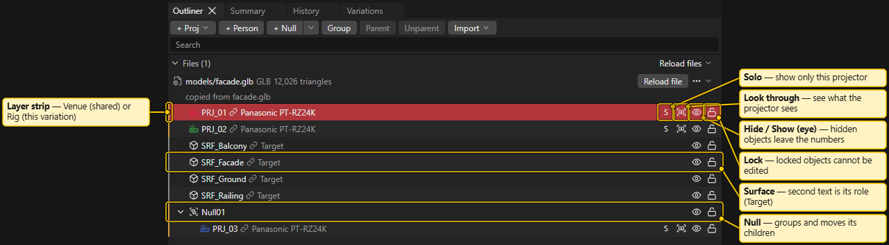
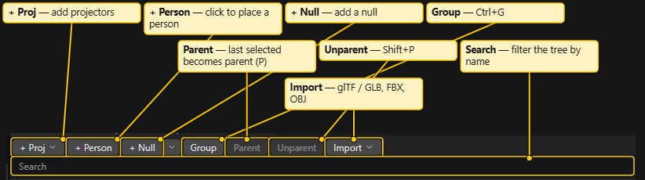
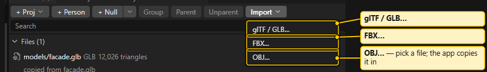
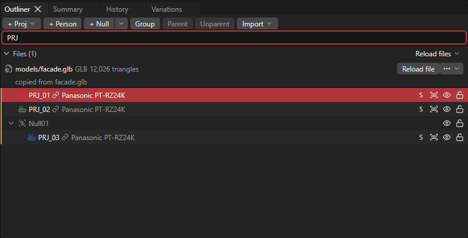
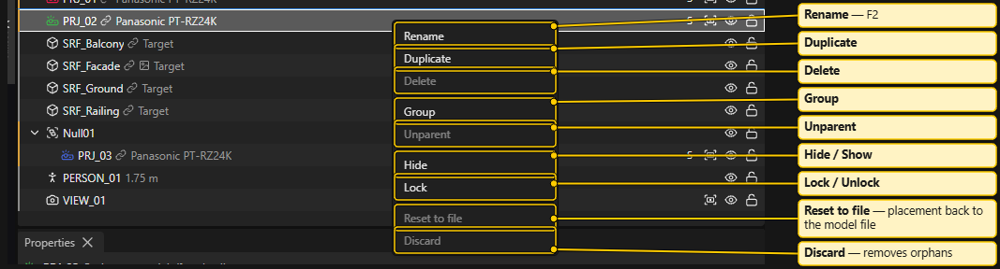
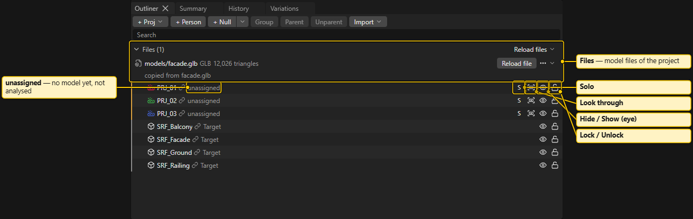
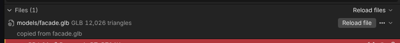
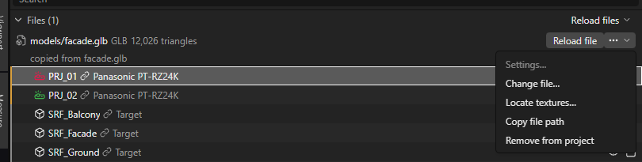
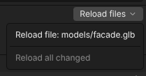
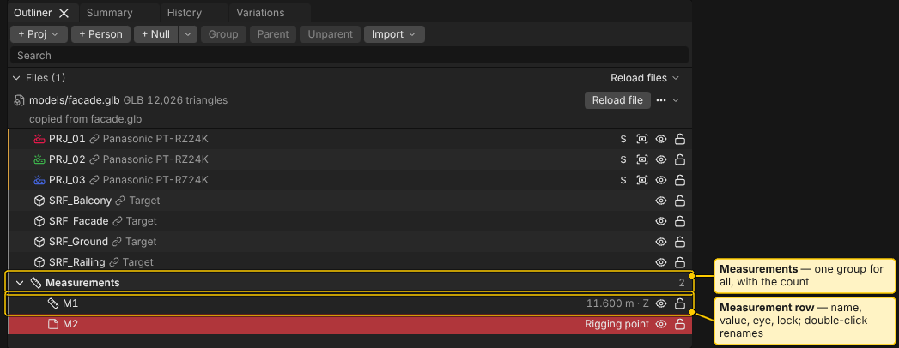

# Outliner

The Outliner is the tree of your project, like the Outliner in Maya. Each object has one row. A child row is indented under its parent.

## What the rows are

Each row has a type icon, a name and a short second text.

- **Mesh** (a venue surface): the second text is its role, **Target**, **Occluder** or **Helper**.
- **Empty** and **null**: objects with a transform only. They group things and move them.
- **Projector**: the second text is the maker and model, or `unassigned`. The icon takes the colour of the projector.
- **Camera** (a saved camera).
- **Person**: the second text is the height, for example `1.75 m`.
- **Measurements**: a group after the other rows, when the project has measurements. It has one row for each measurement or note. See [Measure Tools](Measure-Tools.md).

A thin strip at the left edge of a row shows the layer. Hover the strip. The tooltip says **Venue: shared by all variations** or **Rig: this variation only**. Venue objects (models and venue nulls) are the same in every variation. Projectors and rig nulls belong to one variation. See [Variations and Compare](Setups-and-Compare.md).

A name must be unique among all objects that are visible together. The maximum length of a name is 64 characters.

## Toolbar

- **+ Proj** opens the projector picker. Choose the model, the lens and how many. See [Placing Projectors](Placing-Projectors.md).
- **+ Person** adds a person of 1.75 m. Click in the 3D view where the person stands. `Esc` or a right-click cancels. See [People](People.md).
- **+ Null** adds a null to the rig of the active variation, at the centre of the view. Its small arrow offers **Venue null (shared by all variations)**.
- **Group** (`Ctrl+G`) puts the selection in a new null.
- **Parent** (`P`) makes the last selected object the parent of the other selected objects.
- **Unparent** (`Shift+P`) moves the selected objects to the scene root.
- **Import** opens a menu of the three formats: **glTF / GLB…**, **FBX…** and **OBJ…**. Choose a file from any folder. The app copies it into the project.
- **Search** filters the tree by name. The match ignores upper and lower case. Rows that do not match are dimmed. `Esc` clears the field when the focus is in the Outliner. If no object matches, the Outliner says `No object matches "<text>".`

A toolbar button that does not apply is dimmed. Its tooltip says why. For **Parent**, select the children first and the new parent last. The toolbar is inactive while you drag a gizmo or a number field.

## Selecting

- Click a row to select it.
- `Ctrl+click` adds a row to the selection, or removes it.
- `Shift+click` selects a range. `Shift+Ctrl+click` adds a range.
- When you select an object in the 3D view, the Outliner selects the same row. It opens the tree and scrolls to the row.
- Click the arrow at the left of a row to expand or collapse it.

## Row buttons

These buttons are on the right of a row:

- **Solo** (projectors only): shows only this projector. This is a view setting. It is not an edit.
- **Look through** (projectors and cameras): the 3D view shows what that projector or camera sees. Click again to leave. This also works in a read-only window.
- **Hide / Show** (eye): hides the object. The numbers do not include hidden projectors and surfaces. Summary shows a "Hidden:" line, so the numbers never change silently. A tooltip says when an object is hidden through a parent.
- **Lock / Unlock**: a locked object cannot be moved or edited. You can still select it. A lock from a parent shows faint, with the tooltip "Locked through a parent".

## Rename

Press `F2` or double-click the name. Press `Enter` to confirm. Press `Esc` to cancel. A locked object cannot be renamed. The app shows a message for a name that it refuses.

## Drag to parent

Drag a row onto another row. The place where you drop decides the result:

- Middle of a row that can hold children (mesh, empty, null): the dragged object becomes a **child**.
- Top or bottom quarter of that row: the dragged object becomes a **sibling** before or after the row.
- Projectors and cameras cannot have children. On these rows, the top half means "before" and the bottom half means "after".
- Below the last row, in empty space: the object moves to the scene root.

More details:

- Dragging a selected row moves the whole selection.
- Hover a collapsed row for a short time to open it.
- The list scrolls when you drag near its edge.
- `Esc` cancels the drag.

A line shows where the object lands. When a drop is not allowed, the cursor changes and the app shows the reason. A drop that changes nothing is ignored. One drop is one undo step. Drag and drop, the toolbar and the keys `P` and `Shift+P` use the same rules. A locked object refuses a move in all of them.

## Right-click menu

Right-click a row. If the row is not selected, the app selects it alone first. If the row is selected, the menu acts on the whole selection.

The entries are **Rename**, **Duplicate**, **Delete**, **Group**, **Unparent**, **Hide** (or **Show**), **Lock** (or **Unlock**), **Reset to file** and **Discard**. An entry that does not apply is greyed out. The tooltip gives the reason.

- **Duplicate** selects the copies afterwards.
- **Reset to file** puts the placement back to what the model file holds. It is on only when the object differs from its model file.
- **Discard** removes objects that the model file no longer holds (orphans).
- On the root row of a model file, **Copy file path** copies the path of the model copy in the project.

## Badges and flags

A red badge means the object is not in the numbers, or not in its file. An amber badge means the object is in the numbers, with a caveat. A grey badge is information.

- `orphan`: the model file no longer has this object.
- `not in file`: the loaded file does not have this mesh.
- A red badge on a projector names the reason why the app does not analyse it. Examples are `unassigned`, `no lens`, `model missing`, `lens missing`, `hidden`, `mirrored camera`, `not analysed: unsupported lens` or `over the 16-projector limit`.
- Amber: zoom out of range, lens shift out of range, or the lens is inside the body of another projector.
- Grey: the body model falls back to a generic shape.

Small icons on the root row of a model show the source of the file and its state:

- A chain or file icon shows the source file and key.
- **not in git**: the model copy is over 100 MB, so git ignores it. The tooltip explains this. Other machines need their own copy. See [Several Machines](Several-Machines.md).
- Texture icons: texture missing, texture not supported, texture file not in git, and loaded texture. See [Textures](Textures.md).

## Files section

The **Files** section at the top lists the model files of the project. Click its header to fold it. The header shows the number of files. With no files, it says "No model files imported" and offers **Import**.

Each file row shows the file name, the format (GLB, FBX or OBJ), the number of triangles, the **Reload file** button and an actions menu.

- **Reload file** reads the file again and compares it with the project.
- The actions menu has **Settings…** (unit and up axis; dimmed for glTF), **Change file…**, **Locate textures…**, **Copy file path** and **Remove from project**.
- Badges on a file row show that the file is missing from the project folder, **changed** on disk, or not in git. They can also show a source change or a texture problem.
- **Reload files** lists every file as **Reload file: <path>**, with changed files first. It also has **Reload all changed**, which is dimmed when no file changed.

Reload is manual. The app keeps your edits by default. A report offers to keep your version or to take the version from the file.

An empty project shows a hint. Use **File > Import**, drop a model file on the Outliner, or add projectors with **+ Proj**. See [Blender Export and Import](Blender-Export-and-Import.md).

## Measurements group

When the project has measurements, the **Measurements** group ends the list. It shows a ruler icon and the number of measurements. Click its header to fold it. You cannot select the header. While a search runs, the group stays open.

Each row has a ruler or note icon, the name, the value (for example `11.600 m · Z`), an eye and a lock. A locked measurement refuses the eye, edits and deletion. An amber **check** badge means that the position needs a look after a reload. The tooltip gives the reason. Search filters these rows too. When you select a measurement in the 3D view, the group opens.

The right-click menu of a measurement has **Rename**, **Duplicate**, **Delete**, **Hide** or **Show**, and **Lock** or **Unlock**. **Group**, **Unparent**, **Reset to file** and **Discard** are greyed out, because measurements are not part of the scene tree.

## Keys

These keys work when the focus is in the Outliner or the 3D view: `Ctrl+G` group, `P` parent, `Shift+P` unparent, `Delete` delete, `Ctrl+D` duplicate, `F2` rename. See [Keyboard Shortcuts](Keyboard-Shortcuts.md).

See also: [Measure Tools](Measure-Tools.md), [Properties](Properties.md), [Placing Projectors](Placing-Projectors.md), [Blender Export and Import](Blender-Export-and-Import.md), [3D View](3D-View.md)
