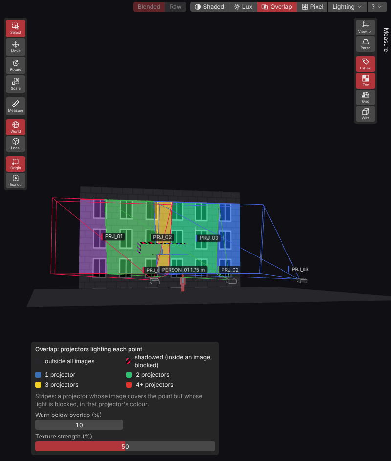
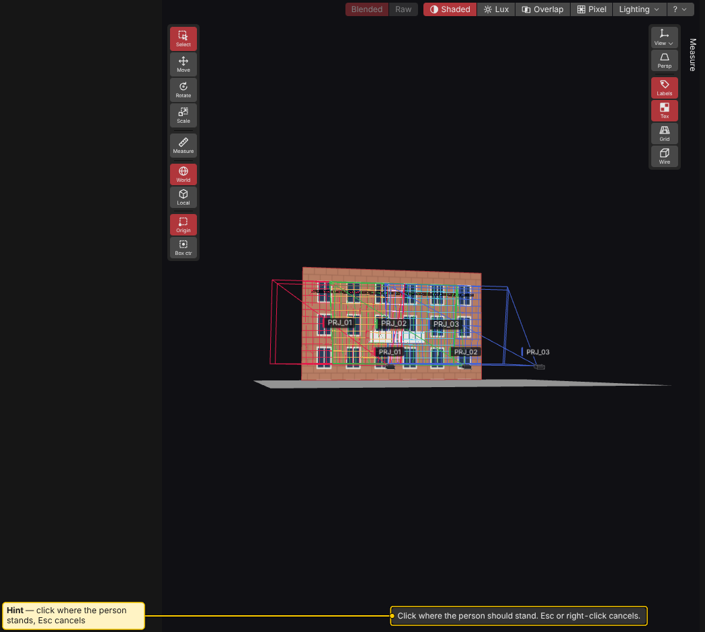
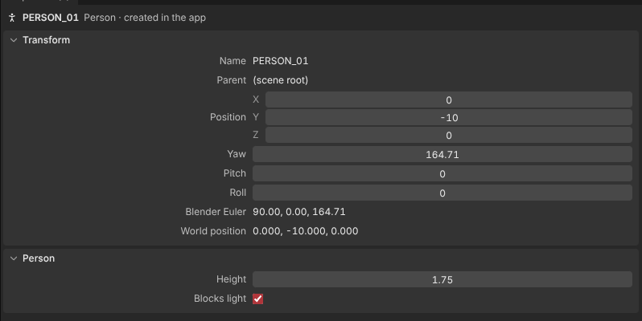

# People

A person is a standing figure in the venue. Use it to check scale and shadows of an audience.

## What a person is for

- **Scale.** A person is 1.75 m tall by default. You can judge screen height, throw distance and head room at a glance.
- **Shadows.** By default, a person **blocks light**. It casts a shadow on the venue. Illuminance, overlap, pixel size and metrics change where the person stands. Use this to check what an audience member, a presenter or a technician does to your image.

A person only blocks light. It is never a projection target. It gets no illuminance reading and does not count as a surface.

## Adding a person in the app

1. In the Outliner toolbar, click **+ Person**.
2. A hint appears over the 3D view: "Click where the person should stand. Esc or right-click cancels."
3. Click in the 3D view.

The person stands on the floor or the stage under your click. It turns towards your camera. If you click a wall or a ceiling, the person goes to the floor in front of the wall or under the ceiling. If nothing is there to stand on, the app says so and waits for another click.

The new person is selected. Adding a person is one undo step. A person is part of the venue, so all variations share it.

## Moving and editing

- Move and turn a person with the gizmo and the **Transform** fields, like any object. The scale is fixed. **Height** sets the size.
- Select a person and open the **Person** section in **Properties**:
  - **Height** (m): 0.50 to 2.50 m. The Value Ladder works as in other number fields.
  - **Blocks light**: on by default. Turn it off for a figure that is for display only. It then casts no shadow and changes no numbers.
- With several people selected, a field shows the common value or a dash. A change applies to all of them.
- You can hide a person (the eye in the Outliner), lock it, put it under a venue null, duplicate it (`Ctrl+D`) and delete it.
- A hidden person casts no shadow.
- A locked person is frozen. **Height** and **Blocks light** are greyed out, and the section says why.
- Box select includes people.

The names of people show in the 3D view when **View > Labels** is on.

## Importing people from Blender

Name an empty `PERSON_<anything>` in Blender. On import (glTF / GLB or FBX), it becomes a person:

- The position and the turn about the up axis come from the file. The scale is dropped. The figure stands upright.
- **Height** is 1.75 m and **Blocks light** is on.
- **Height** and **Blocks light** are app edits. A reload keeps them. The position follows the normal reload rule (keep mine by default).
- OBJ files hold meshes only. People need glTF or FBX.

See [Blender Export and Import](Blender-Export-and-Import.md) for all name prefixes.

## In the report

**Report setup** has a **Show people** checkbox. With it off, report pictures do not draw people. People with **Blocks light** on still cast shadows in the numbers and in the lit image. The numbers never depend on a display switch. See [Report and PDF](Report-and-PDF.md).

See also: [Outliner](Outliner.md), [Properties](Properties.md), [Blender Export and Import](Blender-Export-and-Import.md), [Analysis](Analysis.md)
