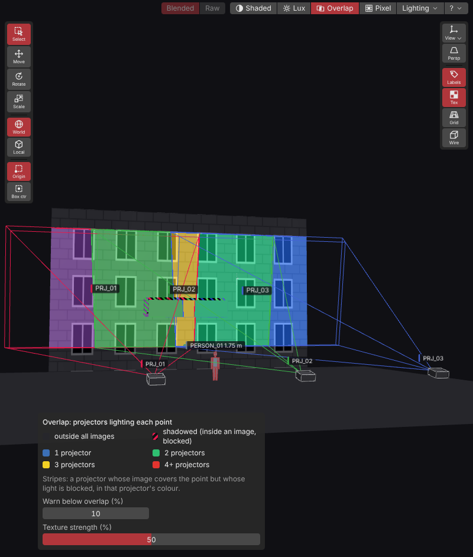
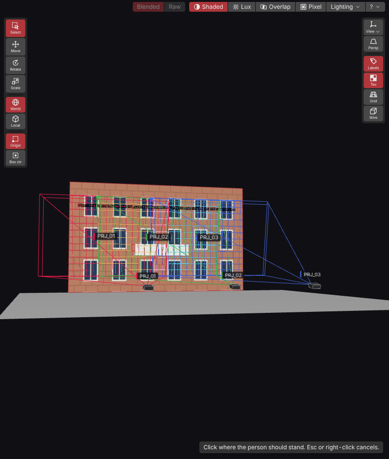
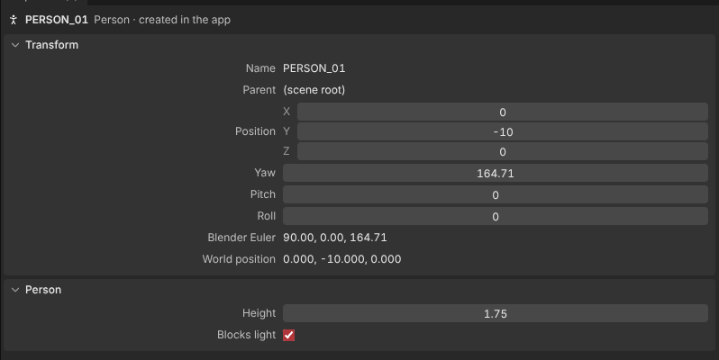

# People

A person is a standing figure in the venue. Use it to check scale and audience shadows.

## What a person is for

- **Scale.** A person is 1.75 m tall by default. Judge screen height, throw distance and head room at a glance.
- **Shadows.** By default a person **blocks light**. It casts a shadow on the venue, so lux, overlap, pixel size and metrics change where it stands. Check what an audience member, presenter or technician does to your image.

A person blocks light only. It is never a projection target, gets no lux reading and does not count as a surface.

## Adding a person in the app

1. In the Outliner toolbar, press **+ Person**.
2. A hint appears over the 3D view: "Click where the person should stand. Esc or right-click cancels."
3. Click in the 3D view. The person stands on the floor or stage under your click, turned towards your camera. If you click a wall or ceiling, the person goes to the floor in front of or under it.
4. If nothing is there to stand on, the app says so and waits for another click.

The new person is selected. Adding one is one undo step. A person is part of the venue, so all variations share it.

## Moving and editing

- Move and turn a person with the gizmo and the Transform fields, like any object. Scale is fixed. **Height** sets the size.
- Select a person and open the **Person** section in Properties:
  - **Height** (m): 0.50 to 2.50 m. Value Ladder works as in other number fields.
  - **Blocks light**: on by default. Turn it off for a display-only figure that casts no shadow and changes no numbers.
- With several people selected, a field shows the common value or a dash. A change applies to all of them.
- You can hide a person (eye in the Outliner), lock it, put it under a venue null, duplicate it (`Ctrl+D`) and delete it. A hidden person does not cast a shadow (owner: check).
- A locked person is frozen. Height and Blocks light are greyed out, and the section says why.
- Box select includes people.

Names of people show in the 3D view when **View > Labels** is on.

## Importing people from Blender

Name an empty `PERSON_<anything>` in Blender. On import (glTF / GLB or FBX) it becomes a person:

- Position and turn about the up axis come from the file. Scale is dropped. The figure stands upright.
- Height is 1.75 m and Blocks light is on.
- Height and Blocks light are app edits. Reload keeps them. Position follows the normal reload rule (keep mine by default).
- OBJ files hold meshes only, so people need glTF or FBX.

See [Blender Export and Import](Blender-Export-and-Import.md) for all name prefixes.

## In the report

**Report setup** has a **Show people** checkbox. With it off, report pictures do not draw people. People with **Blocks light** on still cast shadows in the numbers and in the lit image. Numbers never depend on a display switch. See [Report and PDF](Report-and-PDF.md).

See also: [Outliner](Outliner.md), [Properties](Properties.md), [Blender Export and Import](Blender-Export-and-Import.md), [Analysis](Analysis.md)
