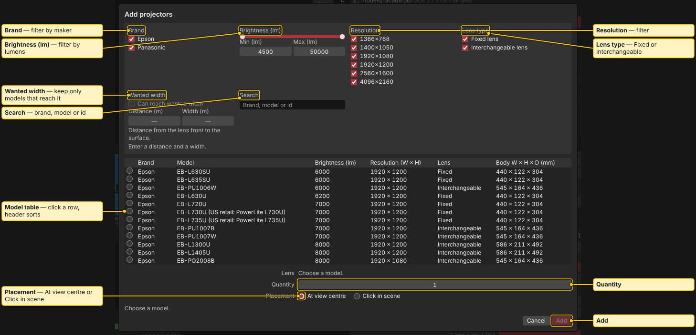
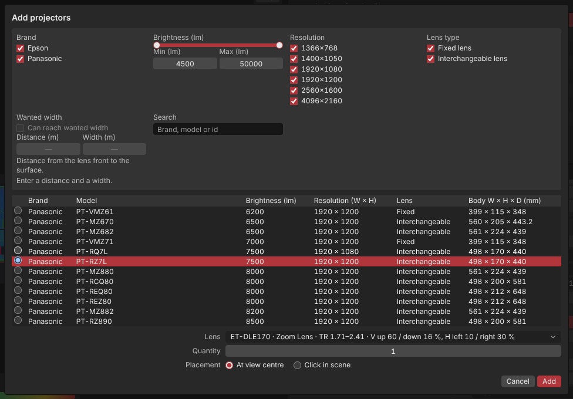
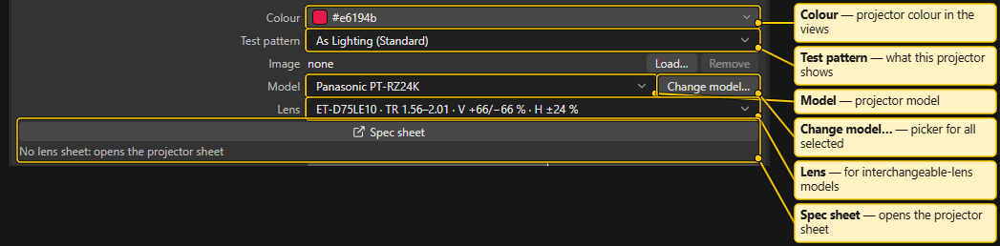
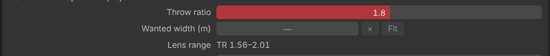
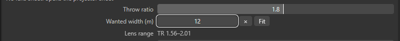
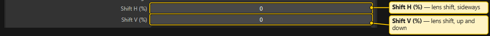
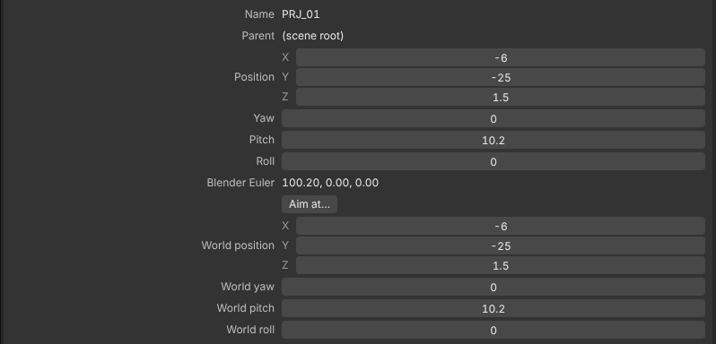
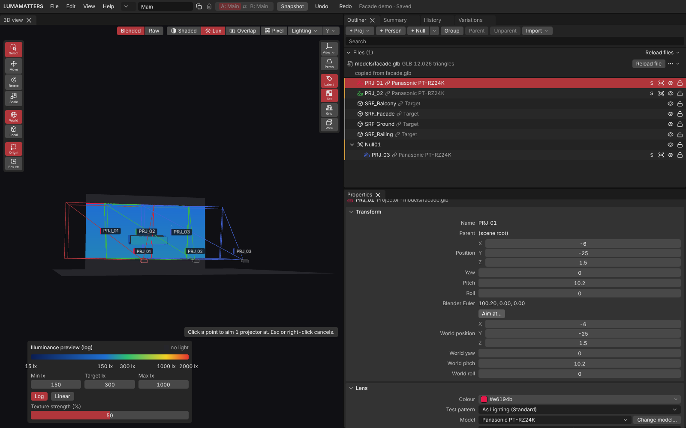
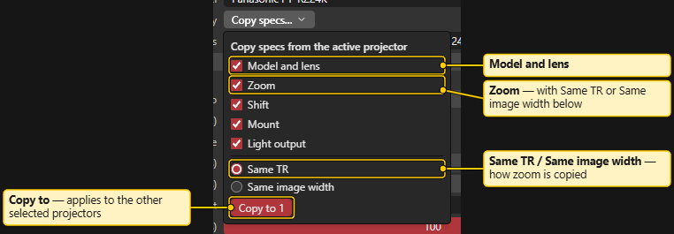
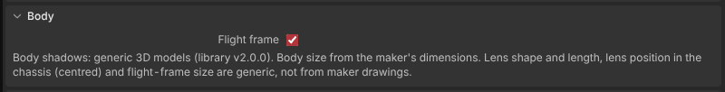

# Placing Projectors

> **Planning aid.** LUMAMATTERS is a planning aid. Its numbers (lux, pixel size, throw distance, overlap) come from maker data and simplified models and can be wrong. No guarantee of correct data is given. Check critical values against the maker's spec sheets and on site.

Add projectors in the app, choose a lens, set zoom and shift, and place and aim them. You do not need `PRJ_` cameras from Blender (see [Blender Export and Import](Blender-Export-and-Import.md) if you prefer them).

## Add projectors with + Proj

Press **+ Proj** in the [Outliner](Outliner.md) toolbar. The **Add projectors** dialog opens.

1. **Filter the list.** Filter by **Brand**, **Brightness (lm)**, **Resolution**, **Lens type** (**Fixed lens** or **Interchangeable lens**) or by search text (brand, model or id).
2. **Check reach (optional).** Tick **Can reach wanted width**, then enter a **Distance (m)** (from the lens front to the surface) and a **Width (m)**. Only models and lenses that can fill that width stay in the list.
3. **Pick a model.** Click a row. Click a column header to sort. A greyed row cannot be added. Hover to see why.
4. **Choose a lens.** A fixed-lens model shows its lens. For an interchangeable-lens model, pick from the **Lens** list. Lenses that do not fit show a reason.
5. **Set Quantity.**
6. **Choose Placement.** **At view centre** drops the projectors where the 3D view looks. **Click in scene** lets you click a point in the 3D view. Esc or a right-click cancels.
7. Press **Add**.

Projector data comes from maker spec sheets (Panasonic and Epson). See [Projector Database](Projector-Database.md).

### How many projectors

- Up to 8 projectors run at full speed.
- From 9 up to 16, the dialog warns that the view gets slower and preview shadows get lower resolution. The 3D view header shows a standing notice: "9-16 projectors: the live view may be slow".
- More than 16 in one variation is refused. The dialog says how many more fit.

Speed depends on your graphics card. These limits were set on an RTX 5080 laptop GPU.

## Lens, zoom and shift

Select the projector and open **Properties**.

- **Model** and **Change model…** swap the model. **Change model…** opens the same picker for all selected projectors.
- **Lens** picks the lens for interchangeable-lens models. If the selected projectors have different lenses, zoom and shift are not shown.
- **Throw ratio** is the zoom. It is the maker throw ratio, as on the spec sheet. The **Lens range** line under it shows the lowest and highest ratio the lens allows. Zoom is optical only.
- **Wanted width (m)** and **Fit** set the zoom so the image has your width at the current aim distance. The **×** button clears the wanted width.
- **Shift H (%)** and **Shift V (%)** are lens shift. The lens limits the range (owner: check how the field reacts to a value outside it).
- **Mount** is **Floor** or **Ceiling**.
- **Light output (%)** dims the projector.
- **Flight frame** toggles the flight-frame model on the projector body.
- **Look through** shows the 3D view as the projector sees it. Press it again to leave. It changes only the view.

Below the fields, readouts show **Aim distance**, **Aims at** (which surface), **Throw distance (maker)**, **Throw ratio (centre)**, **Image W × H**, **Centre** (lux at the image centre), **Pixel** and **Φ_eff** (effective lumens). If a projector is not analysed, the reason shows here.

## Position and aim

The projection centre is the lens, not the body.

- Use the **Move** (`W`) and **Rotate** (`E`) tools in the 3D view, or type values in **Properties > Transform** (**Position** and **Rotation**). Numbers use Blender's axes (Z up) and metres.
- **Snapping.** Turn on the **magnet** in the top strip of the 3D view to snap a Move to the corners and edges of the venue and to a step (default 0.1 m), and a Rotate to 5° steps. With the magnet on, hold `Ctrl` to move freely; with it off, `Ctrl` snaps. The step sizes are in the small arrow next to the magnet. A projector never snaps to its own lens. See [3D View](3D-View.md#snapping-magnet).
- **Aim at point** points selected projectors at a surface point. Use **Edit > Aim at point** or the **Aim at…** button under **Rotation** in Properties. A hint appears: "Click a point to aim n projector(s) at. Esc or right-click cancels." Click once on a surface.
  - Only yaw and pitch change. Roll, mount and portrait orientation are kept.
  - A projector that cannot reach the point (for example the point is at the lens, or straight below with horizontal shift) stays unchanged. A message names it.
  - One undo reverts all aimed projectors.

## Copy specs from active

Select two or more projectors. The last one selected is the active one. Use **Edit > Copy specs from active** or the **Copy specs** button in Properties. Choose what to copy:

- **Model and lens**, **Zoom**, **Shift**, **Mount**, **Light output**.
- Zoom copies as **Same TR** or **Same image width**.

Colour, name and wanted width are never copied. A value that does not fit a target projector's lens is clamped, and a message says so.

## Duplicate and nulls

- **Edit > Duplicate** or `Ctrl+D` duplicates the selection.
- **+ Null** adds a null (an empty object) to the current variation's rig, at the view centre. Use nulls to hold projectors, for example a truss. Projectors follow when you move the null.
- The arrow next to **+ Null** offers **Venue null (shared by all variations)**.
- **Group**, **Parent** (`P`) and **Unparent** (`Shift+P`) work on the selection. The last selected object becomes the parent.

## Bodies, shadows and frustum

- Projector bodies are generic 3D models, sized from the maker's dimensions. Lens position is a generic centred guess. Projection centre and lens numbers still come from the database.
- In **Summary > Metrics**, the checkbox **Projector bodies cast shadows** is the one global switch for body shadows. If the projection centre lies inside another projector's body while shadows are on, that projector lights nothing. The reason is shown.
- Each projector draws a frustum in the 3D view: lines from the lens to a rectangle at the farthest surface it hits, plus a thin outline at the nearest. People and projector bodies that block light cut the lines. With no surface hit, the lines end at the aim distance (dashed) or at 5 m.
- **View > Labels** shows projector names in the 3D view.

## See also

[Analysis](Analysis.md), [Properties](Properties.md), [Projector Database](Projector-Database.md), [Variations and Compare](Setups-and-Compare.md)
