# Placing Projectors

> **Planning aid.** LUMAMATTERS is a planning aid. Its numbers (illuminance, pixel size, throw distance, overlap) come from maker data and simplified models. They can be wrong. No guarantee of correct data is given. Check critical values against the maker's spec sheets and on site.

Add projectors in the app, choose a lens, set the zoom and the lens shift, and place and aim the projectors. You do not need `PRJ_` cameras from Blender. If you prefer them, see [Blender Export and Import](Blender-Export-and-Import.md).

## Add projectors with + Proj

1. Click **+ Proj** in the [Outliner](Outliner.md) toolbar. The **Add projectors** dialog opens.
2. Set the filters and choose a model and a lens, as described below.
3. Click **Add**.

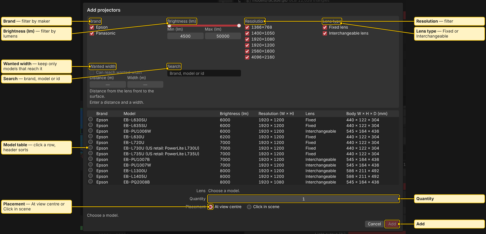

In the dialog:

1. **Filter the list.** Use **Brand**, **Brightness (lm)**, **Resolution** or **Lens type** (**Fixed lens** or **Interchangeable lens**). You can also type search text (brand, model or id). The dialog remembers the filters for the session.
2. **Check the reach (optional).** Tick **Can reach wanted width**. Enter a **Distance (m)** from the lens front to the surface. Enter a **Width (m)**. Only models and lenses that can fill that width stay in the list.
3. **Pick a model.** Click a row. Click a column header to sort. A grey row cannot be added. Hover over it to see why.
4. **Choose a lens.** A fixed-lens model shows its lens. For an interchangeable-lens model, pick a lens from the **Lens** list. A lens that does not fit shows a reason.
5. **Set Quantity.** The value is 1 to 16.
6. **Choose Placement.** **At view centre** puts the projectors where the 3D view looks. **Click in scene** lets you click a point on a surface in the 3D view. `Esc` or a right-click cancels.
7. Click **Add**.

New projectors get the names `P01`, `P02` and so on. The zoom starts at the middle of the lens throw range. The lens shift starts at 0. The mount is **Floor**. **Light output (%)** starts at 100.

Projector data comes from maker spec sheets (Panasonic and Epson). See [Projector Database](Projector-Database.md).

### How many projectors

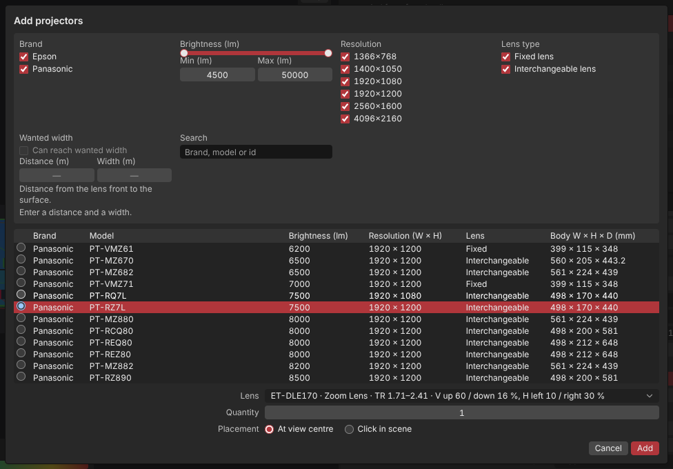

- Up to 8 projectors run at full speed.
- With 9 to 16 projectors, the dialog warns that the view gets slower and that preview shadows get a lower resolution. The 3D view header also shows a notice: "9-16 projectors: the live view may be slow".
- The app refuses more than 16 projectors in one variation. The dialog says how many more fit.

Speed depends on your graphics card. The limits were set on an RTX 5080 laptop GPU.

## Lens, zoom and shift

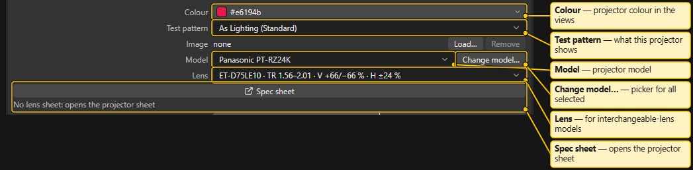

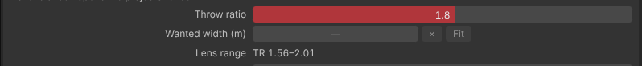

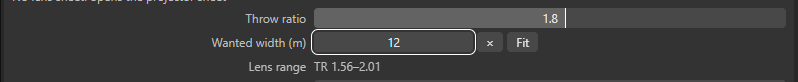

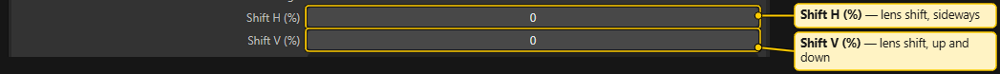

Select the projector and open **Properties**. The fields are:

- **Model** and **Change model…**: swap the model. **Change model…** opens the same picker for all selected projectors.
- **Lens**: picks the lens of an interchangeable-lens model. A **✓** mark shows that the lens reaches the wanted width.
- **Throw ratio**: the zoom. It is the maker throw ratio, as on the spec sheet. The **Lens range** line under it shows the lowest and the highest ratio of the lens. Zoom is optical only.
- **Wanted width (m)** and **Fit**: set the zoom so that the image has your width at the current aim distance. The **×** button clears the wanted width.
- **Shift H (%)** and **Shift V (%)**: the lens shift. The lens limits the range. A drag in the field stops at the limit.
- **Mount**: **Floor** or **Ceiling**.
- **Light output (%)**: dims the projector. The range is 1 to 100.
- **Look through**: shows the 3D view as the projector sees it. Click it again to leave. It changes only the view.
- **Spec sheet**: opens the lens sheet, or the projector sheet if the lens sheet is not known.

If the selected projectors have different models or lenses, Properties does not show zoom and shift. Select projectors with the same model and lens to change them together.

**Light output (%)** lowers the rated lumens of the projector. At 50 %, the analysis uses half of the rated lumens. The setting changes the analysis numbers. See [Analysis](Analysis.md).

Below the fields, the **Readouts** section shows these values:

- **Aim distance**
- **Aims at** (which surface)
- **Throw distance (maker)**
- **Throw ratio (centre)**
- **Image W × H**
- **Centre** (illuminance at the image centre, in lx)
- **Pixel**
- **Φ_eff** (effective lumens)

If the analysis does not include a projector, the reason shows here.

## Position and aim

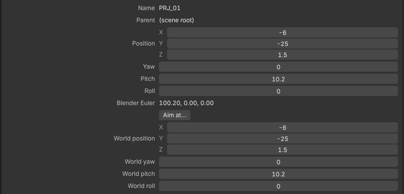

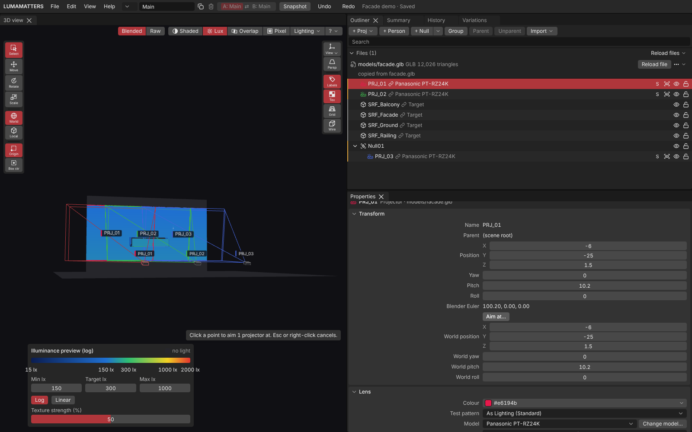

The projection centre is the lens, not the body.

- Use the **Move** (`W`) and **Rotate** (`E`) tools in the 3D view. You can also type values in **Properties > Transform** (**Position** and **Rotation**). Numbers use the axes of Blender (Z up) and metres.
- **Snapping.** Switch on the **Magnet** in the top strip of the 3D view. A Move then snaps to the corners and edges of the venue and to a step. The default Move step is 0.1 m. A Rotate snaps to steps of 5°. With the magnet on, hold `Ctrl` to move freely. With the magnet off, `Ctrl` snaps. The small arrow next to the magnet sets the step sizes. A projector never snaps to its own lens. See [3D View](3D-View.md#snapping-magnet).
- **Aim at point.** This command points the selected projectors at a point on a surface. Choose **Edit > Aim at point**, or click **Aim at…** under **Rotation** in Properties. A hint appears: "Click a point to aim n projector(s) at. Esc or right-click cancels." Click once on a surface.
  - Only yaw and pitch change. Roll, mount and portrait orientation stay the same.
  - A projector that cannot reach the point stays unchanged, and a message names it. An example is a point at the lens, or straight below the projector when the lens shift is horizontal.
  - One undo reverts all aimed projectors.

## Copy specs from active

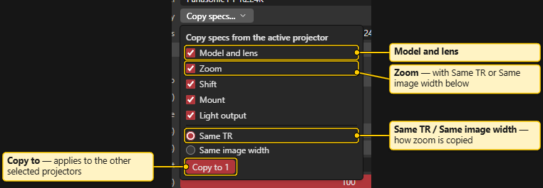

Select two or more projectors. The last projector you select is the active one. Choose **Edit > Copy specs from active**, or click **Copy specs** in Properties. Then choose what to copy:

- **Model and lens**, **Zoom**, **Shift**, **Mount** and **Light output**.
- Zoom copies as **Same TR** or **Same image width**.

The app never copies colour, name or wanted width. If a value does not fit the lens of a target projector, the app limits it to the lens range and shows a message. One undo reverts the copy.

## Test pattern and projector image

Each projector draws an image on the surfaces. By default this image is a test pattern. The project sets the kind of test pattern. A projector can use its own kind.

- **Test pattern** (in Properties): choose **As Lighting**, **Standard**, **Gradient grid** or **Checker** for the selected projectors.
- **Image** (in Properties): click **Load…** to show your own picture instead of the test pattern. Click **Remove** to go back to the test pattern. The row shows the file name, "none" or "Mixed".
- To see the images in every view mode, switch on **Images** in the **Beams** section of the Viewport fold-out. The Shaded view always shows them.

A projector image makes the project format version 5.0. The app stretches the picture to the image of the projector. The picture does not change the analysis numbers. See [Test Patterns](Test-Patterns.md).

## Duplicate and nulls

- Choose **Edit > Duplicate** or press `Ctrl+D` to duplicate the selection.
- Click **+ Null** to add a null (an empty object) to the rig of the current variation, at the view centre. Use nulls to hold projectors, for example a truss. The projectors follow when you move the null.
- The arrow next to **+ Null** offers **Venue null (shared by all variations)**.
- **Group**, **Parent** (`P`) and **Unparent** (`Shift+P`) work on the selection. The last selected object becomes the parent.

## Bodies, shadows and frustum

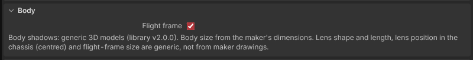

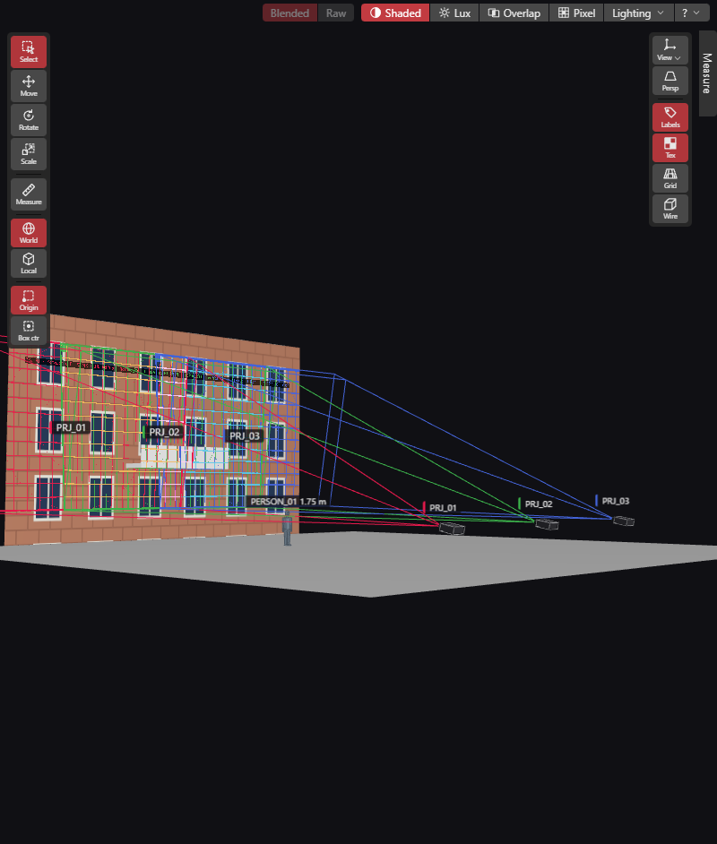

- Projector bodies are generic 3D models. Their size comes from the maker's dimensions. The lens position is a generic guess at the centre. The projection centre and the lens numbers still come from the projector database.
- In the **Body** section, **Flight frame** shows or hides the flight-frame model on the projector body.
- In **Summary > Metrics**, the checkbox **Projector bodies cast shadows** is the one global switch for body shadows. If the projection centre is inside the body of another projector while body shadows are on, that projector lights nothing. The app shows the reason.
- Each projector draws a frustum in the 3D view. The lines run from the lens to a rectangle at the farthest surface the projector hits. A thin outline marks the nearest surface. People and projector bodies that block light cut the lines. With no surface hit, the lines end at the aim distance (dashed) or at 5 m.
- **View > Labels** shows the names of projectors in the 3D view.

## See also

[Analysis](Analysis.md), [Properties](Properties.md), [Projector Database](Projector-Database.md), [Test Patterns](Test-Patterns.md), [Variations and Compare](Setups-and-Compare.md)
