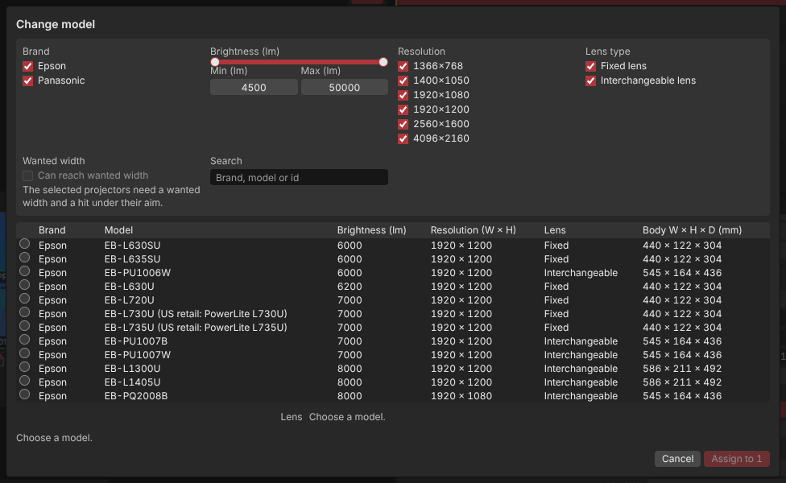

# Projector database

> **Planning aid.** LUMAMATTERS is a planning aid. Its numbers (lux, pixel size, throw distance, overlap) come from maker data and simplified models and can be wrong. No guarantee of correct data is given. Check critical values against the maker's spec sheets and on site.

LUMAMATTERS ships with a built-in, offline database of projector bodies and lenses. Pick from it with **+ Proj** and in **Properties**.

## What is in it

- **Makers:** Panasonic and Epson.
- **Size:** 110 projector bodies (63 Panasonic, 47 Epson) and 398 lens records, from 132 different lens part numbers. Counted from `research/projector-db/projectors.json` and `lenses.json`. Later seed updates can change these numbers.
- **Lens types:** 100 of 110 bodies take interchangeable lenses. The others have a fixed lens.

## What is stored per body

- Brand, model and series.
- Brightness in lumens and the standard it was measured to (ISO 21118 or ANSI, as the maker states it).
- Native resolution and aspect.
- Weight and dimensions. The 3D view uses these for the body and its shadow.
- Light source, contrast and power (info only; the analysis does not use them).
- A link to the maker's spec sheet.

## What is stored per lens

- Throw ratio range, from wide to tele (the zoom range).
- Lens shift limits: up, down, left and right, in percent.
- Which bodies the lens fits.
- Data source: the maker document title and URL, and a verification note per field.
- For many lenses: the maker's throw-distance formula or table. The app uses it to turn the maker's throw numbers into the exact distance from the projection centre.

Only optical zoom is modelled. Digital zoom and keystone correction are not.

## Maker throw data and format 4.0

On open, the app can add the maker's throw data to lens records in the project that lack it. It then tells you how many lens records changed and how much image sizes change (up to a few percent). Each projector keeps its zoom position.

Such a project is saved in **project format 4.0**. Older app versions refuse it. Update the app on every machine before you open that project there. See [Project files](Project-Files.md).

## Spec sheet button

In **Properties**, under the **Lens** choice, the **Spec sheet** button opens the maker's page or PDF for that lens. Without a lens sheet, it opens the projector's sheet. If there is none, the button is greyed out and the note below it gives the reason.

- Only `https` links open.
- In the Windows desktop app the link opens in your default browser. Only a fixed list of maker sites is allowed (Panasonic and Epson download hosts, and projektoren-datenbank.com). Any other host is refused with a message.
- The app never downloads the PDF itself.
- The button works even when the project is locked or read-only.

## Check the data

The database was filled from maker documents and verified field by field. Still:

- Some fields are marked partly verified or unverified in the data. A few records are analogies from sibling models.
- Makers print their own tolerance. Panasonic states that throw distances in its tables can be off by about 5 %.
- Lens shift percentages follow the maker's wording. The exact reference is not always stated.

Compare the numbers you rely on with the maker's spec sheet. The **Spec sheet** button is one click away.

## Report wrong data

Note the model, the lens, the field and the value from the maker's sheet. Send it to the app's owner. (owner: check how testers should send this, for example a GitHub issue or an email.) The database is regenerated from source files. Flat exports are never edited by hand.

## See also

[Properties](Properties.md) | [Placing projectors](Placing-Projectors.md) | [Physics model and limits](Physics-Model.md) | [Project files](Project-Files.md)
