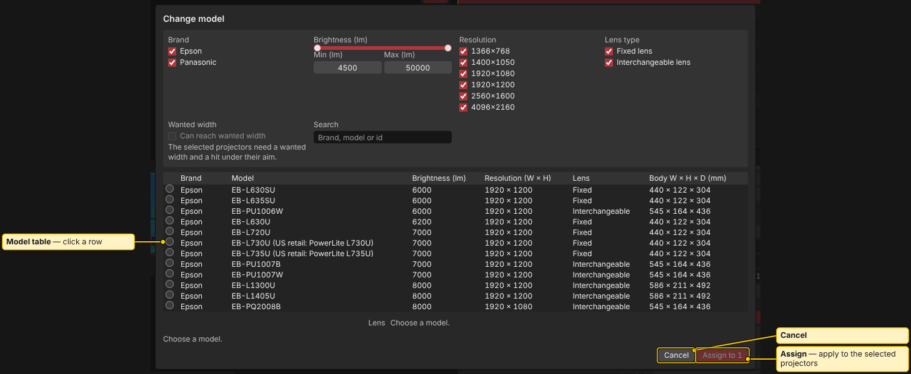

# Projector database

> **Planning aid.** LUMAMATTERS is a planning aid. Its numbers (illuminance, pixel size, throw distance, overlap) come from maker data and simplified models and can be wrong. No guarantee of correct data is given. Check critical values against the maker's spec sheets and on site.

LUMAMATTERS ships with a built-in projector database. It lists projector bodies and lenses. It works offline. Pick from it with **+ Proj** and in **Properties**.

## What is in it

- **Makers:** Panasonic and Epson.
- **Projector bodies:** 110 models (63 Panasonic and 47 Epson). Counted in the seed file of the app, `src/data/projectors/seed.json`.
- **Lenses:** 132 different lens part numbers. Counted in the same seed file.
- **Lens types:** 100 of the 110 bodies take interchangeable lenses. The other 10 have a fixed lens.

A later update of the database can change these numbers.

## Find a projector

**+ Proj** opens the dialog **Add projectors**. With projectors selected, **Change model…** in **Properties** opens the same dialog as **Change model**. You can filter the list by:

- **Brand**;
- **Brightness (lm)**;
- **Resolution**;
- **Lens type**: **Fixed lens** or **Interchangeable lens**;
- **Wanted width**: the filter **Can reach wanted width** keeps the models that have a lens for a width (**Width (m)**) at a distance (**Distance (m)**);
- **Search**: type a brand, a model or an id.

Click a column header to sort the table. The app keeps your filters until you close the app. A model that is incomplete, or that has no usable lens, is greyed out with its reason. You cannot choose it. See [Placing projectors](Placing-Projectors.md) for the rest of the dialog.

## What is stored per body

- Brand, model and series.
- Brightness in lumens, and the standard it was measured to (ISO 21118 or ANSI, as the maker states it).
- Native resolution and aspect.
- Weight and dimensions. The 3D view uses them for the body and its shadow. The projector bodies and lens bodies in the 3D view are generic shapes. They are sized from these numbers. They are not the 3D models of the makers.
- Light source, contrast and power. These fields are for information only. The analysis does not use them.
- A link to the spec sheet of the maker.

## What is stored per lens

- The throw ratio range, from wide to tele (the zoom range).
- The lens shift limits: up, down, left and right, in percent.
- The bodies that the lens fits.
- The data source: the title and the URL of the maker document, and a verification note for each field.
- For many lenses: the throw-distance formula or table of the maker. The app uses it to turn the throw numbers of the maker into the exact distance from the projection centre.

The app models optical zoom only. It does not model digital zoom or keystone correction.

## Maker throw data and format 4.0

When you open a project, the app can add the throw data of the maker to lens records that lack it. It then tells you how many lens records changed. It also tells you how much the image sizes change (up to a few percent). Each projector keeps its zoom position.

The app saves such a project in **project format 4.0**. Older versions of the app refuse it. Update the app on every machine before you open that project there. See [Project files](Project-Files.md).

## Spec sheet button

In **Properties**, the **Spec sheet** button is under the **Lens** choice. It opens the maker page or PDF for that lens. If there is no lens sheet, it opens the sheet of the projector. If there is no sheet at all, the button is greyed out. The note below it gives the reason.

- Only `https` links open.
- In the Windows desktop app, the link opens in your default browser. Only a fixed list of maker sites is allowed: the download hosts of Panasonic and Epson, and projektoren-datenbank.com. The app refuses every other host and shows a message.
- The app never downloads the PDF itself.
- The button works also when the project is locked or read-only.

## Check the data

The database was filled from maker documents. Each field was verified one by one. You must still check it:

- Some fields are marked as partly verified or unverified in the data. A few records are analogies from sibling models.
- Makers print their own tolerance. Panasonic states that the throw distances in its tables can be off by about 5 %.
- The lens shift percentages follow the wording of the maker. The maker does not always state the exact reference.

Compare the numbers that you rely on with the spec sheet of the maker. The **Spec sheet** button is one click away.

## Report wrong data

1. Note the model, the lens, the field and the value from the sheet of the maker.
2. Choose **Help > Send feedback…**. See [Menus](Menus.md#send-feedback).
3. Describe what is wrong.

The app regenerates the database from source files. Nobody edits the flat exports by hand.

## Trademarks and data sources

Panasonic, Epson and other product names are trademarks of their owners. LUMAMATTERS uses them only to identify compatible products. LUMAMATTERS is not affiliated with these companies and they do not endorse it. The projector data comes from public spec sheets and can contain errors.

## See also

[Properties](Properties.md) | [Placing projectors](Placing-Projectors.md) | [Physics model and limits](Physics-Model.md) | [Project files](Project-Files.md)
