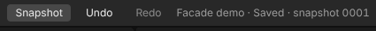
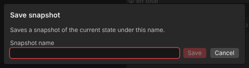
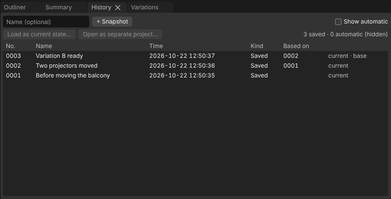
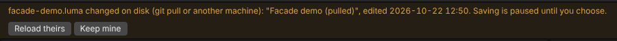

# Projects and Snapshots

## One project = one folder

Each project is a folder in your workspace: `projects/<name>/`. The main file is `<name>.luma`. Imported model files are copied into the project's `models` folder, so the project stays whole. See [Project Files](Project-Files.md) for the folder layout.

## Your work is saved by itself

There is no Save to remember. Every committed edit is written to `<name>.luma` right away, with no interval to set. After a crash you lose at most the one edit being written.

The header shows the save state next to the project name:

- **Saved**
- **Saving…**
- **Paused: changed on disk** (see below)
- **Paused: unreadable on disk**
- **Read-only: open in another window**
- **Not saved: <reason>**

You may see `· snapshot 0012` after it: the snapshot your current state is based on. `(changed)` means you edited since then.

## File menu: projects

- **File > New…** asks for a project name and creates an empty project.
- **File > Open…** lists the projects of the workspace.
- **File > Open Recent** lists the last projects you opened on this machine.
- **File > Save As…** (`Ctrl+Shift+S`) writes the current state, including unsaved changes, into a new project with copies of its model files, and opens it. The name starts as "<name> copy". Both projects keep their own edits.
- **File > Change workspace…** switches to another workspace folder. See [First Start and Workspace](First-Start-and-Workspace.md).
- **File > New window** (desktop app only) opens a second window.

On the start screen, **Duplicate…** copies a project without opening it.

When you leave a project (New, Open, Open Recent, Change workspace, Save As), the app finishes writing first. It asks **Save changes to <name>?** only when a write failed or is paused.

## Snapshots

A snapshot is a frozen copy of the project state at one moment. It never changes. Use snapshots as restore points before risky work.

- **File > Save snapshot** (`Ctrl+S`) saves an unnamed snapshot at once. The header button **Snapshot** does the same. A toast says "Snapshot 0013 saved". If nothing changed since the last manual snapshot, it says "No changes since snapshot 0012" and writes nothing.
- **File > Save snapshot with name…** asks for a name (up to 80 characters). A named snapshot is always written.
- **File > Snapshot history** shows the **History** tab.

### Automatic snapshots

The app also takes snapshots by itself, only when the state differs from the newest snapshot:

- Before a step that clears undo: applying an import, a reload, changing a model file or its settings, and removing a model from the project. History shows **Auto: before file change**.
- When you leave a project: **Auto: left project**.
- At the next open, after you closed the window or the app crashed: **Auto: last session**.
- Before you load an older snapshot as the current state: **Auto: before loading a snapshot**.
- When you choose a side after a change on disk: **Auto: replaced on disk**.

A snapshot also keeps a copy of each model file, once per file content. An unchanged big model is not copied again.

### History tab

The **History** tab sits beside Outliner and Summary. If it is closed, use **View > Panels > History**.

Rows are newest first. Columns: **No.**, **Name**, **Time**, **Kind**, **Based on**. Kind is **Saved** for your own snapshots and **Auto: …** for automatic ones. Automatic ones stay hidden until you tick **Show automatic** (remembered per machine).

- Type a name and press **+ Snapshot** to save a named snapshot.
- Select a row, then **Load as current state…**. Your present state goes into an automatic snapshot first, so you can come back.
- Select a row, then **Open as separate project…**. It writes the snapshot into a new project (default name "<name> from 0007") and opens it. The current project stays unchanged.

### Thinning: how old automatic snapshots are cleaned up

The app thins old automatic snapshots when you open a project, so the history does not grow forever:

- All automatic snapshots of today and yesterday are kept.
- Older than that, up to 30 days: the newest automatic snapshot of each day.
- Older still: the newest of each week.
- Days and weeks are counted in UTC.

Never removed: your own snapshots (named or not), the newest snapshot, the snapshot your current state is based on, and the automatic kinds **before file change**, **before loading a snapshot** and **replaced on disk**. Thinning also removes unreadable zero-byte snapshot files left by a crash, and unused model copies.

## Read-only window and New window

Only one window at a time can edit a project. A second window on the same project is **read-only**:

- A banner says "This window is read-only: the project is open in another window. Close that window, then open the project again here." Use **Open again** after the other window is closed.
- Nothing is written there: no edits, no snapshots, no **Load as current state**.
- You can still look around, use **Open as separate project…** and export.

The app never takes over the lock by itself.

## When the project changes on disk

If `<name>.luma` changes behind the app's back (a `git pull`, another machine, a sync tool), saving pauses and a banner says "`<name>.luma` changed on disk (git pull or another machine)". Choose:

- **Reload theirs** loads the file from disk. Your current state is saved as an automatic snapshot first.
- **Keep mine** keeps what is in the window and writes it over the disk file. The disk version is saved as an automatic snapshot first.

If the file on disk cannot be read at all (for example a git conflict), the banner names the problem. It offers **Keep mine** (the unreadable bytes are copied to `.recovery/` first) and **Keep paused**. If a newer app saved the file, update the app first. See [Several Machines](Several-Machines.md).

A second banner, **Model files changed on disk**, appears when you open a project whose imported model files changed since their last reload. It lists each file with **Reload file: <path>** and has **Dismiss**. The app never reloads models by itself. See [Blender Export and Import](Blender-Export-and-Import.md).

If write permission to the workspace folder is taken back, a banner says so, with **Re-grant**. Your edits stay in the window.

## Backups

The app keeps no backup copies elsewhere. To back up, copy the workspace folder (or just `projects/<name>/`) with Explorer, an external drive or git, while the app is closed or idle. Snapshots are a safety net for edits, not a backup against a dead disk.

See also: [First Start and Workspace](First-Start-and-Workspace.md), [Several Machines](Several-Machines.md), [Summary and History](Summary-and-History.md), [Project Files](Project-Files.md)
