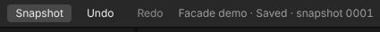
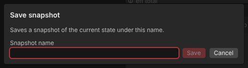
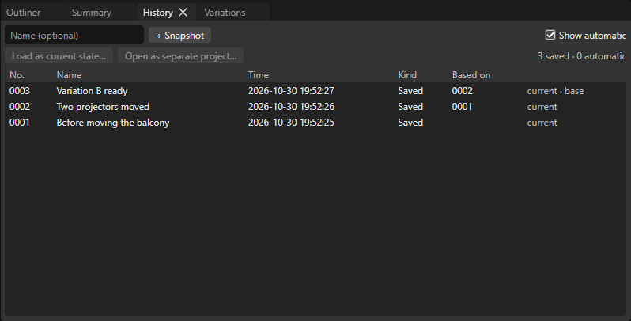
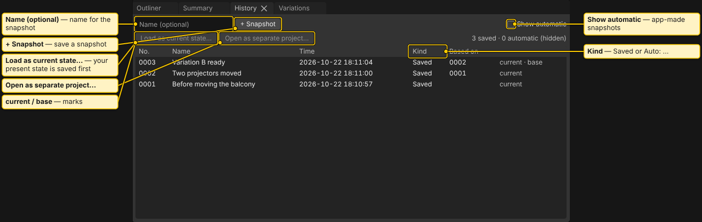
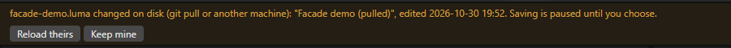

# Projects and Snapshots

## One project = one folder

Each project is a folder in your workspace: `projects/<name>/`. The main file is `<name>.luma`. The app copies each imported model file into the `models` folder of the project, so the project stays whole. See [Project Files](Project-Files.md) for the folder layout.

## Your work is saved by itself

You do not need to save. The app writes every committed edit to `<name>.luma` at once. You set no interval. After a crash, you lose at most the one edit that was being written.

The header shows the save state next to the project name:

- **Saved**
- **Saving…**
- **Paused: changed on disk** (see below)
- **Paused: unreadable on disk**
- **Read-only: open in another window**
- **Not saved: <reason>**

After the save state you can see `· snapshot 0012`. This is the snapshot that your current state is based on. `(changed)` means that you edited since then.

## File menu: projects

- **File > New…** asks for a project name and creates an empty project.
- **File > Open…** lists the projects of the workspace.
- **File > Open Recent** lists the last projects that you opened on this machine.
- **File > Save As…** (`Ctrl+Shift+S`) writes the current state, including unsaved changes, into a new project with copies of its model files. Then it opens the new project. The name starts as "<name> copy". Both projects keep their own edits.
- **File > Change workspace…** switches to another workspace folder. See [First Start and Workspace](First-Start-and-Workspace.md).
- **File > New window** (desktop app only) opens a second window.

On the start screen, **Duplicate…** copies a project without opening it.

When you leave a project, the app finishes writing first. You leave a project with New, Open, Open Recent, Change workspace or Save As. The app asks **Save changes to <name>?** only when a write failed or is paused.

## Snapshots

A snapshot is a saved copy of the whole project state at one moment. It never changes. Use snapshots as restore points before risky work.

- **File > Save snapshot** (`Ctrl+S`) saves an unnamed snapshot at once. The header button **Snapshot** does the same. A toast says "Snapshot 0013 saved". If nothing changed since the newest snapshot, the toast says "No changes since snapshot 0012" and the app writes nothing.
- **File > Save snapshot with name…** asks for a name (up to 80 characters).
- **File > Snapshot history** shows the **History** tab.

### Automatic snapshots

The app also takes snapshots by itself. It does this only when the state differs from the newest snapshot. You cannot switch automatic snapshots off. The app takes them in these cases:

- Before a step that clears undo. These steps are: applying an import, a reload, changing a model file or its settings, and removing a model from the project. History shows **Auto: before file change**.
- When you leave a project: **Auto: left project**.
- At the next open, after you closed the window or the app crashed: **Auto: last session**.
- Before you load an older snapshot as the current state: **Auto: before loading a snapshot**.
- When you choose a side after a change on disk: **Auto: replaced on disk**.

A snapshot also keeps a copy of each model file, once for each file content. The app does not copy an unchanged big model again.

### History tab

The **History** tab is next to Outliner and Summary. If the tab is closed, choose **View > Panels > History**.

The rows are newest first. The columns are **No.**, **Name**, **Time**, **Kind** and **Based on**. Kind is **Saved** for your own snapshots and **Auto: …** for automatic ones. The automatic ones stay hidden until you tick **Show automatic**. The app remembers this setting per machine.

- To save a named snapshot, type a name and click **+ Snapshot**.
- To go back, select a row and click **Load as current state…**. The app first saves your present state as an automatic snapshot, so you can come back.
- To keep your project unchanged, select a row and click **Open as separate project…**. The app writes the snapshot into a new project (default name "<name> from 0007") and opens it.

### Thinning: how the app cleans up old automatic snapshots

The app thins old automatic snapshots when you open a project. This keeps the history short.

- The app keeps all automatic snapshots of today and yesterday.
- For older days, up to 30 days back, it keeps the newest automatic snapshot of each day.
- For older snapshots, it keeps the newest of each week.
- The app counts days and weeks in UTC.

The app never removes these snapshots:

- your own snapshots (named or not)
- the newest snapshot
- the snapshot that your current state is based on
- the automatic kinds **before file change**, **before loading a snapshot** and **replaced on disk**

Thinning also removes unreadable zero-byte snapshot files that a crash left behind. It also removes unused model copies.

## Read-only window and New window

Only one window at a time can edit a project. A second window on the same project is **read-only**.

- A banner says "This window is read-only: the project is open in another window. Close that window, then open the project again here." After you close the other window, click **Open again**.
- Nothing is written in the read-only window: no edits, no snapshots and no **Load as current state…**.
- You can still look around, use **Open as separate project…** and export.

The app never takes over the lock by itself.

## When the project changes on disk

Sometimes `<name>.luma` changes without the app. A `git pull`, another machine or a sync tool can do this. Then saving pauses, and a banner says "`<name>.luma` changed on disk (git pull or another machine)". Choose one button:

- **Reload theirs** loads the file from disk. The app first saves your current state as an automatic snapshot.
- **Keep mine** keeps what is in the window and writes it over the disk file. The app first saves the disk version as an automatic snapshot.

Sometimes the app cannot read the file on disk at all, for example after a git conflict. Then the banner names the problem. It offers **Keep mine** and **Keep paused**. For **Keep mine**, the app first copies the unreadable bytes to `.recovery/`. If a newer app saved the file, update the app first. See [Several Machines](Several-Machines.md).

A second banner, **Model files changed on disk**, appears when you open a project whose imported model files changed since their last reload. It lists each file with **Reload file: <path>**. It also has **Dismiss**. The app never reloads models by itself. See [Blender Export and Import](Blender-Export-and-Import.md).

If the app loses its write permission for the workspace folder, a banner says so. The banner has **Re-grant**. Your edits stay in the window.

## Backups

The app keeps no backup copies elsewhere. To make a backup, copy the workspace folder, or only `projects/<name>/`. Use Explorer, an external drive or git. Do this while the app is closed or idle. Snapshots protect you against bad edits. They do not protect you against a dead disk.

See also: [First Start and Workspace](First-Start-and-Workspace.md), [Several Machines](Several-Machines.md), [Summary and History](Summary-and-History.md), [Project Files](Project-Files.md)
