# Properties

Properties shows the settings of the selection, at the bottom right. With nothing selected, it says "Select an object in the 3D view or the Outliner."

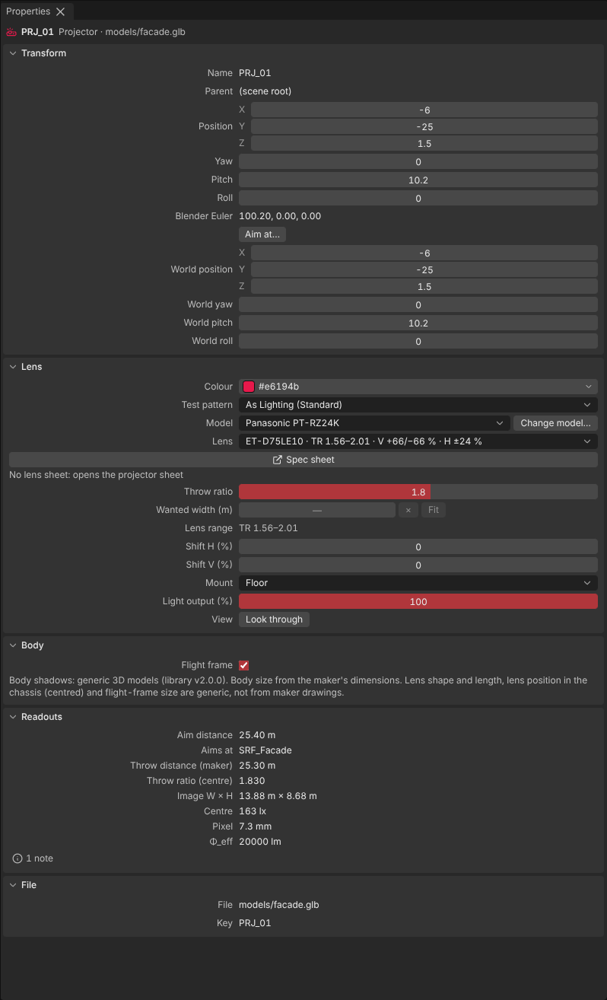

## Top of the panel

A heading shows the type icon, the name and `type · file` (or "created in the app"). With several objects selected, it shows "N objects". Badges below the heading repeat the badges of the Outliner. They show why a projector is not analysed, and they show hidden, orphan and not-in-file objects.

Sections fold and unfold. The panel shows only the sections that every selected object has. A field that differs between the objects shows a dash.

A locked object shows a note, and its fields are disabled.

## Number fields

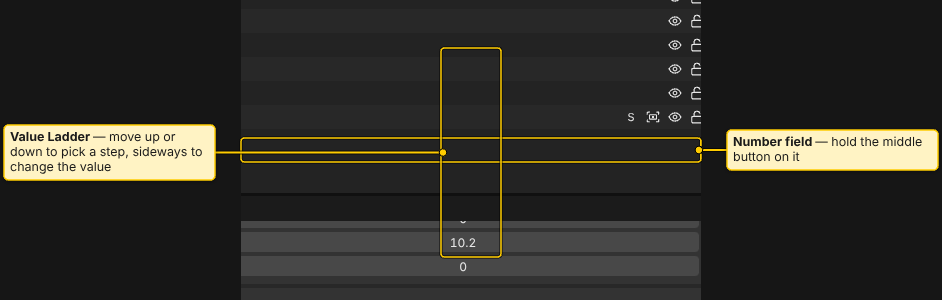

- **Click** a field and type. Press `Enter` or leave the field to commit. Press `Esc` to drop the typed text.
- **Drag left or right** with the left mouse button to change the value. Right is up. Hold `Shift` for a tenth of the step. Hold `Ctrl` to snap.
- **Middle mouse button: Value Ladder** (as in TouchDesigner). Press the middle button on a field. A column of steps appears: 100, 10, 1, 0.1, 0.01. Integer fields show 100, 10, 1. Move up or down to pick a step. Then move sideways to change the value by that step. After a short sideways move, the step stays fixed. Release the button to commit. Press `Esc` to cancel.
- On the label of a row with several values (Position, Shift), the ladder changes all values together.
- One drag is one undo step. The 3D view follows live while you drag.
- A drag stops at the allowed range of the field.
- With several objects selected, a drag in a transform field applies the same change to each object.

## Transform (all objects)

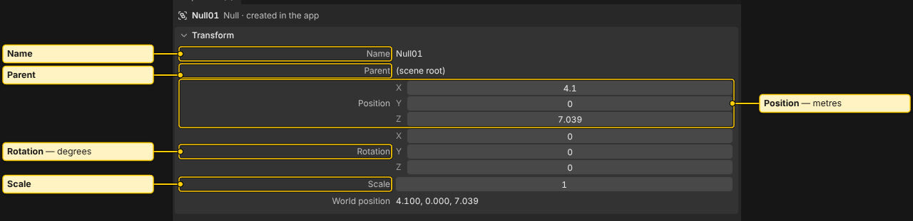

The fields are **Name**, **Parent**, **Position**, **Rotation** (with **Yaw / Pitch / Roll** and a Blender Euler row) and **Scale**. A node with a parent also shows its world position and angles. They are in a **World** sub-section, which is folded at first. Values are in metres and degrees. The axes follow the convention of Blender. For projectors, **Aim at…** aims the projector at a surface point that you click.

## Projector

The **Lens** section holds most projector settings. These are the rows, from top to bottom:

- **Colour**: a 16-colour palette for the projector.
- **Test pattern**: the pattern that the projector draws.
- **Image**: see below.
- **Model**, with **Change model…**.
- **Copy**: with two or more projectors selected, **Copy specs…** opens the **Copy specs** popover. Tick what to copy. For the zoom, choose "Same TR" or "Same image width".
- **Spec sheet**: a button that opens the maker's spec sheet.
- **Lens**: for interchangeable lenses. A lens that you cannot use shows the reason.
- **Throw ratio**: the maker's number. It sets the zoom.
- **Wanted width (m)** with **Fit**: **Fit** sets the zoom so that the image has that width at the aim distance.
- **Lens range**: the smallest and largest throw ratio of the lens.
- **Shift H (%)** and **Shift V (%)**: lens shift.
- **Mount**: **Floor** or **Ceiling**.
- **Light output (%)**: see below.
- **Look through**: shows the scene from the lens of the projector.

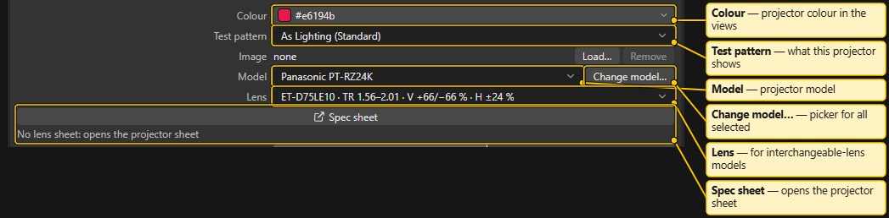

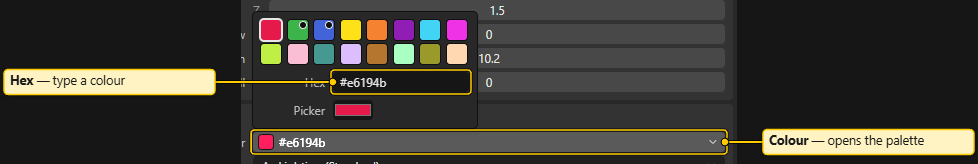

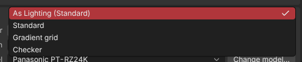

Zoom is optical zoom only. Throw and lens shift come from the projector database. Zoom and lens shift need projectors with the same model and lens. See [Projector Database](Projector-Database.md) and [Placing Projectors](Placing-Projectors.md).

### Image (new in 1.1.0)

The **Image** row shows the name of the picture that this projector shows, or `none`. With several different pictures selected, it shows `Mixed`.

1. Click **Load…** and choose a picture file.
2. The app copies the file into the project and its snapshots.
3. Click **Remove** to bring the test pattern back.

The picture replaces the test pattern of that projector. The Shaded view always shows it. The other views show it when **Images** is on (**Viewport** fold-out, **Beams** section). The app stretches the picture to the projector image, with no aspect fit. It shows the picture at up to 1024 pixels. A project with a projector image is saved as project format 5.0. See [Project Files](Project-Files.md#project-format-version).

### Light output (%)

**Light output (%)** dims one projector. It lowers the rated lumens of that projector. The range is 1 to 100, and the default is 100. At 50, the analysis uses half of the rated lumens. The field changes the analysis numbers. There is no project-wide dimming field.

### Body

The **Body** section has the **Flight frame** checkbox and a note on the body model in use. See [Physics Model](Physics-Model.md).

### Readouts

The **Readouts** section appears when you select one projector. Its rows are:

- **Aim distance**
- **Aims at**
- **Throw distance (maker)**
- **Throw ratio (centre)**
- **Image W × H**
- **Centre**: the illuminance at the image centre, in lx
- **Pixel**: the pixel size
- **Φ_eff**: the effective lumens

Under the rows are **flag chips** that explain caveats. Click a chip to read its explanation.

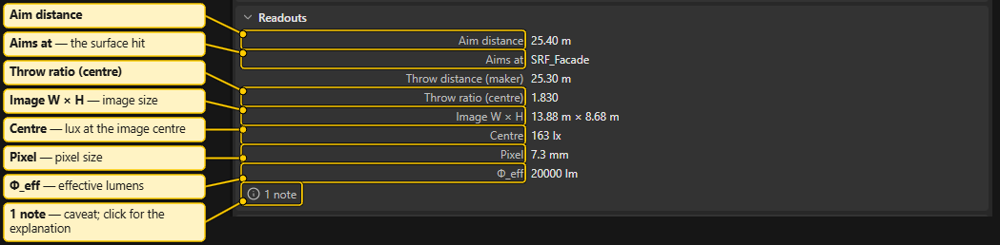

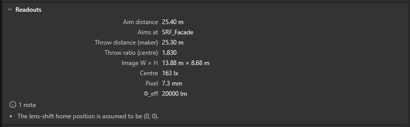

## Surface (venue meshes)

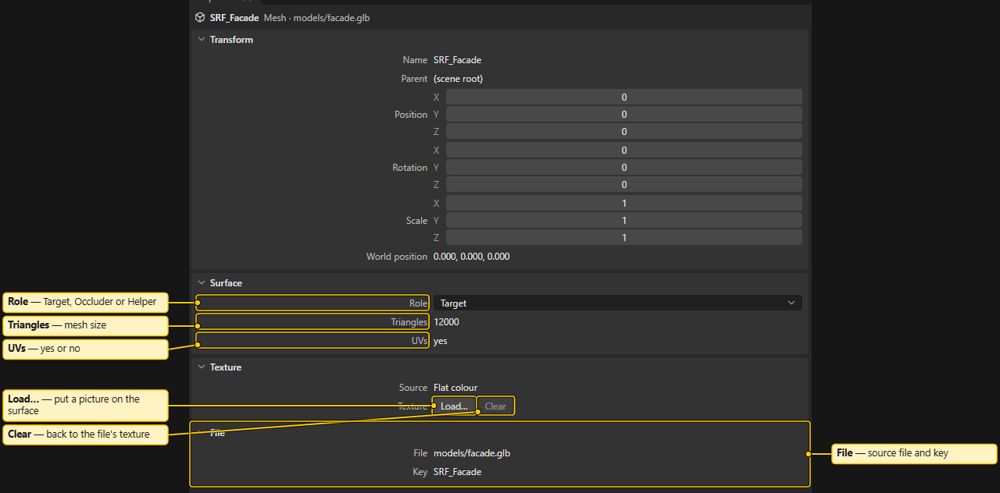

- **Role**: **Target** (the surface should be lit and counted), **Occluder** (it blocks light) or **Helper** (light passes through it).
- **Reflectance** (new in 1.1.0): the reflectance ρ of the surface, from 0 to 1. The Photometric view uses it for Luminance. See [Physics Model](Physics-Model.md). Type a number, or pick a typical value from the list.
- **Triangles**: the number of triangles.
- **UVs**: yes or no.

The list of **Reflectance** has these values: **white paint** 0.80, **light plaster** 0.45, **sandstone** 0.30, **concrete** 0.25, **granite** 0.22 and **red brick** 0.12. The entry **Project default** removes the own value of the object. The object then follows the **Default ρ** of the Photometric legend, which is 1.00 until you change it. Each choice is one undo step. A project with a reflectance is saved as project format 5.0.

## Texture (venue meshes)

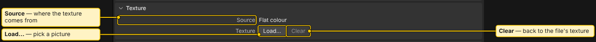

The section shows **Source** and **Size**. Click **Load…** to put a picture on the selected surfaces. Click **Clear** to return to the texture of the model file. Select the root row of a model to list the textures of that model. See [Textures](Textures.md).

## Person

The fields are **Height (m)** and **Blocks light**. See [People](People.md).

## Camera

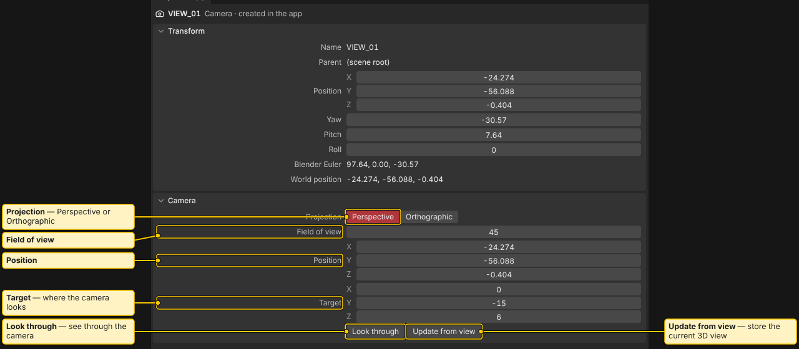

The fields are **Projection** (**Perspective** or **Orthographic**), **Field of view** (or **Ortho height**), **Position** and **Target**. Two buttons are **Look through** and **Update from view**. **Update from view** stores the current 3D view in this camera.

## Measurement

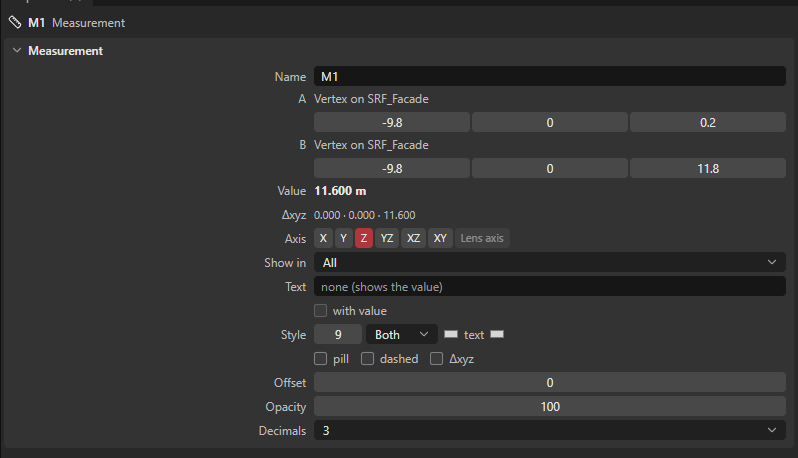

With only measurements selected, Properties shows **Name**, the ends **A** and **B**, **Value**, **Axis**, **Show in**, **Text** and the full **Style**. With objects and measurements selected, the sections of the objects stay. A note counts the measurements. See [Measure Tools](Measure-Tools.md).

## File

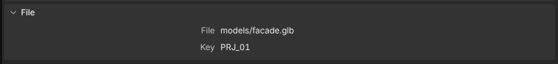

This section is for objects that come from a model file. It shows **File** and **Key**. It shows **Reset to file** when the placement differs from the file.

See also: [Measure Tools](Measure-Tools.md), [Outliner](Outliner.md), [Placing Projectors](Placing-Projectors.md), [Textures](Textures.md), [Summary and History](Summary-and-History.md)
