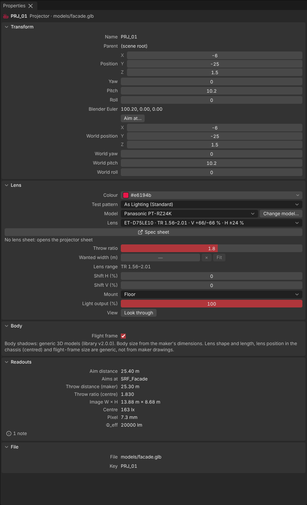
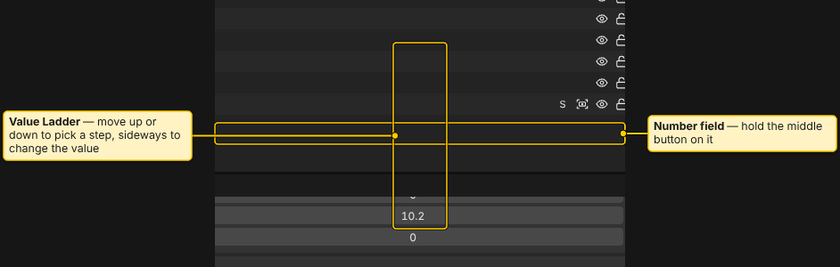
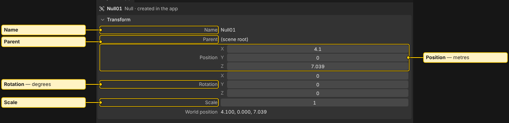
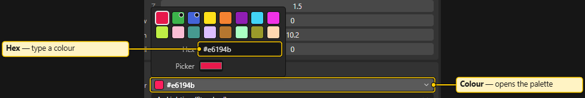
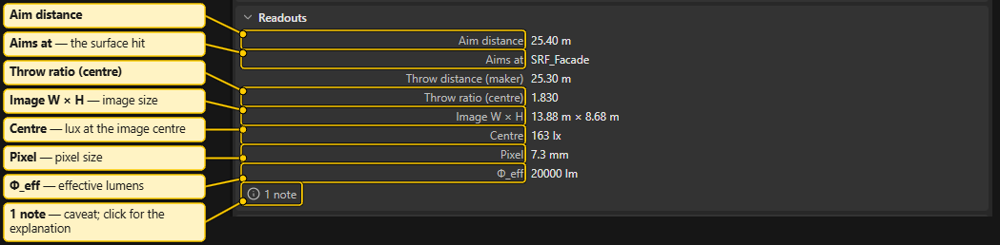
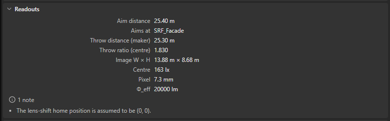
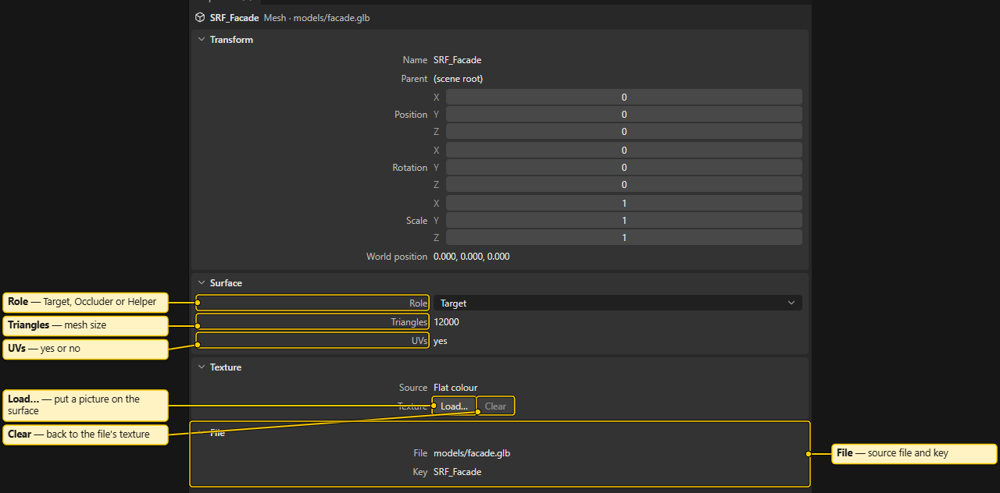
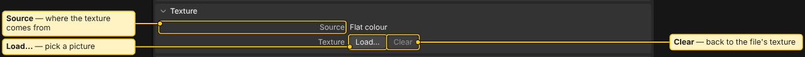
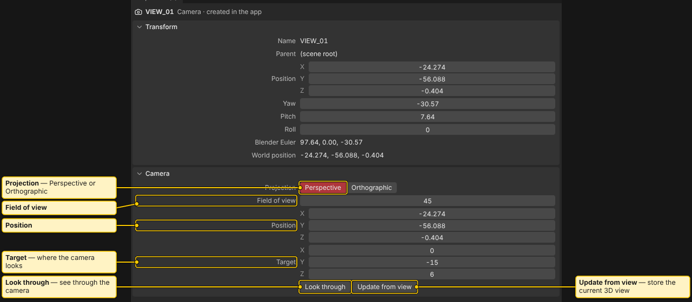
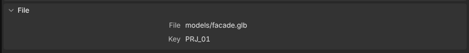

# Properties

Properties shows the settings of the selection, at the bottom right. With nothing selected it says "Select an object in the 3D view or the Outliner."

## Top of the panel

A heading shows the type icon, the name and `type · file` (or "created in the app"). With several objects selected it shows "N objects". Badges below repeat the Outliner's (why a projector is not analysed, hidden, orphan, not in file).

Sections fold and unfold. Only sections that every selected object has are shown. A field that differs between objects shows a dash.

A locked object shows a note, and its fields are disabled.

## Number fields

- **Click** a field and type. `Enter` or leaving the field commits. `Esc` drops the typed text.
- **Drag left or right** with the left mouse button to change the value. Right is up. Hold `Shift` for a tenth of the step, `Ctrl` to snap.
- **Middle mouse button: Value Ladder** (like TouchDesigner). Press the middle button on a field. A column of steps appears: 100, 10, 1, 0.1, 0.01 (integer fields: 100, 10, 1). Move up or down to pick a step, then move sideways to change the value by that step. After a little sideways movement, the step stays fixed. Release to commit. `Esc` cancels.
- On the label of a multi-value row (Position, Shift), the ladder changes all components together.
- One drag is one undo step. The 3D view follows live while you drag.
- A drag stops at the allowed range of the field.
- With several objects selected, dragging a transform field applies the same change to each.

## Transform (all objects)

**Name**, **Parent**, **Position**, **Rotation** (with **Yaw / Pitch / Roll** and a Blender Euler row), **Scale**. A **World** group shows world position and angles. Values are in metres and degrees. Axes follow Blender's convention. For projectors, **Aim at…** aims at a surface point you click.

## Projector

- **Lens**: **Colour**, **Test pattern**, **Model** (with **Change model…**), **Lens** (for interchangeable lenses; unusable lenses carry the reason), a **Spec sheet** button, **Throw ratio** (the maker's number), **Wanted width (m)** with **Fit** (sets the zoom so the image has that width at the aim distance), **Lens range**, **Shift H (%)**, **Shift V (%)**, **Mount** (**Floor** or **Ceiling**), **Light output (%)** and **Look through**. With two or more projectors, a **Copy** row opens **Copy specs**: tick what to copy and choose "Same TR" or "Same image width" for the zoom.

- **Image** (new in 1.1.0): the name of the picture this projector shows, or none, with **Load…** and **Remove**. A loaded picture replaces the test pattern of that projector in the Shaded view, and in the Photometric view, Overlap and Pixel when **Images** (Viewport > Beams) is on. It is stretched to the projector's image (no aspect fit) and shown at up to 1024 pixels. The file is copied into the project (and its snapshots). **Remove** brings the test pattern back. A project with a projector image is saved as project format 5.0. See [Project Files](Project-Files.md#project-format-version).
- **Body**: the **Flight frame** checkbox and a note on the body model in use. See [Physics Model](Physics-Model.md).
- **Readouts** (one projector): Aim distance, Aims at, Throw distance (maker), Throw ratio (centre), Image W x H, Centre lux, Pixel, effective lumens, and **flag chips** that explain caveats. Click a chip for its explanation.

Zoom is optical zoom only. Throw and shift come from the projector database. See [Projector Database](Projector-Database.md) and [Placing Projectors](Placing-Projectors.md).

## Surface (venue meshes)

- **Role**: **Target** (should be lit and counted), **Occluder** (blocks light) or **Helper**.
- **Reflectance** (new in 1.1.0): the reflectance ρ from 0 to 1 that Luminance uses (see [Physics Model](Physics-Model.md)). Type a number or pick a typical value from the list: **white paint** 0.80, **light plaster** 0.45, **sandstone** 0.30, **concrete** 0.25, **granite** 0.22, **red brick** 0.12. **Project default** removes the object's own value, so it follows the **Default ρ** of the Photometric legend (1.00 until you change it). Each choice is one undo step. A project with a reflectance is saved as project format 5.0.
- **Triangles** and **UVs** (yes / no).

## Texture (venue meshes)

**Source**, **Size**, and **Load…** to put a picture on the selected surfaces. **Clear** returns to the model file's texture. Select the model's root row to list its own textures. See [Textures](Textures.md).

## Person

**Height (m)** and **Blocks light**. See [People](People.md).

## Camera

**Projection** (**Perspective** or **Orthographic**), **Field of view** (or **Ortho height**), **Position** and **Target**, **Look through** and **Update from view** (stores the current 3D view in this camera).

## Measurement

With only measurements selected, Properties shows **Name**, the ends **A** and **B**, **Value**, **Axis**, **Show in**, **Text** and the full **Style**. With objects and measurements selected, the object sections stay and a note counts the measurements. See [Measure Tools](Measure-Tools.md).

## File

For objects that come from a model file: **File**, **Key** and **Reset to file** when the placement differs from the file.

See also: [Measure Tools](Measure-Tools.md), [Outliner](Outliner.md), [Placing Projectors](Placing-Projectors.md), [Textures](Textures.md), [Summary and History](Summary-and-History.md)
