# Report and PDF

> **Planning aid.** LUMAMATTERS is a planning aid. Its numbers (lux, pixel size, throw distance, overlap) come from maker data and simplified models and can be wrong. No guarantee of correct data is given. Check critical values against the maker's spec sheets and on site.

The Report tab is a small page editor. Build A4 landscape pages with text, 3D-view pictures, tables and shapes. Save them as a PDF through the app's print dialog. The app has no PDF engine of its own.

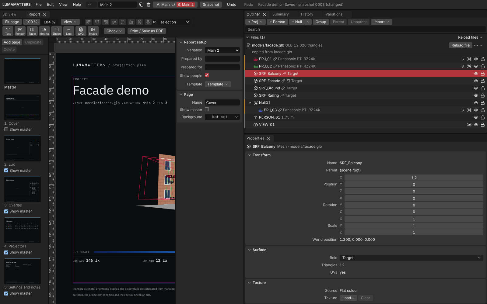

## Opening the report

- **View > Report**, or
- **File > Export > Report…**

Both open and focus the **Report** tab next to the 3D view. With no project open it says "Open a project to set up its report." The report reads the open project as it is now. You do not need to save first. It also works in a read-only window.

The first time, the tab shows the built-in **Dark lab** starter: near-black pages, IBM Plex fonts, a cover, a Photometric page, an Overlap page, a Projectors page and a Settings and notes page. Opening the tab writes nothing to your project. Your first edit stores the layout in the project file.

## The disclaimer

The report carries its own disclaimer in the footer of the cover and of the master page. The text is:

> Planning estimate. Brightness, overlap and pixel values are calculated from manufacturer data and the 3D model; real results depend on the venue, the surfaces, the projectors' condition and their setup. Check on site.

It is a field in a text block. If you delete it from your layout, the report no longer carries it.

## Layout of the tab

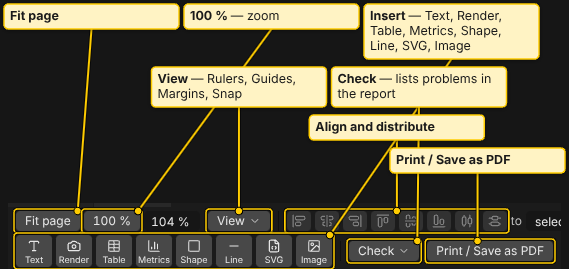

- **Toolbar** (top): zoom, **View**, align, **Insert**, **Check** and **Print / Save as PDF**.
- **Pages** (left): thumbnails of the **Master** and every page, with **Add page**, **Duplicate** and **Delete**. Drag a thumbnail to reorder pages. `Alt+Up` and `Alt+Down` move the selected page. Delete asks "Delete this page and its blocks?".
- **Canvas** (middle): the pages, with rulers in millimetres.
- **Properties** (right): **Report setup**, then the fields of the selected page or block.

### Master page

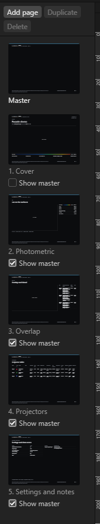

The **Master** holds what repeats on every page: header, footer, page numbers and, if you want, a logo. Click **Master** in the page list to edit it. A page can switch it off with **Show master** in its page properties.

### Report setup

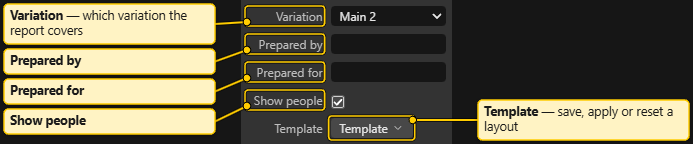

At the top of the properties panel:

- **Variation**: which variation the report covers. Shown only when the project has more than one variation. One report covers one variation.
- **Prepared by** and **Prepared for**: optional one-line fields for the cover. While one is empty, the Report tab shows its field name dimmed in its place, for example `‹report.preparedBy›`. The thumbnails and the PDF show nothing there.
- **Show people**: draws the people from the [People](People.md) page in report pictures. Their shadows stay in the numbers either way.
- **Template**: **Save as template…**, **Apply template…**, **Reset to starter**.

## Blocks

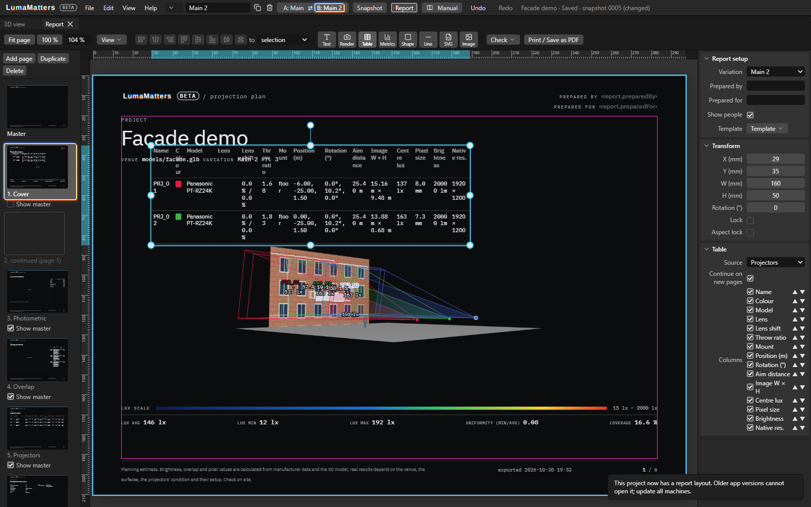

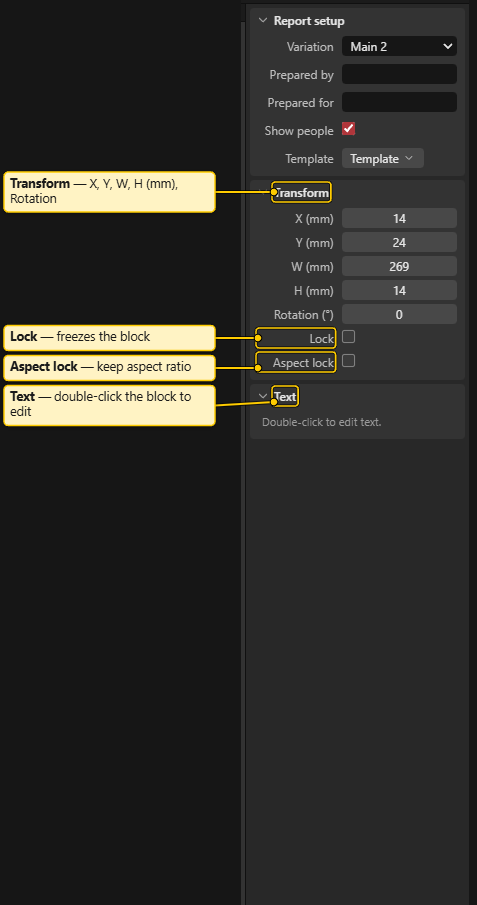

Add blocks with the **Insert** buttons. They go on the current page, or on the master while you edit it.

| Button | Block |
|---|---|
| **Text** | Rich text: font, size, bold, italic, underline, lists, alignment, paragraph styles, and **Insert field** for live values. Double-click to edit. |
| **Render** | A picture of the 3D view. Each Render block has its own camera. |
| **Table** | A table filled from the project, with a column picker. Sources: **Projectors**, **Pairs**, **Notes**, **Settings**, **Measurements**. A long table continues on new pages with its header repeated. |
| **Metrics** | A photometry box with layouts **Strip**, **Grid** and **Table**, and an optional colour scale of the project's quantity (called "Lux scale" for Illuminance). Since 1.1.0 its items also include **Luminance min / avg / max**, **Visible lit area** and **Ambient contrast min / max**. The luminance rows read n/a unless the 3D view's quantity is Luminance. |
| **Shape** | A rectangle or ellipse. |
| **Line** | A line: solid, dashed or dotted. |
| **SVG** | Your own SVG artwork. |
| **Image** | A picture file, for example your logo. |

Drag SVG and picture files onto the Report tab. Model files are refused there.

### Render block

In Properties, a Render block has:

- **View mode**: **Shaded**, **Photometric**, **Overlap** or **Pixel** (Distance is not offered in reports).
- **Quantity** and **Bands** (only with the Photometric view): **Illuminance**, **Luminance**, **Surface contrast** or **Ambient contrast**, and **Smooth**, **5 bands** or **10 bands**. Each change is one undo step. The legend strip of the picture follows the quantity. Luminance uses the viewpoint chosen in the Photometric legend.
- **Source**: **Current 3D view**, a saved camera or a projector. With **Current 3D view**, press **Update view** to store the 3D view's current camera for this picture.
- **Light** (only for a projector source: **This projector only** or **All projectors**), **Fit** (**Fill** or **Fit**), **Lighting**, **Textures** (**As 3D view**, **On**, **Off**), **Texture strength** (Photometric, Overlap and Pixel views), **Test patterns** (Shaded view), **Legend** and **Background**.
- Overlay options (the iso-lux lines and labels are greyed out unless the quantity is Illuminance): **Cones**, **Iso-lux lines**, **Iso-lux labels**, **Centre lux** and **Blend values**, with **Label size**, **Label colour** and **Label outline**.
- Measurement options: **Measurements**, **Image size tags** and **Edge lengths**, and a **Measurements** list. See "Measurements in the report" below.

Every number in the report equals the matching number in the app panels.

### Measurements in the report

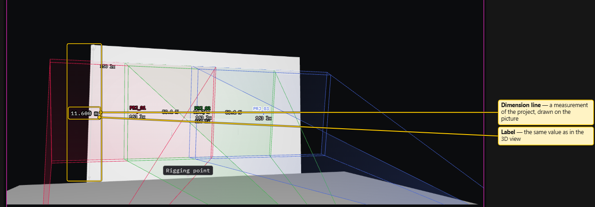

The dimension lines and notes you drew with the [Measure tools](Measure-Tools.md) can appear on report pictures and in a table.

- **On a picture.** The Render block's Properties has three switches: **Measurements** (the dimension lines, notes and labels; on for new pictures), **Image size tags** (each projector's image width x height at its aim distance; off for new pictures) and **Edge lengths** (the four image edges with their lengths; off for new pictures). Each dimension keeps its own style from the Measure tool. The picture's **Label outline** applies to its labels; **Label colour** and **Label size** do not.
- **Which ones show.** A picture draws the measurements whose **Show in** matches it (**All**, or the picture's camera) and which exist in the report's variation. A picture from the current 3D view or a projector shows only those set to **All**.
- **Hide one on one picture.** Under the picture options, the **Measurements** list has a checkbox for every measurement the picture could show. Untick one to hide it on this picture only. It stays in the project, on other pictures and in the table. You can also click a dimension in the selected picture and press **Hide <name> on this picture**.
- **Check flag.** A measurement with an amber **check** flag (after a model reload) is drawn amber and dashed with a "check" badge in the Report tab. The printed copy draws it normally. **Check** lists it as a warning.

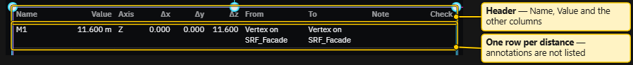

- **As a table.** Insert a **Table** block and set **Source** to **Measurements**. The columns are fixed: **Name**, **Value**, **Axis**, **Δx**, **Δy**, **Δz**, **From**, **To**, **Note**, **Check**. One row per visible distance measurement that exists in the report's variation, in the order of the Measure sidebar list. Annotations are not rows. Hiding a measurement on a picture does not remove it from the table.

### Moving and arranging

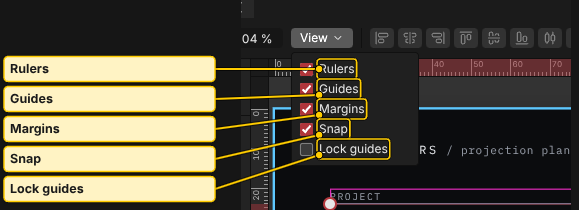

- Drag, resize and rotate with the handles. Shift-click adds to the selection.
- Type exact **X**, **Y**, **W**, **H** (mm) and **Rotation** in **Transform**.
- **Aspect lock** (checkbox "Keep aspect ratio") keeps the shape when you resize. With it off, dragging a side stretches or squashes a picture. **Lock** freezes a block.
- Align buttons: **Align left**, **Align centre**, **Align right**, **Align top**, **Align middle**, **Align bottom**. **Distribute horizontally** and **Distribute vertically** space the selected blocks evenly. **Align to** chooses what to align against.
- Blocks snap to guides, page edges and other blocks. Drag guides out of the rulers. The **View** button toggles **Rulers**, **Guides**, **Margins**, **Snap** and **Lock guides**.
- Keys when the canvas has focus: arrows nudge 1 mm (`Shift` + arrow 10 mm), `Ctrl+D` duplicates, `Delete` removes, `Ctrl+C`, `Ctrl+X` and `Ctrl+V` copy, cut and paste, `Ctrl+L` locks. Every edit is one undo step, with the app's normal undo.

### Crop

Select a picture or Render block. In **Picture**, press **Crop on page** (or double-click the picture). The block's handles turn into crop handles:

- Drag an edge or corner to cut that side. The picture stays where it is.
- Drag inside the frame to pan the picture.
- Use **Zoom**, **Pan X** and **Pan Y** for exact values. A stretched picture crops at its edges too, and Zoom moves both directions by the same factor.
- Press **Done** (or `Enter`) to keep the crop, `Esc` to cancel. **Reset crop** goes back to the full picture.

## Templates

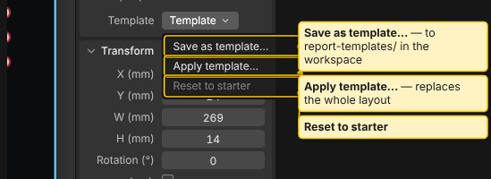

**Template** in Report setup:

- **Save as template…** stores the layout, with its pictures and SVG files, in your workspace folder under `report-templates/`. It asks for a name and asks before replacing one.
- **Apply template…** replaces the whole layout. Logos and SVG files are copied into this project. Camera choices of Render blocks are cleared.
- **Reset to starter** goes back to the built-in starter.

Built-in templates: **Dark lab**, **White lab** and **Lab sheet**. Lab sheet is white paper with dark ink, IBM Plex Mono throughout, one orange accent and a measuring-sheet frame.

### The BETA mark

While LUMAMATTERS is in beta, a small **BETA** pill appears on report pages after the product name. It shows in the Report tab, in the page thumbnails and in **Print / Save as PDF**. It is drawn when the page is shown and is not stored in your layout or templates.

- The pill follows a piece of text that is exactly `LUMAMATTERS`, as in the built-in templates' wordmark. It takes that text's font and colour.
- A page without that exact text gets no pill. Text such as `LUMAMATTERS rocks`, or the word split into parts by formatting, also gets none.

## Check

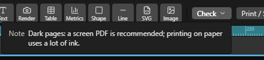

**Check** counts the problems in your report and lists them. Click an entry to jump to its block. It finds, for example:

- text that does not fit its frame, even at 6 pt;
- measurements that carry a **check** flag and may be shown on a picture or listed in a Measurements table (a warning; they still print);
- blocks that reach beyond the page edge;
- missing picture files and Render blocks that cannot be drawn;
- a note when the pages are dark: "a screen PDF is recommended; printing on paper uses a lot of ink."

## Making the PDF

1. Press **Print / Save as PDF** (or `Ctrl+P`).
2. If Check found warnings or errors, a dialog lists them and asks "Print anyway?".
3. The app waits for the final numbers, loads the fonts and draws every Render block at print size. A progress card with **Cancel** shows meanwhile.
4. In the print dialog, choose **Save as PDF** (owner: check the exact wording of this dialog in the desktop app).

The dialog suggests the file name `<project> – <variation> – <date>`. If you change the project while the report is being prepared, printing stops and asks you to try again.

The PDF keeps text selectable (owner: check). Check the result in a PDF viewer before you send it.

See also: [View Modes](View-Modes.md), [Analysis](Analysis.md), [People](People.md), [Textures](Textures.md)
