# Report and PDF

> **Planning aid.** LUMAMATTERS is a planning aid. Its numbers (illuminance, pixel size, throw distance, overlap) come from maker data and simplified models and can be wrong. No guarantee of correct data is given. Check critical values against the maker's spec sheets and on site.

The Report tab is a small page editor. Build the report from text, pictures of the 3D view, tables and shapes. Save it as a PDF through the print dialog. The app has no PDF engine of its own.

Every page has the same fixed size: A4 landscape, 297 × 210 mm. You cannot change it.

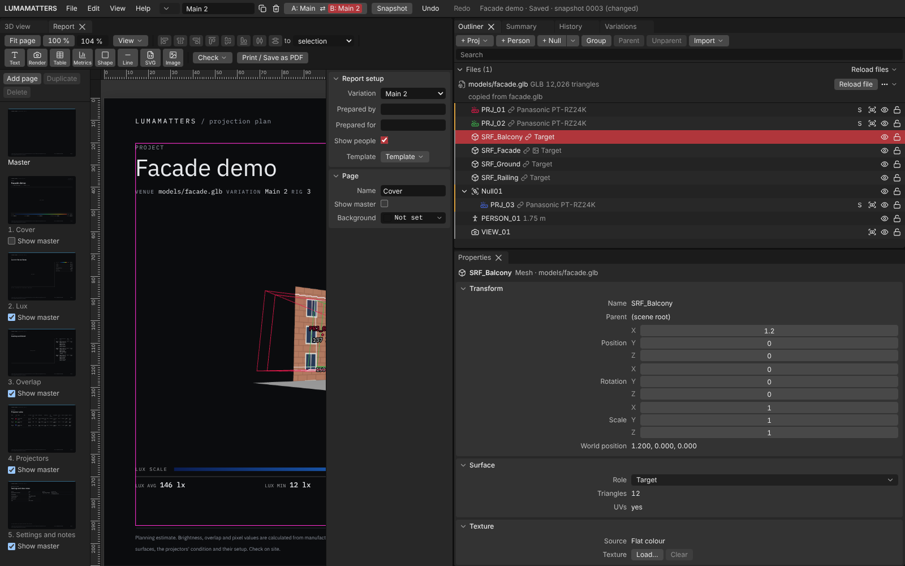

## Opening the report

Use one of these two ways:

- Choose **View > Report**.
- Choose **File > Export > Report…**.

Both open the **Report** tab next to the 3D view. With no project open, the tab says "Open a project to set up its report." The report reads the open project as it is now. You do not need to save first. It also works in a read-only window.

The first time, the tab shows the built-in **Dark lab** starter. It has near-black pages and IBM Plex fonts. The pages are a cover, a Photometric page, an Overlap page, a Projectors page and a Settings and notes page. Opening the tab writes nothing to your project. Your first edit stores the layout in the project file.

## The disclaimer

The footer of the cover and of the master page carries a disclaimer. The text is:

> Planning estimate. Brightness, overlap and pixel values are calculated from manufacturer data and the 3D model; real results depend on the venue, the surfaces, the projectors' condition and their setup. Check on site.

The disclaimer is a field in a text block. If you delete it from your layout, the report no longer carries it.

## Layout of the tab

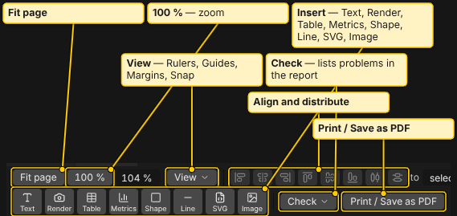

- **Toolbar** (top): zoom, **View**, align buttons, **Insert** buttons, **Check** and **Print / Save as PDF**.
- **Pages** (left): thumbnails of the **Master** and of every page. The buttons are **Add page**, **Duplicate** and **Delete**. **Delete** asks "Delete this page and its blocks?".
- **Canvas** (middle): the pages, with rulers in millimetres.
- **Properties** (right): **Report setup**, then the fields of the selected page or block.

To reorder pages, drag a thumbnail. You can also press `Alt+Up` or `Alt+Down` to move the selected page.

### Master page

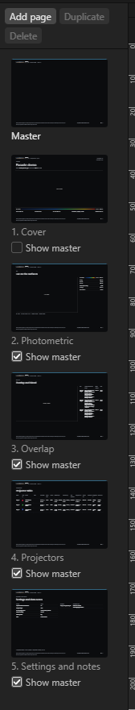

The **Master** holds what repeats on every page: header, footer, page numbers and, if you want, a logo. To edit it, click **Master** in the page list. To switch it off for one page, clear **Show master** in the page properties.

### Report setup

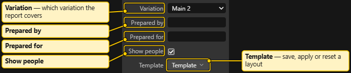

**Report setup** is at the top of the properties panel. It has these fields:

- **Variation**: the variation that the report covers. The field shows only when the project has more than one variation. One report covers one variation.
- **Prepared by** and **Prepared for**: optional one-line fields for the cover. While a field is empty, the Report tab shows its field name dimmed, for example `‹report.preparedBy›`. The thumbnails and the PDF show nothing there.
- **Show people**: draws the people from the [People](People.md) page in report pictures. Their shadows stay in the numbers either way.
- **Template**: **Save as template…**, **Apply template…** and **Reset to starter**.

## Blocks

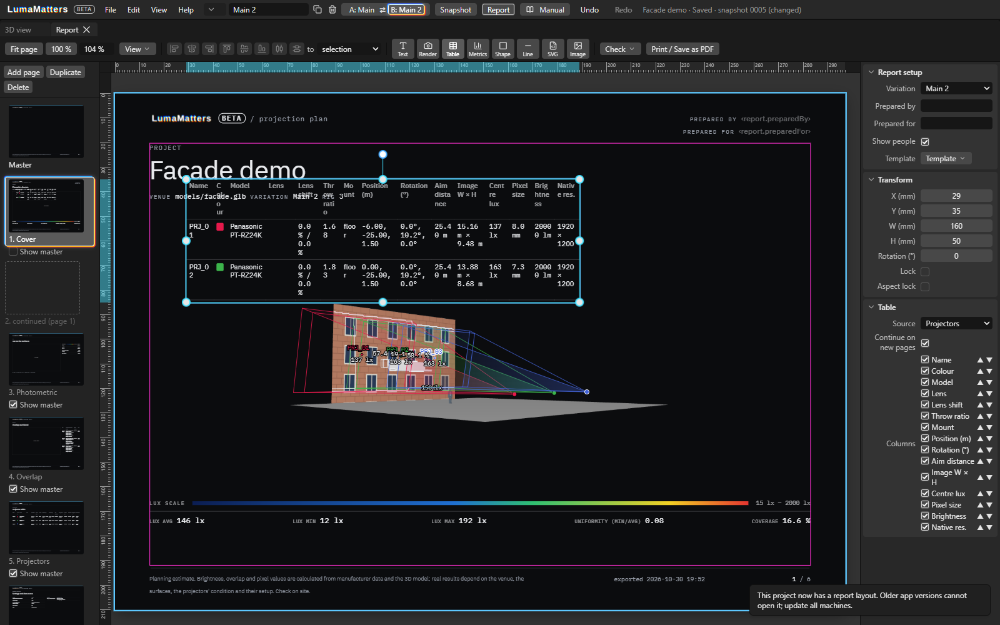

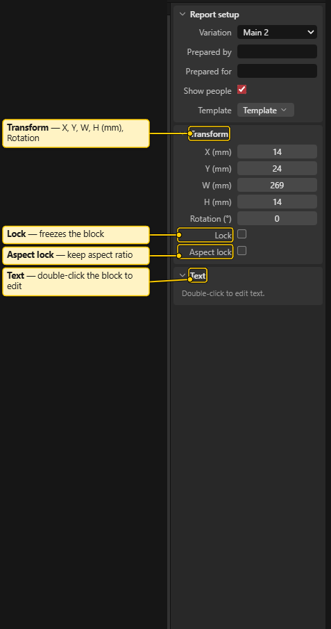

Click an **Insert** button to add a block. The block goes on the current page. While you edit the master, it goes on the master.

| Button | Block |
|---|---|
| **Text** | Rich text with font, size, bold, italic, underline, lists, alignment and paragraph styles. **Insert field…** adds live values. Double-click to edit. |
| **Render** | A picture of the 3D scene. Each Render block has its own camera. |
| **Table** | A table filled from the project, with a column picker. Sources: **Projectors**, **Pairs**, **Notes**, **Settings**, **Measurements**. A long table continues on new pages with its header repeated. |
| **Metrics** | A box of metric values. Layouts: **Strip**, **Grid** and **Table**. The optional **Lux scale** setting adds a colour bar. |
| **Shape** | A rectangle or an ellipse. |
| **Line** | A solid, dashed or dotted line. |
| **SVG** | Your own SVG artwork. |
| **Image** | A picture file, for example your logo. |

To add an SVG or a picture file, drag it onto the Report tab. The report refuses model files.

### Metrics block

The **Items** row of a Metrics block lists the values that the block shows. The row is read-only. Each value has the same label and the same text as in the **Summary** tab.

A Metrics block can show the photometry rows: **Luminance min**, **Luminance avg**, **Luminance max**, **Visible lit area**, **Ambient contrast min** and **Ambient contrast max**. A row reads n/a when the analysis has no value for it. The luminance rows read n/a unless the quantity of the 3D view is Luminance.

### Render block

A Render block has these rows in **Properties**:

- **View mode**: **Shaded**, **Photometric**, **Overlap** or **Pixel**. Reports do not offer the Distance view.
- **Quantity** and **Bands**: these rows show only with the Photometric view.
  - **Quantity**: **Illuminance**, **Luminance**, **Surface contrast** or **Ambient contrast**.
  - **Bands**: **Smooth**, **5 bands** or **10 bands**.
  - Each change is one undo step. The legend strip of the picture follows the quantity.
  - Luminance uses the viewpoint that you chose in the Photometric legend.
- **Source**: **Current 3D view**, a saved camera or a projector. With **Current 3D view**, click **Update view** to store the present camera of the 3D view for this picture.
- **Light**: this row shows only for a projector source. Choose **This projector only** or **All projectors**.
- **Fit**: **Fill** or **Fit**.
- **Lighting**: **Default** or **As 3D view**.
- **Textures**: **As 3D view**, **On** or **Off**.
- **Texture strength**: shows in the Photometric, Overlap and Pixel views.
- **Test patterns**: shows in the Shaded view.
- **Legend**: **Default**, **None**, **Below**, **Right** or **Inside**.
- **Background**.

The overlay options are **Cones**, **Iso-lux lines**, **Iso-lux labels**, **Centre lux** and **Blend values**. The two iso-lux options are greyed out unless the quantity is Illuminance. The label rows are **Label size**, **Label colour** and **Label outline**.

The **Beams** row (**Selected**, **All** or **None**) and the **Beam visibility (%)** row set how the cones of the Cones overlay draw. Both rows are greyed out while **Cones** is off.

- A new Render block takes the Viewport setting at the moment you insert it. It also switches **Cones** on, unless the Viewport beams are **None**.
- After that, the block keeps its own setting. It does not follow the Viewport.
- In a report, nothing is selected. **Selected** therefore draws the lines of every projector without fill. **All** adds the fill.
- Older blocks keep their old look until you change these rows.

Every number in the report equals the matching number in the app panels.

### Measurements in the report

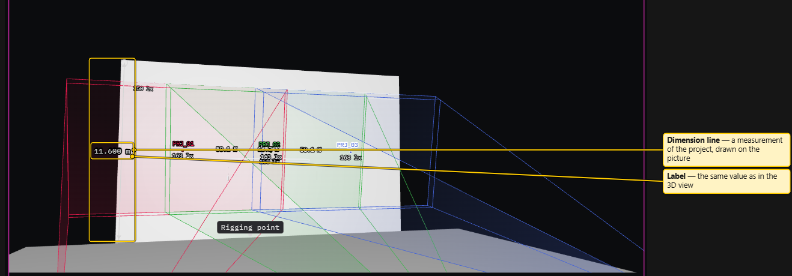

The dimension lines and notes from the [Measure tools](Measure-Tools.md) can appear on report pictures and in a table.

**On a picture.** A Render block has three switches:

- **Measurements**: the dimension lines, notes and labels. On for new pictures.
- **Image size tags**: the width × height of each projector image at its aim distance. Off for new pictures.
- **Edge lengths**: the four image edges with their lengths. Off for new pictures.

Each dimension keeps its own style from the Measure tool. **Label outline** applies to the labels of measurements. **Label colour** and **Label size** do not.

**Which measurements show.** A picture draws the measurements that meet both rules:

- Their **Show in** setting matches the picture. It is **All**, or the camera of the picture.
- They exist in the variation of the report.

A picture from the current 3D view or from a projector shows only the measurements set to **All**.

**Hide one measurement on one picture.** Open the **Measurements** list under the picture options. It has a checkbox for every measurement that the picture can show. Clear a checkbox to hide that measurement on this picture only. The measurement stays in the project, on other pictures and in the table. You can also click a dimension in the selected picture. Then click **Hide <name> on this picture**.

**Check flag.** A measurement can carry an amber **check** flag after a model reload. In the Report tab, the app draws it amber and dashed with a "check" badge. The printed copy draws it normally. **Check** lists it as a warning.

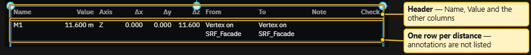

**As a table.** Insert a **Table** block and set **Source** to **Measurements**. The columns are fixed: **Name**, **Value**, **Axis**, **Δx**, **Δy**, **Δz**, **From**, **To**, **Note**, **Check**.

- The table has one row for each visible distance measurement in the variation of the report.
- The rows follow the order of the Measure sidebar list.
- Annotations are not rows.
- Hiding a measurement on a picture does not remove it from the table.

### Moving and arranging

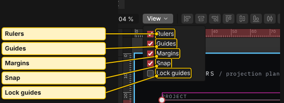

- Drag a block, or use the handles to resize and rotate it. `Shift`-click adds to the selection.
- Type exact values for **X**, **Y**, **W**, **H** (mm) and **Rotation** in **Transform**.
- **Aspect lock** (the checkbox "Keep aspect ratio") keeps the shape when you resize. With it off, dragging a side stretches or squashes a picture.
- **Lock** freezes a block.
- The align buttons are **Align left**, **Align centre**, **Align right**, **Align top**, **Align middle** and **Align bottom**. **Distribute horizontally** and **Distribute vertically** space the selected blocks evenly. **Align to** chooses what to align against.
- Blocks snap to guides, page edges and other blocks. Drag guides out of the rulers.
- The **View** button toggles **Rulers**, **Guides**, **Margins**, **Snap** and **Lock guides**.

**Block order.** Blocks that are higher in the order draw on top. To change the order, right-click a block. The menu has four rows in this order:

1. **Bring to front** (`Ctrl+]`)
2. **Bring forward** (`]`)
3. **Send backward** (`[`)
4. **Send to back** (`Ctrl+[`)

A right-click outside a block opens no menu.

**Keys.** These keys work when the canvas has focus:

| Key | Action |
|---|---|
| Arrow keys | Nudge 1 mm. With `Shift`, nudge 10 mm. |
| `Ctrl+D` | Duplicate |
| `Delete` | Remove |
| `Ctrl+C`, `Ctrl+X`, `Ctrl+V` | Copy, cut and paste |
| `Ctrl+L` | Lock |

Every edit is one undo step. The report uses the normal undo of the app.

### Crop

1. Select a picture or a Render block.
2. In **Picture**, click **Crop on page**. You can also double-click the picture.
3. The handles of the block turn into crop handles.

Then use these controls:

- Drag an edge or a corner to cut that side. The picture stays where it is.
- Drag inside the frame to pan the picture.
- Use **Zoom**, **Pan X** and **Pan Y** for exact values. A stretched picture crops at its edges too. **Zoom** changes both directions by the same factor.
- Click **Done** or press `Enter` to keep the crop. Press `Esc` to cancel.
- Click **Reset crop** to go back to the full picture.

## Templates

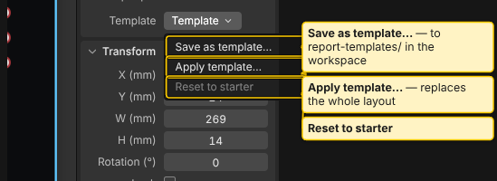

Use **Template** in **Report setup**:

- **Save as template…** stores the layout in your workspace folder under `report-templates/`. It also stores the pictures and SVG files. It asks for a name. It asks before it replaces a template.
- **Apply template…** replaces the whole layout. The app copies logos and SVG files into this project. It clears the camera choices of the Render blocks.
- **Reset to starter** goes back to the built-in starter.

The built-in templates are **Dark lab**, **White lab** and **Lab sheet**. Lab sheet is white paper with dark ink. It uses IBM Plex Mono throughout, one orange accent and a measuring-sheet frame.

### The BETA mark

While LUMAMATTERS is in beta, a small **BETA** pill appears on report pages after the product name. It shows in the Report tab, in the page thumbnails and in **Print / Save as PDF**. The app draws it when it shows the page. The app does not store it in your layout or in your templates.

- The pill follows a piece of text that is exactly `LUMAMATTERS`. The wordmark of the built-in templates is such a text. The pill takes the font and the colour of that text.
- A page without that exact text gets no pill. Text such as `LUMAMATTERS rocks` gets none. A word that formatting splits into parts gets none.

## Check

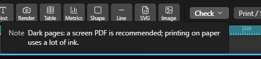

**Check** counts the problems in your report and lists them. Click an entry to jump to its block. **Check** finds, for example:

- text that does not fit its frame, even at 6 pt;
- measurements that carry a **check** flag and may show on a picture or in a Measurements table (a warning; they still print);
- blocks that reach beyond the page edge;
- missing picture files and Render blocks that the app cannot draw;
- dark pages. The note says that a screen PDF is recommended, because printing on paper uses a lot of ink.

When the list is empty, it says "No problems found."

## Making the PDF

1. Click **Print / Save as PDF**, or press `Ctrl+P`.
2. If **Check** found problems, a dialog lists them and asks "Print anyway?". Click **Print anyway** or **Cancel**.
3. Wait while the app prepares the report. It waits for the final numbers, loads the fonts and draws every Render block at print size. A progress card with **Cancel** shows meanwhile.
4. In the print dialog, choose the option that saves a PDF file.

The app suggests the file name `<project> – <variation> – <date>`. If you change the project while the app prepares the report, printing stops. The app asks you to try again.

Open the PDF in a PDF viewer and check it before you send it.

See also: [View Modes](View-Modes.md), [Analysis](Analysis.md), [People](People.md), [Textures](Textures.md)
