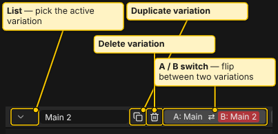
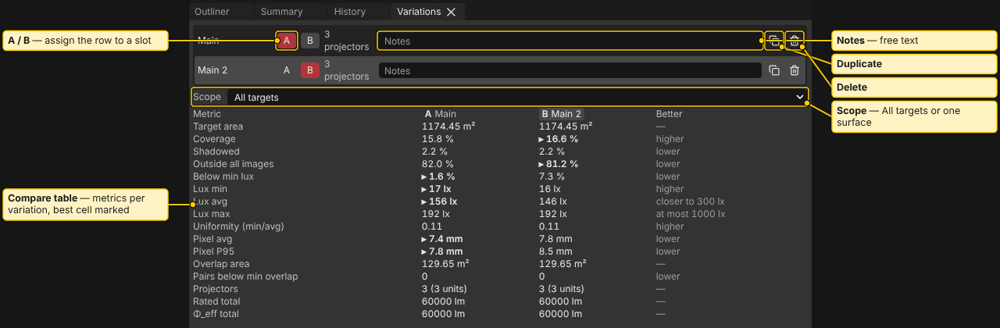

# Variations and Compare

> **Planning aid.** LUMAMATTERS is a planning aid. Its numbers (illuminance, pixel size, throw distance, overlap) come from maker data and simplified models. They can be wrong. No guarantee of correct data is given. Check critical values against the maker's spec sheets and on site.

A project can hold several projector layouts and compare them side by side. The app calls each layout a **variation**.

## What a variation holds

- The **venue** is shared by all variations. It holds the model files, the surface roles and the analysis settings. Change the venue once, and every variation sees the change.
- The **rig** belongs to one variation. It holds the projectors and the rig nulls that hold them.

A variation means "same venue, different projectors". Example names are Main, Wide lens and Fewer projectors.

## Make and manage variations

The variation group is in the header bar, right of the menus. It has these controls:

- The list button picks the active variation.
- The name field renames the active variation. Press `Enter` to apply the name. Press `Esc` to undo the typing. A name must be unique and not empty.
- **Duplicate variation** copies the projectors and the rig nulls into a new variation. The new variation becomes active.
- **Delete variation** removes the active variation. A project keeps at least one variation. If the variation holds a locked object, the app refuses to delete it. Unlock the object first.

The **Variations** tab is next to the Outliner, Summary and History tabs. It lists every variation in a row:

- Click a row to make that variation active.
- Double-click a name to rename the variation.
- Click **A** or **B** to assign the row to a slot of the A/B switch.
- Each row shows the number of projectors and a **Notes** field. The **Notes** field takes up to 2000 characters.
- Each row has **Duplicate** and **Delete** buttons.

## A/B switch

The header button shows the two slots, for example "A: Main ⇄ B: Wide lens". Click it, or press the key left of `1`, to swap between the two slots. The key is the backtick key on most keyboards, whatever its label.

When you swap, the camera, the view mode and the selected venue objects stay the same. If the active variation is in neither slot, the switch goes to A. The button is off when the project has only one variation.

Undo and variations:

- If you undo a rig edit that you made in another variation, the app switches to that variation first. A message says so.
- If you undo a venue edit, the app never switches.

## Compare table

The Compare table is in the **Variations** tab, below the list. Each column is one variation. The columns of the A and B slots carry an A or B tag. Click a column header to make that variation active.

- The **Scope** menu picks **All targets** or one target surface.
- The rows are the metrics of the Summary. Examples are **Coverage**, **Lux min**, **Lux avg**, **Lux max**, **Uniformity (min/avg)**, **Pixel avg**, **Pixel P95**, **Overlap area**, **Pairs below min overlap**, **Projectors**, **Rated total** and **Φ_eff total**. The Lux rows show illuminance in lx.
- The **Better** column gives the rule for each row. The rule is "higher", "lower", "closer to" your target illuminance, or "at most" your maximum illuminance.
- The table marks the best cell in each row. It does not mark ties.
- A cell can show "computing…", "error" or "not computed at Precise". The app does not compute inactive variations at full precision. To fill the column of a variation, make that variation active once.
- A surface that does not exist in a variation shows "—".

The numbers use blended light, as in the Summary. See [Analysis](Analysis.md).

## Projector limit

The analysis covers at most 16 projectors in each variation. The slow-performance warning starts at 9 projectors. See [Placing Projectors](Placing-Projectors.md).

## See also

[Placing Projectors](Placing-Projectors.md), [Analysis](Analysis.md), [Summary and History](Summary-and-History.md), [Report and PDF](Report-and-PDF.md)
