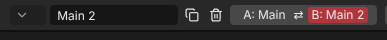
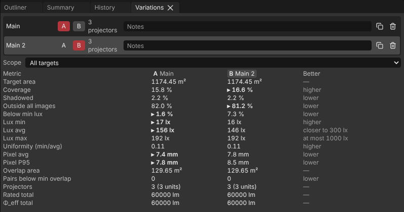

# Variations and Compare

> **Planning aid.** LUMAMATTERS is a planning aid. Its numbers (lux, pixel size, throw distance, overlap) come from maker data and simplified models and can be wrong. No guarantee of correct data is given. Check critical values against the maker's spec sheets and on site.

A project holds several projector layouts and compares them side by side. The app calls each layout a **variation**. (The design specs call it a setup.)

## What a variation holds

- The **venue** is shared by all variations: model files, surface roles and analysis settings. Change the venue once and every variation sees it.
- The **rig** is per variation: the projectors, and the nulls that hold them.

A variation means "same venue, different projectors". For example: Main, Wide lens, Fewer projectors.

## Make and manage variations

The variation group is in the header, right of the menus:

- The list button picks the active variation.
- The name field renames it. Press `Enter` to apply and `Esc` to undo the typing. Names must be unique and not empty.
- **Duplicate variation** copies the projectors and nulls into a new, active variation.
- **Delete variation** removes the active one. A project keeps at least one. A variation that holds a locked object is refused: unlock first.

The **Variations** tab (next to Outliner, Summary and History) lists every variation in rows:

- Click a row to make it active. Double-click its name to rename it.
- The **A** and **B** buttons assign the row to a slot of the A/B switch.
- Each row shows the projector count, a **Notes** field (up to 2000 characters), and Duplicate and Delete.

## A/B switch

The header button reads, for example, "A: Main ⇄ B: Wide lens". Press it, or press the key left of `1` (the backtick key, whatever its label), to flip between the two slots. The camera, view mode and selected venue objects stay. If the active variation is in neither slot, the switch goes to A. With only one variation the button is off.

Undo note: undoing a rig edit made in another variation switches to that variation first, and a message says so. Undoing a venue edit never switches.

## Compare table

The Compare table is in the **Variations** tab below the list. Columns are the variations (A and B are tagged). Click a column header to make that variation active.

- **Scope** picks **All targets** or one target surface.
- Rows are the Summary metrics, such as **Coverage**, **Lux min**, **Lux avg**, **Lux max**, **Uniformity (min/avg)**, **Pixel avg**, **Pixel P95**, **Overlap area**, **Pairs below min overlap**, **Projectors**, **Rated total** and **Φ_eff total**.
- The **Better** column gives the rule per row: higher, lower, "closer to" your target lux, or "at most" your max lux. The best cell in a row is marked. Ties are not marked.
- A cell can read "computing…", "error", or "not computed at Precise". Inactive variations are not computed at full precision. Make the variation active once to fill its column.
- A surface that does not exist in a variation shows "—".

Numbers use blended light, as in the Summary. See [Analysis](Analysis.md).

## Projector limit

Each variation can analyse at most 16 projectors. The slow-performance warning starts at 9. See [Placing Projectors](Placing-Projectors.md).

## See also

[Placing Projectors](Placing-Projectors.md), [Analysis](Analysis.md), [Summary and History](Summary-and-History.md), [Report and PDF](Report-and-PDF.md)
