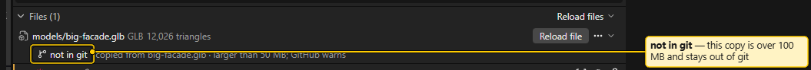
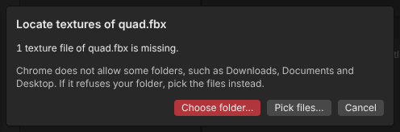

# Several Machines

LUMAMATTERS has no sync and no cloud. To work on more than one computer, share projects with **git** or copy the workspace folder. You do not need to be a developer. You need git on each machine and a place to push to, for example a private GitHub repository.

## Set it up

1. Make the workspace folder a git repository, or pick a workspace inside an existing one.
2. Commit and push from machine A.
3. On machine B, clone the repository.
4. On machine B, choose the clone with **Open workspace…** or **File > Change workspace…**.

The app writes a managed block into the `.gitignore` of the workspace. The block keeps these items out of git: the `content` and `exports` folders of each project, the `.recovery` folder and temporary files. The app never runs git itself. You commit, pull and push yourself.

Close the project in the app before you commit or pull. Pull on the other machine before you start to edit.

## What travels, what stays

Travels in git:

- the project file `<name>.luma`, with the last camera position
- snapshots (their names carry a four-letter machine tag, so two machines never overwrite each other's snapshots)
- imported model files and snapshot model copies, up to 100 MB each
- the projector library in the workspace

Stays on each machine:

- the **Open Recent** list, the panel layout and the remembered workspace folder
- the look settings of the 3D view, for example grid, background and snap steps
- the remembered source of each imported model (where you copied it from)
- the search folder that the app remembers for finding textures

## Big model files (over 100 MB)

GitHub refuses files over 100 MB. The app handles them for you:

- The app adds each model file larger than 100 MB (100,000,000 bytes) to the project's `.gitignore` (`projects/<name>/.gitignore`). Their snapshot copies stay out of git too.
- The import report and the row of the file show a warning. It says that the file is larger than 100 MB and that GitHub refuses it. It also says that the app keeps the file and its snapshot copies out of git. Other machines need their own copy (OneDrive or a local copy).
- In the Outliner, the model file has the flag **not in git**.
- Sometimes git already tracks an older, smaller copy of that path. Then the warning tells you to run `git rm --cached projects/<name>/models/<file>` once. `.gitignore` does not untrack a file that git already follows.

To use such a model on machine B, copy the file there yourself. Put it in the same place in the `models` folder of the project.

## Source paths are remembered per machine

When you import a file, the app copies it into the project and remembers where it came from. This memory stays on that machine. The app never puts it in the project file, because paths differ between computers.

On machine B, **Reload file** can miss the source. Then the dialog **Source file not available** says "The source <file> is not available on this machine."

1. Click **Pick source file…**.
2. Choose the file.
3. If its name differs from the model, the app asks **Use <file> as the source?**. Click **Use**.

Machine B then remembers the source.

## Locate dialog (missing textures)

Use this dialog when a model points to texture images or buffers (for a `.gltf`) that are not on the machine. Open it from the row menu of the model file in the Outliner Files section: **Locate textures…**. The import report and the reload report also offer **Locate textures…** and **Pick files…**.

- **Choose folder…** searches a folder and its subfolders. A running count shows, with **Stop search**.
- **Pick files…** picks the files by hand. It always sits next to the folder button.
- The app remembers the last folder per machine and searches it first.
- The dialog shows a note that some folders, for example Downloads, Documents and Desktop, can be refused. If the app refuses a folder, pick the files instead.

## If both machines edited the same project

Git cannot merge `<name>.luma` when two machines edited the same project without a pull in between. The file holds the last-edit time and the camera. So it conflicts almost every time, even when your edits did not overlap.

**Project closed, then opened.** The file can contain git conflict markers. Then the project does not open. The dialog `<name>.luma cannot be opened` names the error. You have these choices:

- Click **Close** and fix the file in git.
- Click **Use snapshot <number> (...)** to continue from a snapshot.
- If the app can read both halves of the conflict, it also shows one button for each side: **Use the side "<git label>" (edited <time>)**. Compare the edit times to pick the right side.

The app first keeps the unreadable file in `.recovery/`.

**Project open while the file changes.** You get a banner. It has **Reload theirs** and **Keep mine**. For an unreadable file, it has **Keep mine** and **Keep paused**. See [Projects and Snapshots](Projects-and-Snapshots.md).

You do not lose the side that you do not pick. The app saves it as a snapshot or in `.recovery/`. Snapshots never conflict in git.

The simplest rule: **one machine edits a project at a time.** Pull before you start. Push when you stop.

## Without git

A plain copy also works.

1. Close the project.
2. Copy the workspace folder, or one `projects/<name>` folder, to a USB drive or a network share.
3. Open it on the other machine.

Never open the same project from two machines at once on a shared drive.

See also: [Projects and Snapshots](Projects-and-Snapshots.md), [Blender Export and Import](Blender-Export-and-Import.md), [Project Files](Project-Files.md), [Textures](Textures.md)
