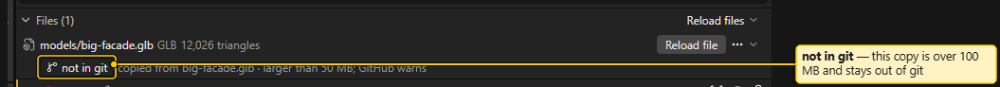
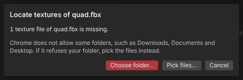

# Several Machines

LUMAMATTERS has no sync and no cloud. If you work on more than one computer, the way to share projects is **git**, or simply copying the workspace folder. This page shows the practical side. You do not need to be a developer, but you need git installed and a place to push to (for example a private GitHub repository).

## Set it up

1. Make the workspace folder a git repository (or pick a workspace inside an existing one).
2. Commit and push from machine A.
3. On machine B, clone the repository and choose that clone with **Open workspace…** or **File > Change workspace…**.

The app writes a managed block into the workspace `.gitignore`. It keeps out the `content` and `exports` folders of each project, the `.recovery` folder and temporary files. The app never runs git itself. You commit, pull and push yourself.

Handy habit: close the project in the app before you commit or pull. Then pull on the other machine before you start editing.

## What travels, what stays

Travels in git:

- the project file `<name>.luma` (including the saved camera view)
- snapshots (their names carry a four-letter machine tag, so two machines never overwrite each other's snapshots)
- imported model files and snapshot model copies, up to 100 MB each
- the projector library in the workspace

Stays on each machine:

- the **Open Recent** list, panel layout and the remembered workspace folder
- the remembered source of each imported model (where you copied it from)
- the search folder remembered for finding textures

## Big model files (over 100 MB)

GitHub refuses files over 100 MB. So the app handles them for you:

- Model files larger than 100 MB (100,000,000 bytes) are added by the app to the project's own `.gitignore` (`projects/<name>/.gitignore`). Their snapshot copies are kept out of git too.
- The import report and the file's row show a warning: the file is larger than 100 MB, GitHub refuses it, the app keeps it and its snapshot copies out of git, and other machines need their own copy (OneDrive or a local copy).
- In the Outliner, the model file is flagged **not in git**.
- If git already tracked an older, smaller copy of that path, the warning tells you to run `git rm --cached projects/<name>/models/<file>` once. `.gitignore` does not untrack a file that git already follows.

To use such a model on machine B, copy the file there yourself, into the same place in the project's `models` folder.

## Source paths are remembered per machine

When you import a model, the app copies the file into the project and remembers where it came from. This memory lives on that machine only. It is never put in the project file, because paths differ between computers.

When you use **Reload file** on machine B, the app may not know the source. A dialog **Source file not available** says "The source <file> is not available on this machine." Click **Pick source file…** and choose the file. If its name differs from the model, the app asks **Use <file> as the source?**. From then on, machine B remembers it.

## Locate dialog (missing textures)

Models can point to texture images or buffers (for a `.gltf`) that are not found on the machine. Open it from the model file's row menu in the Outliner Files section (**Locate textures…**). The import and reload reports offer **Locate textures…** and **Pick files…** too.

- **Choose folder…** searches a folder and its subfolders. A running count shows, with **Stop search**.
- **Pick files…** lets you pick the files by hand. It is always offered beside the folder button.
- The app remembers the last folder per machine and searches it first.
- The app says Chrome does not allow some folders such as Downloads, Documents and Desktop. The desktop app is built on the same engine, so the same limit probably applies. (owner: check) If a folder is refused, pick the files instead.

## If both machines edited the same project

Git cannot merge `<name>.luma` automatically when two machines edited the same project without a pull in between. The file holds the last-edit time and the camera, so this conflicts almost every time, even when your edits did not overlap.

What happens:

- **Project closed, then opened:** if the file contains git conflict markers, the project does not open. A dialog `<name>.luma cannot be opened` names the error. You can choose **Close** and fix it in git, or **Use snapshot <number> (...)** to continue from a snapshot. When both halves of the conflict can be read, you also get one button per side, **Use the side "<git label>" (edited <time>)**. Compare the edit times to pick the right one. The unreadable file is kept in `.recovery/` first.
- **Project open while the file changes:** you get the banner with **Reload theirs** and **Keep mine**, or, for an unreadable file, **Keep mine** and **Keep paused**. See [Projects and Snapshots](Projects-and-Snapshots.md).

You do not lose the side you do not pick: it is saved as a snapshot or in `.recovery/`. Snapshots never conflict in git.

Simplest rule: **one machine edits a project at a time.** Pull before you start, push when you stop.

## Without git

A plain copy works too: close the project, copy the workspace folder (or one `projects/<name>` folder) to a USB drive or network share, and open it on the other machine. Do not open the same project from two machines at the same moment on a shared drive.

See also: [Projects and Snapshots](Projects-and-Snapshots.md), [Blender Export and Import](Blender-Export-and-Import.md), [Project Files](Project-Files.md), [Textures](Textures.md)
