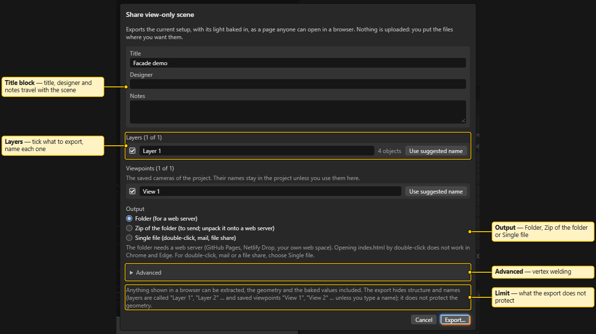

# Share a view-only scene

> **Planning aid.** LUMAMATTERS is a planning aid. Its numbers (illuminance, pixel size, throw distance, overlap) come from maker data and simplified models and can be wrong. No guarantee of correct data is given. Check critical values against the maker's spec sheets and on site.

**File > Share view-only scene…** turns the active variation into a page that anyone can open in a web browser. The viewer does not need LUMAMATTERS or project files. The viewer cannot edit anything.

In the viewer, you can:

- orbit, pan and zoom;
- jump to your saved cameras;
- read the title block and the notes;
- switch layers on and off;
- show the light in the **Shaded** or **Photometric** view.

The Photometric view shows **Illuminance** or **Luminance**, with a colour bar.

The app uploads nothing. It writes the files to a place that you choose. You put them where you want them. LUMAMATTERS itself stays offline.

## What the export contains

- The visible meshes of the active variation, merged per layer and colour. The colours are the base colours of the 3D view.
- The light, baked into the surfaces as numbers per vertex (illuminance and, when available, luminance). The values come from the final analysis of the active variation. The app splits large triangles, so the values follow the edges of beams and shadows. This is the exact calculation of the app, sampled at the vertices. The viewer interpolates between the vertices.
- Your saved cameras (the `VIEW_` cameras) as viewpoints.
- The title, the designer name, the notes and the export date.
- The viewer program itself.

## What the export does not contain

- No `.luma` project file, no original model files and no snapshots.
- No projectors, no projector models, no specs and no rig data. No projector bodies and no beams.
- No people, no textures and no measurements.
- No hidden objects, and no layers that you clear in the dialog.
- No Outliner names, object names, model file names or paths. Layers are called **Layer 1**, **Layer 2** and so on. You can type a name for each layer.
- No Overlap view, no Pixel view and no hover readout.

The title and the designer travel with the scene. The title starts as the project name. The designer starts as the "Prepared by" name of the report. Clear or change them if they must not show.

## Honest limits

Anything that a browser shows can be extracted, including the geometry and the baked values. The export hides structure and names. It does not protect the geometry. Do not share a scene when you cannot hand over its geometry.

## The dialog



The dialog has these parts:

- **Title**, **Designer** and **Notes**. The title starts as the project name. The designer starts as the "Prepared by" name of the report. You can change both here without a change to the project. If the title is blank, the viewer shows "Untitled scene".
- **Layers**. Tick the layers to export. Type a name for each layer. The button **Use suggested name** fills in a name from your project: the Outliner branch or the model file name. The app never fills it in for you. With no layer ticked, the dialog says "Tick at least one layer." and **Export…** stays disabled.
- **Viewpoints**. This list shows only when the project has saved cameras. Tick the cameras to export. Type a name for each camera. The names are **View 1**, **View 2** and so on. **Use suggested name** fills in the camera name.
- **Output**. Choose one of three options:
  - **Folder** writes `index.html`, `viewer.js`, `scene.glb`, `meta.json` and `licences.txt` into a folder that you pick. It needs a web server (see the next sections).
  - **Zip of the folder** writes the same files into one `.zip` file. Send it by mail or file share. The receiver unpacks it onto a web server.
  - **Single file** writes one `.html` file with everything inside. It opens by double-click in Chrome and Edge, from a file share or a mail attachment. It is bigger than the folder, because the scene travels as text inside the page.
- **Password**. This field is for **Single file** only. It is optional and needs at least 8 characters. See [Password](#password).
- **Advanced > Vertex welding**. **1 degree** is the default. It keeps the light values as exact as possible. **5 degrees** makes a smaller file, about half the size on bumpy scans. With 5 degrees, the light value at a shared corner follows its first face. Use it only for scans that are too big.

The app never overwrites a folder. Pick an empty folder. The app refuses your project folder and every folder inside it. It also refuses every folder that holds a `.luma` file or snapshots. For the zip and the single file, the save dialog asks before it replaces a file. The app refuses a place inside your project folder.

Click **Export…**. The app opens the folder dialog or the save dialog first. Then it bakes the light. While it works, the dialog shows a progress bar. The app is busy for a few seconds during the bake. You cannot stop the bake half-way. **Cancel** closes the dialog, ignores the result and writes nothing. If the analysis is still running, the dialog waits for it. The export also works in a window that is open read-only, because it only reads the project.

When the export is done, the button **Cancel** becomes **Close**.

## Folder: it needs a web server

A web server (GitHub Pages, Netlify Drop or your own web space) must serve the folder version. Opening `index.html` by double-click does not work in Chrome and Edge. The browser does not let a page that loads from a file read the scene file next to it. The viewer then shows "Open this folder through a web server, or use the single-file export." For double-click, mail or a file share, choose **Single file**.

### Test it on your PC

1. Open a terminal in the exported folder.
2. Run one of these commands:

```
npx serve
python -m http.server
```

3. Open `http://localhost:3000` (for `npx serve`) or `http://localhost:8000` (for the Python command).

`npx serve` downloads a small tool the first time. `python -m http.server` needs Python. Both serve only to your own PC.

### GitHub Pages

1. Create a new repository on GitHub. A free account needs a **public** repository for Pages. Anyone with the link can then open the files. The geometry in them is public.
2. Upload the exported files to the repository. Click **Add file > Upload files**, drag the contents of the exported folder in, and commit. `index.html` must be at the top level of the published folder.
3. Open **Settings > Pages**.
4. Under **Build and deployment**, choose **Deploy from a branch**.
5. Pick the branch (`main`, or `gh-pages` if you made one) and the folder `/ (root)`. Click **Save**.
6. After a minute, the page is at `https://<your-user>.github.io/<repository>/`.

To change the scene, export again into a new empty folder. Upload the new files over the old ones.

### Netlify Drop

1. Open `app.netlify.com/drop` in your browser.
2. Drag the exported folder onto the page.
3. Netlify gives the site a random address. You can open it at once.

Netlify sets the rules for a site that you make without an account. It also sets how long the site stays online. Read the rules on the page before you rely on the site.

### Your own web space

Upload the exported files to a folder on your web space. Use FTP or the file manager of the host. The address of that folder is the address of the scene.

## The viewer

The viewer starts in the **Shaded** view, with a three-quarter view of the whole scene. It has these parts:

- A title card with the title, the designer, the date and the LUMAMATTERS version.
- A **Notes** card, when you typed notes.
- **Viewpoints**: one button for each saved camera.
- **Layers**: one checkbox for each layer.
- **View**: the buttons **Shaded** and **Photometric**. In the Photometric view, the buttons **Illuminance** and **Luminance** appear. **Luminance** is disabled when the export holds no luminance. The checkbox **Edge highlight** is on by default.

The colour bar of the Photometric view has the fields **Min**, **Target** and **Max**. It also has the buttons **Log** and **Linear** and the button **Auto range**.

## Password

The password is for the single file only. The app uses the engine of StatiCrypt (MIT licence) and runs it inside the app. The app installs nothing on your PC and makes no network call. The file that you get is a password page. It holds the viewer and the scene in encrypted form.

The app turns the password into a key with PBKDF2 (600,000 rounds in total). The browser decrypts the page with AES. The password page shows only a generic prompt. It contains no scene title, no project name and no scene data.

What the password does not do:

- Whoever has the password can open the file, save the page and read the geometry out of the browser. Share the password separately from the file.
- The password is only as strong as you make it. Use a long one.
- There is no recovery. If you lose the password, export again.
- The password page needs a secure page to decrypt. A file opened from disk works. A site served over `https://` works. A site served over plain `http://` does not.
- The password does not cover the folder and the zip. A folder on a web server is public unless the server protects it.

A password-protected file is about twice the size of the same file without a password. For a scene file above 100 MB, the app does not offer the password. Export without a password, or export as a folder.

## Known limits

- The viewer is tested in Chrome and Edge. Firefox is not tested.
- The viewer has no orthographic camera. An orthographic camera of your project becomes a normal viewpoint.
- The viewer cannot show the roll of a viewpoint. Its camera always keeps up as +Y.
- The viewer needs WebGL 2.
- The app exports only the active variation, as it is now. Change the variation first, then export again.

See also: [Menus](Menus.md), [Report and PDF](Report-and-PDF.md), [View modes](View-Modes.md), [Physics model and limits](Physics-Model.md).

## Licences

The viewer contains three.js and the meshoptimizer decoder (both MIT licence). A password page also contains StatiCrypt (MIT licence). The notices travel with the export. The folder and the zip hold a `licences.txt`. The single file and the password page hold an HTML comment at the top.
