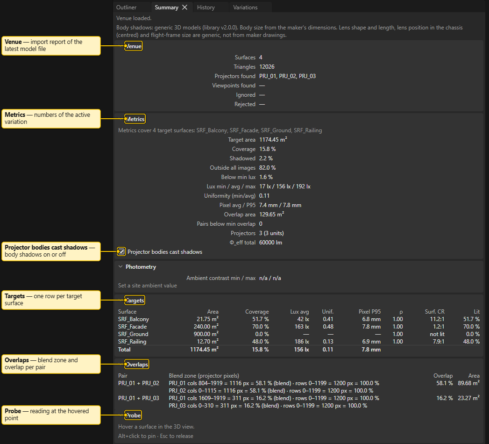
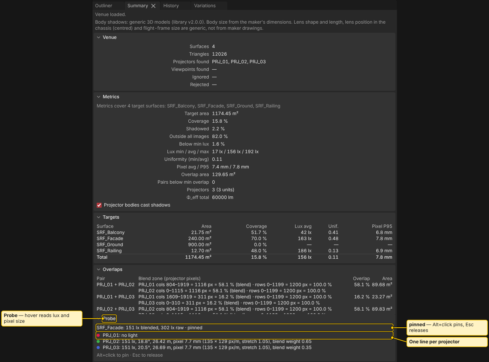
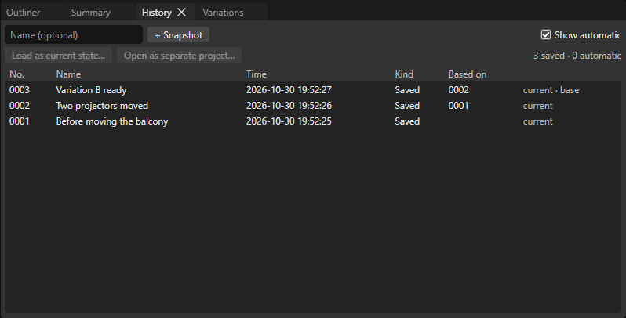

# Summary and History

These two tabs sit next to the Outliner. Do not mix them up with undo. The last section explains the difference.

> **Planning aid.** LUMAMATTERS is a planning aid. Its numbers (illuminance, pixel size, throw distance, overlap) come from maker data and simplified models. They can be wrong. No guarantee of correct data is given. Check critical values against the maker's spec sheets and on site.

## Summary

Summary shows the state of the venue and the numbers of the active variation. Click a section header to fold the section.

- **Status line** at the top. It says "Venue loaded." or "No model file imported. Use File > Import." A problem, for example a missing model file, shows on its own line. A **Hidden:** line counts the hidden projectors and surfaces. The numbers do not include them.
- **Venue**: the import report of the latest model file. It shows Surfaces, Triangles, Projectors found, Viewpoints found, Ignored, Rejected and warnings. With several model files, a list picks which report to show.
- **Metrics**: the rows are Target area, Coverage, Shadowed, Outside all images, Below min lux, Lux min / avg / max, Uniformity (min/avg), Pixel avg / P95, Overlap area, Pairs below min overlap, Projectors and Φ_eff total. Φ_eff total is the effective lumens. The labels with "lux" show illuminance in lx. A badge says `stale` while the numbers recompute. It says `analysis failed: out of date` when the analysis fails. The checkbox **Projector bodies cast shadows** switches body shadows on and off. Without a projector that has a model, the section says "No analysis yet: assign a model to a projector."
- **Photometry**: this section shows while the Photometric view is on. It always has **Ambient contrast min / max**. When the quantity is Luminance, it also has **Luminance min / avg / max** and **Visible lit area**. Without a site ambient value, it says "Set a site ambient value".
- **Targets**: one row for each target surface, and a **Total** row. The columns are Area, Coverage, Lux avg, Unif. and Pixel P95. In the Photometric view, the table adds **ρ**, **Lum. avg** (quantity Luminance), **Surf. CR** (surface contrast; hover to see its band) and **Lit**.
- **Overlaps**: this section shows only when pairs of overlapping projectors exist. It is a table with the columns **Pair**, **Blend zone (projector pixels)**, **Overlap** and **Area**. The table marks pairs below the warning threshold.
- **Probe**: this section is pinned at the bottom. Hover a surface in the 3D view to read the illuminance, the pixel size and the distance for each projector at that point. In the Photometric view, it adds a line for the quantity that you chose (Luminance, Ambient contrast, or the surface contrast of the object). `Alt+click` pins the probe. `Esc` releases it.

To read the numbers, see [Analysis](Analysis.md).

## History

History lists the **snapshots** of your project. **File > Snapshot history** also opens it.

- The name field and **+ Snapshot** take a snapshot. The name is optional. `Ctrl+S` takes a snapshot too.
- **Show automatic** shows or hides the snapshots that the app took itself. It takes them before a file change, when you leave a project, before it loads a snapshot, and in other cases. The app always takes these snapshots. The tick is off by default.
- The table has the columns **No.**, **Name**, **Time**, **Kind** (`Saved`, or `Auto: <reason>`) and **Based on**. A marks column shows `current` (the same as the state now) and `base` (the snapshot that your state came from).
- An empty table says "No snapshots to show. Ctrl+S saves one."
- Select a row, then click **Load as current state…** or **Open as separate project…**.
  - **Load as current state…** first saves the current state as a snapshot, so nothing is lost. Then it clears the undo history.
  - **Open as separate project…** leaves your project as it is.
- The arrow keys, `Home` and `End` move through the rows.

More in [Projects and Snapshots](Projects-and-Snapshots.md).

## History panel versus undo

- **History panel / File > Snapshot history**: restore points that the app saves to disk.
- **Edit > Undo / Redo** (`Ctrl+Z`, `Ctrl+Y`) and the **Undo** and **Redo** buttons in the header bar: step back through the recent edits of this session. No panel lists the undo steps.

See also: [Projects and Snapshots](Projects-and-Snapshots.md), [Analysis](Analysis.md), [Interface Tour](Interface-Tour.md), [Variations and Compare](Setups-and-Compare.md)
