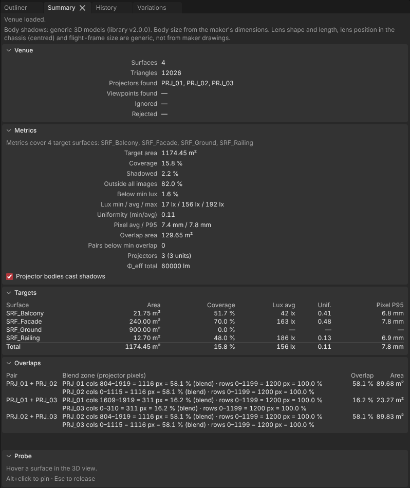
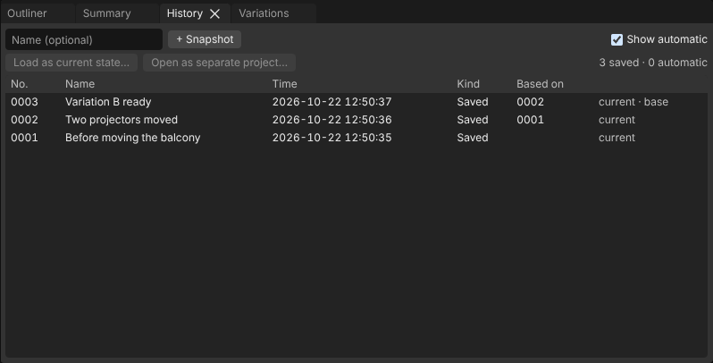

# Summary and History

These two tabs sit next to the Outliner. Do not mix them up with undo: see the last section.

> **Planning aid.** LUMAMATTERS is a planning aid. Its numbers (lux, pixel size, throw distance, overlap) come from maker data and simplified models and can be wrong. No guarantee of correct data is given. Check critical values against the maker's spec sheets and on site.

## Summary

Summary shows the venue state and the numbers of the active variation. Sections fold.

- **Status line** at the top: "Venue loaded.", "No model file imported. Use File > Import.", or a problem (a missing model file) on its own line. A **Hidden:** line counts the hidden projectors and surfaces, which are not in the numbers.
- **Venue**: the import report of the latest model file (Surfaces, Triangles, Projectors found, Viewpoints found, Ignored, Rejected, warnings). With several files, a list picks which report to show.
- **Metrics**: Target area, Coverage, Shadowed, Outside all images, Below min lux, Lux min / avg / max, Uniformity (min/avg), Pixel avg / P95, Overlap area, Pairs below min overlap, Projectors, total effective lumens. A badge says `stale` while numbers recompute, or `analysis failed: out of date`. The checkbox **Projector bodies cast shadows** switches body shadows.
- **Targets**: one row per target surface.
- **Overlaps**: a pair table with the blend zone (in projector pixels) and the overlap per pair; pairs under the warning threshold are marked.
- **Probe** (pinned at the bottom): hover a surface in the 3D view to read lux, pixel size and distance per projector at that point. `Alt+click` pins it, `Esc` releases it.

To read the numbers, see [Analysis](Analysis.md).

## History

History lists the **snapshots** of your project. **File > Snapshot history** also opens it.

- The name field and **+ Snapshot** take a snapshot (name optional), as does `Ctrl+S`.
- **Show automatic** shows or hides snapshots the app took itself (before a file change, when leaving a project, before loading a snapshot, and so on).
- The table has **No.**, **Name**, **Time**, **Kind** (`Saved` or `Auto: <reason>`), **Based on**, and marks: `current` (equals the state now) and `base` (the snapshot your state came from).
- Select a row, then **Load as current state…** or **Open as separate project…**. Loading first saves the current state as a snapshot, so nothing is lost, then clears the undo history. Opening as a separate project leaves your project untouched.
- Arrow keys, `Home` and `End` move through the rows.

More in [Projects and Snapshots](Projects-and-Snapshots.md).

## History panel versus undo

- **History panel / File > Snapshot history**: restore points saved to disk.
- **Edit > Undo / Redo** (`Ctrl+Z`, `Ctrl+Y`) and the header's **Undo** and **Redo** buttons: step back through recent edits of this session. No panel lists undo steps.

See also: [Projects and Snapshots](Projects-and-Snapshots.md), [Analysis](Analysis.md), [Interface Tour](Interface-Tour.md), [Variations and Compare](Setups-and-Compare.md)
