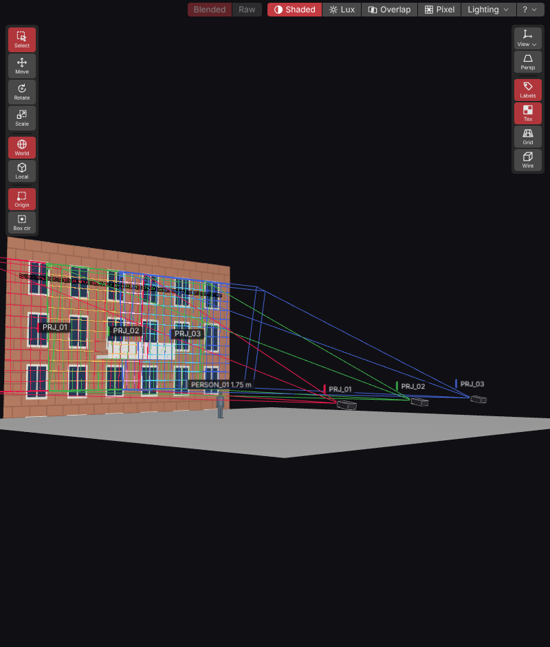
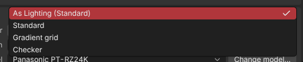
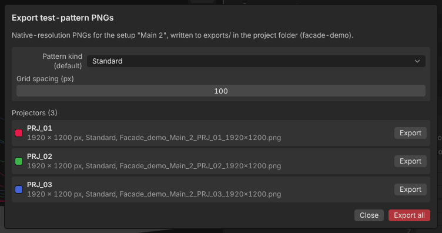

# Test Patterns

Each projector shows a test pattern in the **Shaded** view. Export the same pattern as a PNG at the projector's native resolution, then play it from your media server to line up the real projector.

## In the Shaded view

In **Shaded** view (key `1`), each projector draws its test pattern in its own colour. Where projectors overlap, their light adds up. Patterns are on by default.

Open **Lighting** in the view toolbar for the controls. Lighting belongs to the Shaded view:

- **Pattern (%)** sets how strongly the pattern shows. Default is 45 %.
- **Pattern kind** picks the pattern for the whole project: **Standard** or **Gradient grid**. It is saved with the project and can be undone.

## Pattern kinds

- **Standard**: a grid, a border, corner marks, a centre crosshair, circles, an orientation square and a text label. The label reads `<projector name> · <model> · <W>×<H> · <variation>`.
- **Gradient grid**: 10 x 10 fixed cells of graded colour (owner: check).
- **Checker**: colour cells on black. Only available per projector.

A single projector can have its own pattern. Select it and use the **Test pattern** row in Properties. Choices: **As Lighting (<project kind>)**, **Standard**, **Gradient grid** and **Checker**. With several projectors selected, a change applies to all in one step.

## Exporting PNGs

**File > Export > Test-pattern PNGs…** opens the export dialog. It needs an open project. It also works in a read-only window.

The dialog shows:

- **Pattern kind (default)**: the same project setting as in Lighting.
- **Grid spacing (px)**: for Standard and Checker. Greyed out when every listed projector uses the gradient grid, which has fixed cells.
- **Projectors**: each exportable projector of the active variation, with pixel size, pattern and file name. Press **Export** on a row for one projector, or **Export all**.
- **Left out**: projectors that cannot be exported, each with the reason. Examples: hidden, no projector model assigned, variation not valid.

The PNGs go into the `exports` folder inside the project folder. A progress card shows while they are written.

File names look like `<project>_<variation>_<projector>_<width>x<height>.png`. Characters other than letters, digits, dot, underscore and dash become `_`. A repeated name gets `_2`, `_3`. Exporting again writes the same names again.

Each PNG has the projector's native resolution. The largest side is 16384 px.

## Exporting camera images

**File > Export > Camera images (PNG)…** writes one picture per visible camera.

1. Choose it. The app asks for a folder.
2. It writes one 3840 x 2160 PNG per visible camera, named `<project>_<camera>.png`.
3. A message at the end says how many files were written and where.

Cameras are the saved viewpoints (`VIEW_*` from Blender, or cameras you saved in the app). Hidden cameras are skipped. The menu item is greyed out when there is no project or no visible camera the view can take. Pictures use the current view mode, lighting and texture settings of the 3D view (owner: check). Cancel stops after the current picture (owner: check). The export needs a graphics card that can draw 3840 x 2160 images. If yours cannot, the app says so.

See also: [View Modes](View-Modes.md), [Menus](Menus.md), [Placing Projectors](Placing-Projectors.md), [Report and PDF](Report-and-PDF.md)
