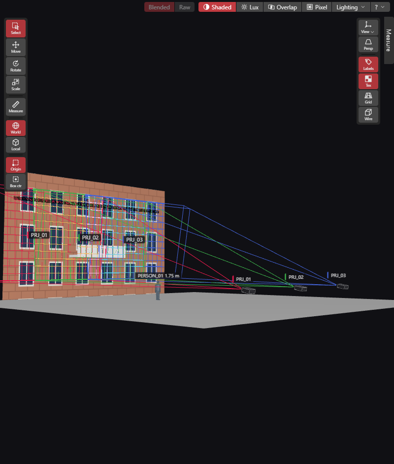
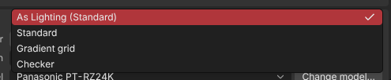
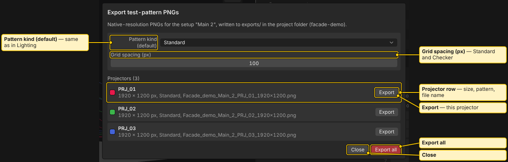

# Test Patterns

Each projector shows a test pattern in the **Shaded** view. Export the same pattern as a PNG at the native resolution of the projector. Then play it from your media server to line up the real projector.

## In the Shaded view

In the **Shaded** view (key `1`), each projector draws its test pattern in its own colour. Where projectors overlap, their light adds up. Patterns are on by default.

Open the **Viewport** fold-out and go to **Lighting**. The Lighting controls belong to the Shaded view:

- **Pattern (%)** sets how strongly the pattern shows. The default is 45 %.
- **Pattern kind** picks the pattern for the whole project: **Standard** or **Gradient grid**. The project stores it. You can undo a change.

To show the patterns in every view, switch on **Images** in the Viewport fold-out. The Shaded view always shows them.

## Pattern kinds

- **Standard**: a grid, a border, corner marks, a centre crosshair, circles, an orientation square and a text label. The label reads `<projector name> · <model> · <W>×<H> · <variation>`.
- **Gradient grid**: 10 × 10 cells of graded colour. The number of cells is fixed.
- **Checker**: colour cells on black. It is available per projector only.

A single projector can have its own pattern. Select the projector and use the **Test pattern** row in **Properties**. The choices are **As Lighting (<project kind>)**, **Standard**, **Gradient grid** and **Checker**. With several projectors selected, a change applies to all of them in one step.

## Your own projector image

A projector can show your own picture instead of a test pattern.

1. Select the projector.
2. In **Properties**, find the **Image** row.
3. Click **Load…** and choose a picture.

Click **Remove** to go back to the test pattern. A project that holds a projector image is saved in format 5.0. See [Project files](Project-Files.md).

## Exporting PNGs

Choose **File > Export > Test-pattern PNGs…** to open the export dialog. It needs an open project. It also works in a read-only window.

The dialog shows these items:

- **Pattern kind (default)**: the same project setting as in Lighting.
- **Grid spacing (px)**: for Standard and Checker. The default is 100 px. The field is greyed out when every listed projector uses the gradient grid, because the gradient grid has fixed cells.
- **Projectors**: each projector of the active variation that the app can export. A row shows the pixel size, the pattern and the file name.
- **Left out**: the projectors that the app cannot export, each with the reason. Examples are a hidden projector, a projector with no projector model, or a variation that is not valid.

To export, click **Export** on a row for one projector. Or click **Export all**.

The PNGs go into the `exports` folder inside the project folder. A progress card shows while the app writes them.

File names look like `<project>_<variation>_<projector>_<width>x<height>.png`. The app replaces every character other than letters, digits, dot, underscore and dash with `_`. A repeated name gets `_2`, `_3` and so on. Exporting again writes the same names again.

Each PNG has the native resolution of the projector. The largest side is 16384 px. A projector with a larger image is left out.

## Exporting camera images

**File > Export > Camera images (PNG)…** writes one picture for each visible saved camera.

1. Choose the menu item. The app asks for a folder.
2. The app writes one 3840 × 2160 PNG for each visible camera. The names are `<project>_<camera>.png`.
3. A message at the end says how many files the app wrote and where.

Saved cameras are the viewpoints that you saved in the app, and the `VIEW_*` cameras from Blender. The export skips hidden cameras. The menu item is greyed out when there is no project or no visible camera that the view can take.

The pictures use the view mode, the lighting and the texture settings of the 3D view. The Distance view exports as the Shaded view. Click **Cancel** to stop the export. The app finishes the picture in progress, then stops.

The export needs a graphics card that can draw 3840 × 2160 images. If your card cannot, the app says so.

To get the view from a projector, click **Look through** in the **Properties** of the projector. Then choose **View > Viewpoint > Save view as camera…**.

See also: [View Modes](View-Modes.md), [Menus](Menus.md), [Placing Projectors](Placing-Projectors.md), [Report and PDF](Report-and-PDF.md)
