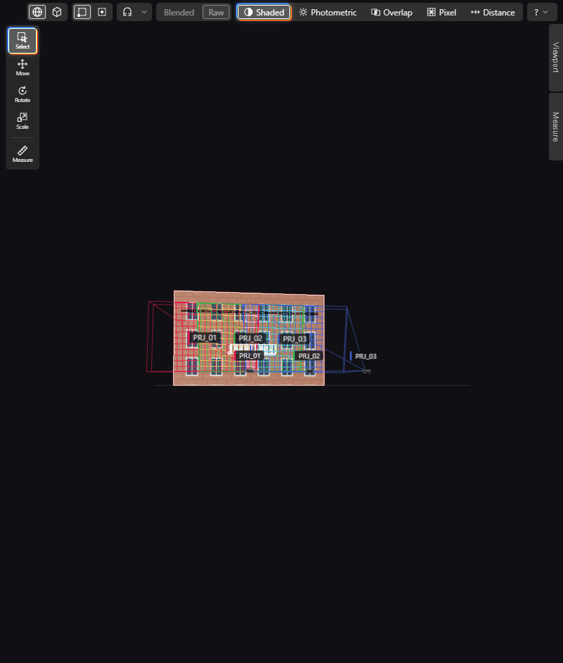
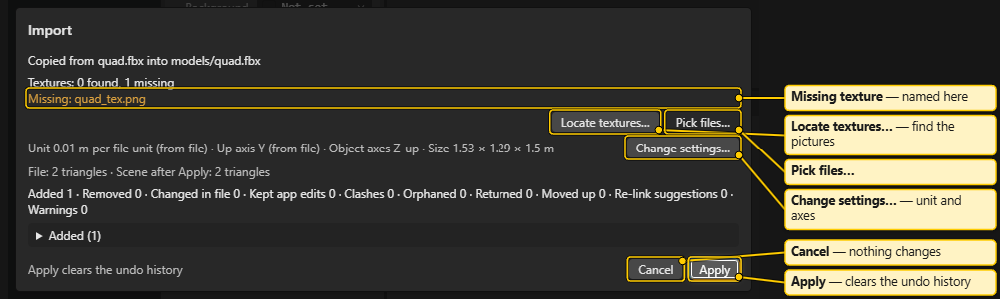
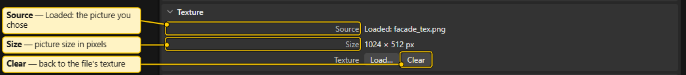
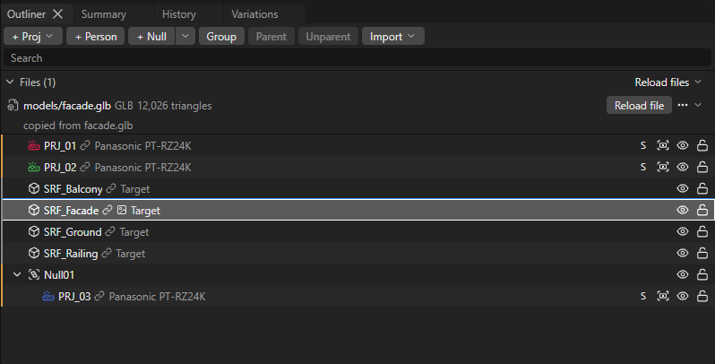

# Textures

The **Shaded** view shows the pictures of your venue model, for example wood, brick or a painted logo. You can also put your own picture on a surface. Textures are for looking only. They never change a number.

## What you see

- In the **Shaded** view, the venue shows its base-colour textures. The projector light is on top.
- In the **Photometric**, **Overlap**, **Pixel** and **Distance** views, the colours are drawn over a grey copy of the texture. The venue keeps its detail, and the colours stay readable.
- The legend of each of these four views has a **Texture strength (%)** slider. The slider sets how much texture shows. The default is 50 %. At 0 %, the views look as they did before textures existed.
- The analysis never reads a picture. All numbers are the same with textures on or off.

The app uses only the base colour. It ignores normal, roughness, emissive and other maps. It also ignores transparency inside a picture, so the surface stays opaque.

To hide textures and imported colours in the Shaded view, switch on **Grey** in the **Surfaces** section of the **Viewport** fold-out. To let edges in the base texture count for **Highlight**, switch on **Texture** in the **Edges** section.

## Where textures come from

- **From the model file.** The app reads textures from glTF / GLB (embedded or external) and FBX. It also reads textures from OBJ with its `.mtl` file. The picture formats are PNG, JPEG and WebP.
- **From you.** You can load a picture onto any surface of the venue (see below).

On import, the app copies the pictures of the model into the project folder, next to the model copy. If a picture is missing, the import report lists it and offers **Locate textures…**. Pick the folder with the pictures, and the app searches it. A missing texture never stops the import. The surface keeps its flat colour, and the Outliner shows a "texture missing" flag.

The app shrinks pictures that are wider or taller than 4096 px, for display only. Properties says so.

## Switch textures on and off

- **View > Textures** is a check item. It is on by default.
- The **Tex** button in the **Overlays** section of the **Viewport** fold-out does the same.
- The setting is per session. The project does not save it.
- While textures are off, the **Texture strength (%)** slider is grey.

## Load your own texture

A loaded texture is an app edit. It wins over the texture in the model file. **Reload** never replaces it.

1. Select one or more surfaces (meshes) in the Outliner or in the 3D view.
2. Open the **Texture** section in Properties.
3. Click **Load…**.
4. Pick a PNG, JPEG or WebP picture.

You can also drag one picture from Explorer. Drop it on the **Texture** section of Properties to load it onto the selected surfaces. Drop it on a surface in the 3D view to load it onto that surface. Drop one picture at a time.

The **Texture** section shows:

- **Source**: "From file: <file>", "Flat colour" or "Loaded: <picture name>".
- **Size**: the picture size in pixels.
- **Load…** and **Clear**. **Clear** goes back to the texture from the model file, or to the flat colour.

Rules:

- The surface needs a UV map. Without one, the app refuses with a message like "<object> has no UV map; add one in Blender". If you select several surfaces, the app skips the surfaces without UVs and names them. The app never projects a picture by itself.
- Loading or clearing is one undo step, however many surfaces you selected.
- The app keeps a copy of your picture in the `textures` folder of the project. The copy travels with the project and its snapshots.
- A copy above 100 MB stays out of git and gets a flag, like big models.
- Both buttons are off in a read-only window.
- The Outliner marks a surface that has a loaded texture.
- The reload report lists the loaded textures that it kept.

## Model textures section

Select the root row of a model file. Properties then shows a **Model textures** section. It shows how many pictures were found, missing or not supported. **Locate textures…** is on only while some pictures are missing. After you cancel a texture load, **Load textures** also shows.

## Loading bar

Pictures load after the scene shows, so flat colours appear first. While pictures decode, the header shows "Loading textures n/m" with a small bar and a cancel button (x). Cancel stops all loads, and the flat colours stay. To load the pictures again, click **Load textures** on the model.

## In the report

A **Render** block in the report has its own **Textures** choice: **As 3D view**, **On** or **Off**. It also has its own **Texture strength** setting. See [Report and PDF](Report-and-PDF.md).

See also: [View Modes](View-Modes.md), [Blender Export and Import](Blender-Export-and-Import.md), [Properties](Properties.md), [Report and PDF](Report-and-PDF.md)
