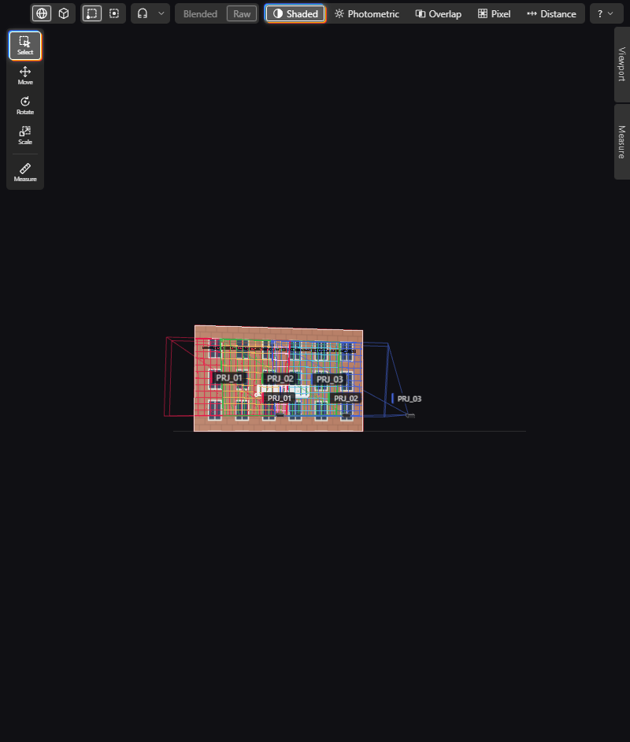

# Textures

LUMAMATTERS can show the pictures of your venue model (wood, brick, a painted logo) in the **Shaded** view. You can also put your own picture on a surface. Textures are only for looking at the scene. They never change a number.

## What you see

- In **Shaded** view, the venue shows its base-colour textures, with the projector light on top.
- In **Lux**, **Overlap** and **Pixel** view, the colours are drawn over a grey copy of the texture. You keep the venue's detail, and the colours stay readable.
- A **Texture strength (%)** slider in the legend of those three views sets how much of the texture shows. The default is 50 %. At 0 % the views look as they did before textures existed.
- The analysis never reads a picture. Lux, overlap, pixel size and all other numbers are the same with textures on or off.

Only the base colour is used. Normal, roughness, emissive and other maps are ignored. Transparency inside a picture is ignored too, so the surface stays opaque.

## Where textures come from

- **From the model file.** glTF / GLB (embedded or external), FBX and OBJ with its `.mtl` file. Picture formats are PNG, JPEG and WebP.
- **From you.** Load a picture onto any surface of the venue (see below).

When you import a model, the app copies its pictures into the project folder, next to the model copy. If a picture cannot be found, the import report lists it and offers **Locate textures…**. You pick the folder where the pictures live and the app searches it. A missing texture never stops the import. The surface keeps its flat colour and the Outliner shows a "texture missing" flag.

Pictures wider or taller than 4096 px are shrunk for display only. The Properties panel says so.

## Switching textures on and off

- **View > Textures** is a check item. It is on by default.
- The **Tex** button in the view toolbar does the same.
- This setting belongs to your session. It is not saved in the project.
- While textures are off, the **Texture strength (%)** slider is greyed out.

## Loading your own texture

A loaded texture is an app edit. It wins over the texture in the model file, and **Reload** never replaces it.

1. Select one or more surfaces (meshes) in the Outliner or the 3D view.
2. Open the **Texture** section in Properties.
3. Press **Load…** and pick a PNG, JPEG or WebP picture.

You can also drag one picture from Explorer onto the **Texture** section of Properties (it goes to the selected surfaces), or onto a surface in the 3D view (it goes to that surface). Drop one picture at a time.

The section shows:

- **Source**: "From file: <file>", "Flat colour", or "Loaded: <picture name>".
- **Size**: the picture size in pixels.
- **Load…** and **Clear**. **Clear** goes back to the texture from the model file, or to the flat colour.

Good to know:

- The surface needs a UV map. Without one, the app refuses with a message like "<object> has no UV map; add one in Blender". With several surfaces selected, the ones without UVs are skipped and named. The app never projects a picture by itself.
- Loading or clearing is one undo step, however many surfaces you selected.
- The app keeps a copy of your picture in the project's own `textures` folder. It travels with the project and its snapshots.
- A copy above 100 MB is kept out of git and flagged, like big models.
- Both buttons are off in a read-only window.
- The Outliner marks a surface that has a loaded texture.
- The Reload report lists the loaded textures it kept.

## Model textures section

Select the root row of a model file. Properties then shows a **Model textures** section. It says how many pictures were found, missing or not supported. It has **Locate textures…** (on only while some are missing). After you cancel a texture load, it also has **Load textures**.

## Loading bar

Pictures load after the scene is shown, so you see flat colours first. While they decode, the header shows "Loading textures n/m" with a small bar and a cancel button (x). Cancelling stops all loads. The flat colours stay. Use **Load textures** on the model to load the pictures again.

## In the report

A **Render** block in the Report has its own **Textures** choice: **As 3D view**, **On** or **Off**. See [Report and PDF](Report-and-PDF.md).

See also: [View Modes](View-Modes.md), [Blender Export and Import](Blender-Export-and-Import.md), [Properties](Properties.md), [Report and PDF](Report-and-PDF.md)
