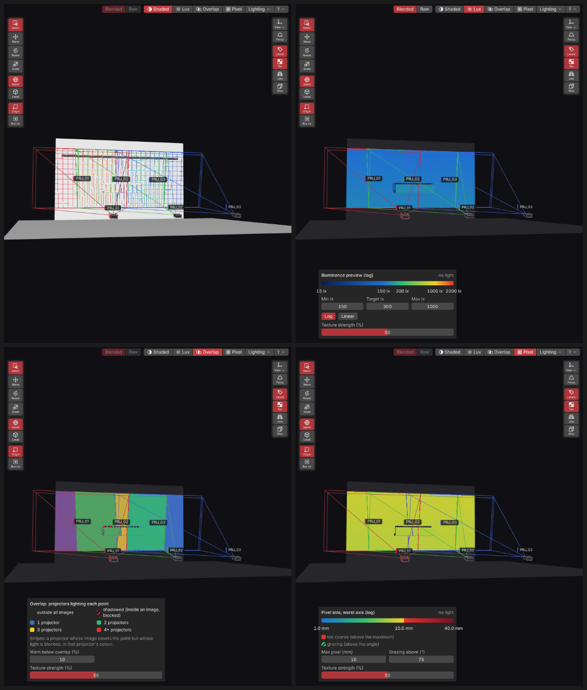
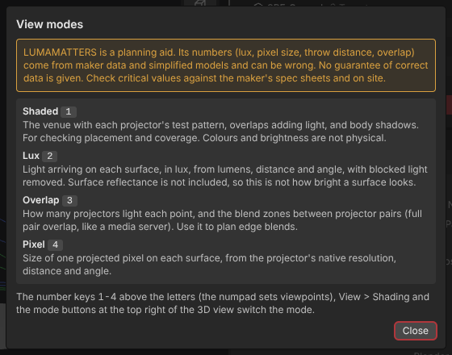
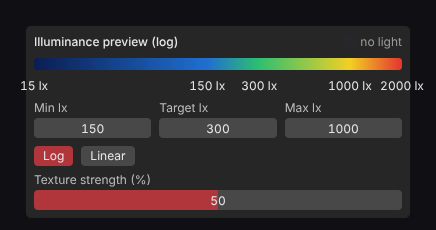
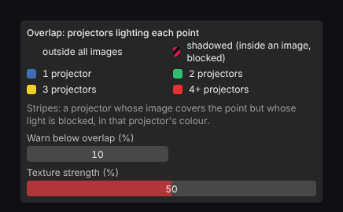
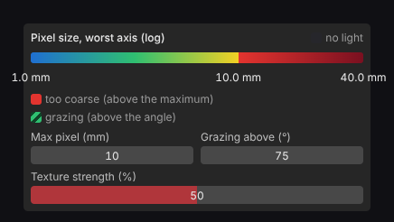

# View Modes

> **Planning aid.** LUMAMATTERS is a planning aid. Its numbers (lux, pixel size, throw distance, overlap) come from maker data and simplified models and can be wrong. No guarantee of correct data is given. Check critical values against the maker's spec sheets and on site.

The 3D view has four modes. Switch with the buttons at the top right, **View > Shading**, or the number keys `1` to `4` on the row above the letters. The numpad sets viewpoints, not modes.

| Mode | Key | What it shows |
|---|---|---|
| **Shaded** | `1` | The venue with each projector's test pattern, overlaps adding light, and body shadows. Checks placement and coverage. Colours and brightness are not physical. |
| **Lux** | `2` | Light arriving on each surface, in lux, from lumens, distance and angle, with blocked light removed. Surface reflectance is not included, so it is not how bright a surface looks. |
| **Overlap** | `3` | How many projectors light each point, and the blend zones between projector pairs (full pair overlap, like a media server). Plans edge blends. |
| **Pixel** | `4` | Size of one projected pixel on each surface, from the projector's native resolution, distance and angle. |

The **?** button beside the mode buttons explains the current mode and repeats the warning "Numbers can be wrong. No guarantee of correct data." **Help > View modes…** shows all four.

## Blended and Raw

**Blended** and **Raw** (or **View > Light**) change only the Lux view. They are greyed out in other modes ("Lux view only."). Blended applies the blend ramps between overlapping projectors; Raw shows the light without them. The Summary and the report always use blended light.

## Legends

Lux, Overlap and Pixel draw a legend at the bottom left of the 3D view. Shaded has none. Editing a threshold recolours the view at once and is one undo step.

### Lux legend

"Illuminance preview" with a colour bar and a **no light** swatch. Fields: **Min lx**, **Target lx**, **Max lx**. Buttons **Log** and **Linear** pick the scale. While the first analysis runs, it shows "blend pending: the ramps below are a placeholder until the analysis finishes".

### Overlap legend

"Overlap: projectors lighting each point", with one colour per count. Stripes mean a projector's image covers the point but its light is blocked; they use that projector's colour. The field **Warn below overlap (%)** sets the blend warning threshold.

### Pixel legend

"Pixel size, worst axis (log)" with the **no light** swatch, a **too coarse (above the maximum)** swatch and a **grazing (above the angle)** hatch. Fields: **Max pixel (mm)** and **Grazing above (°)**.

### Texture strength

With **Textures** on, Lux, Overlap and Pixel draw over a greyscale copy of the texture. **Texture strength (%)** sets how much texture detail shows. 0 % is the view without textures. It is a view setting: not saved, not undone. It is disabled ("Textures are off") while **View > Textures** is off. See [Textures](Textures.md).

See also: [Analysis](Analysis.md), [Physics Model](Physics-Model.md), [3D View](3D-View.md), [Summary and History](Summary-and-History.md)
