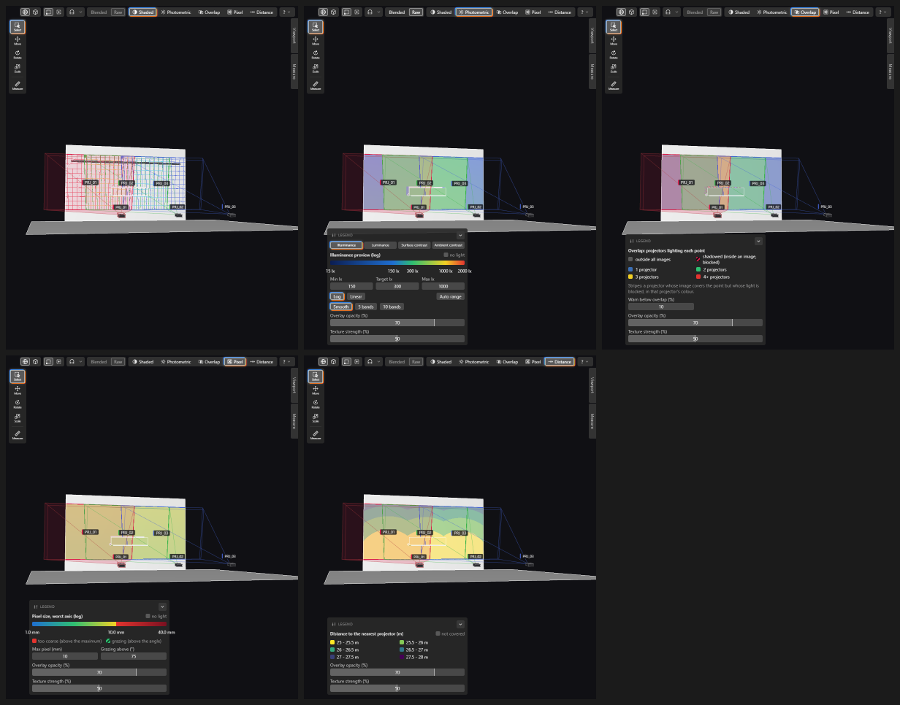
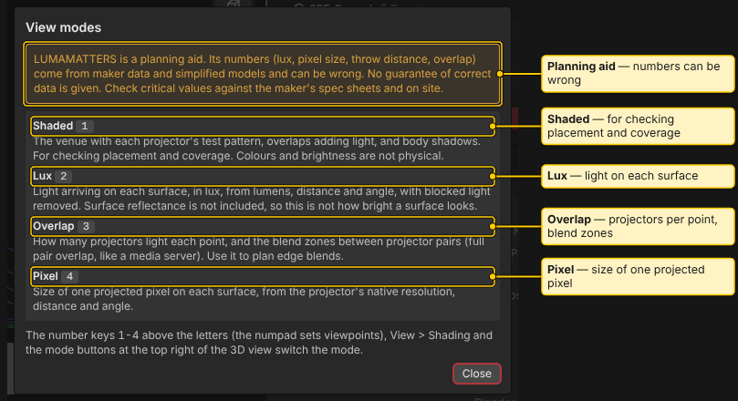
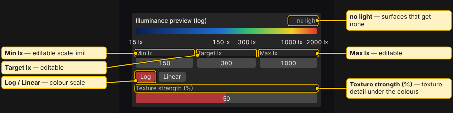
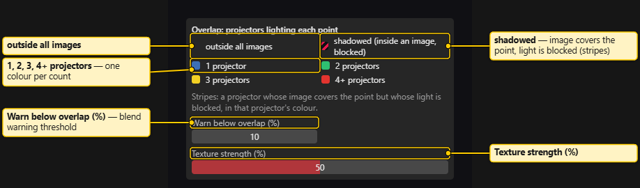
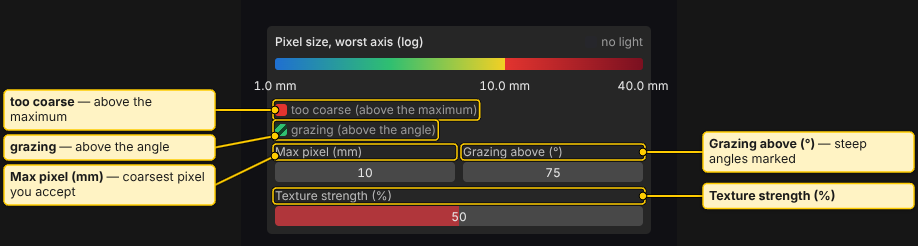
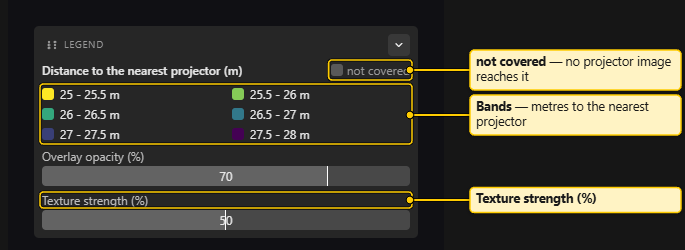

# View Modes

> **Planning aid.** LUMAMATTERS is a planning aid. Its numbers (illuminance, pixel size, throw distance, overlap) come from maker data and simplified models. They can be wrong. No guarantee of correct data is given. Check critical values against the maker's spec sheets and on site.

The 3D view has five view modes. To switch, use the buttons at the top right, **View > Shading**, or the number keys `1` to `5` on the row above the letters. The numpad sets viewpoints, not modes.

| Mode | Key | What it shows |
|---|---|---|
| **Shaded** | `1` | The venue with the test pattern of each projector, overlaps that add light, and body shadows. Use it to check placement and coverage. Colours and brightness are not physical. Surface colours are dimmed so the projections stand out. A projection never covers a surface by more than the **Overlay opacity (%)**. |
| **Photometric** | `2` | Light on each surface. Four quantities are available: **Illuminance**, **Luminance**, **Surface contrast** and **Ambient contrast**. You choose the quantity in the legend. |
| **Overlap** | `3` | How many projectors light each point, and the blend zones between projector pairs (full pair overlap, like a media server). Use it to plan edge blends. |
| **Pixel** | `4` | The size of one projected pixel on each surface, in mm. It comes from the native resolution of the projector, the distance and the angle. |
| **Distance** | `5` | The distance from each surface to the nearest projector that lights it, in m, with a band legend. Surfaces that no projector covers keep the grey of the Shaded view. It is a display aid. It is not in reports or exports. |

The **?** button beside the mode buttons explains the current view mode. It repeats the warning "Numbers can be wrong. No guarantee of correct data." **Help > View modes…** shows all five modes.

## The Photometric view

The Photometric view shows more than illuminance. It has four quantities. Each quantity answers a different question. Choose one in the **Quantity** group of the legend.

| Quantity | Unit | Question it answers |
|---|---|---|
| **Illuminance** | lx | How much light reaches the surface? It does not depend on colour or viewpoint. |
| **Luminance** | cd/m² | How bright does the surface look from a viewpoint? It uses the reflectance of the surface. |
| **Surface contrast** | ratio | How evenly is one object lit? It is p99 / p1 of the illuminance on that object. |
| **Ambient contrast** | ratio | How well does the projection stand out against the light of the site? |

Luminance and the two contrast quantities need more input than illuminance:

- Luminance needs a **Reflectance** for each object. Set it in Properties > Surface. Objects without a value use **Default ρ**.
- Ambient contrast needs **Site ambient lx**. A new project starts with 10 lx.

For the formulas, see [Physics Model](Physics-Model.md). For the numbers in the Summary, see [Analysis](Analysis.md).

## Blended and Raw

**Blended** and **Raw** (also **View > Light**) change the Photometric view only. They are greyed out in the other view modes ("Photometric view only."). **Blended** applies the blend ramps between overlapping projectors. **Raw** shows the light without the ramps. The Summary and the report always use blended light.

## Legends

The Photometric, Overlap, Pixel and Distance views show a legend. The Shaded view has none. The legend is a floating card called **Legend**. It floats over the 3D view and starts at the lower left.

- Drag the card by its grip (the dotted bar with the word Legend).
- Double-click the grip to put the card back. You can also press `Home` while the grip has focus.
- These parts always stay visible: the quantity tabs, the title, the colour bar with its tick labels, and the Min / Target / Max fields.
- The other controls are in a **Settings** section under the colour bar: **Log** / **Linear**, **Auto range**, **Reset defaults**, bands, viewpoint, opacity and texture strength.
- Click the chevron of **Settings** to open or close it. It is closed at first.
- The app keeps the place of the card and the state of **Settings** for each machine. It does not keep them in the project file.
- A change to a range recolours the view at once. It is one undo step.

### Photometric legend

At the top, the **Quantity** group has four buttons: **Illuminance**, **Luminance**, **Surface contrast** and **Ambient contrast**. Under it is the colour bar of that quantity. A **no light** swatch marks surfaces that receive no light.

The fields depend on the quantity:

| Quantity | Range fields | Defaults (log scale) | Extra settings |
|---|---|---|---|
| **Illuminance** | **Min lx**, **Target lx**, **Max lx** | 100 / 200 / 500 lx | None. |
| **Luminance** | **Min cd/m²**, **Target cd/m²**, **Max cd/m²** | 30 / 60 / 150 cd/m² | **Default ρ** and **Luminance viewpoint**. |
| **Surface contrast** | None. | Three bands: below 5:1, 5:1 to 10:1, 10:1 and above. | None. |
| **Ambient contrast** | **Min ratio**, **Target ratio**, **Max ratio** | 5 / 20 / 50 | **Site ambient lx**. |

Notes on the quantities:

- **Illuminance** is the light that arrives on the surface. It ignores the colour of the surface and your viewpoint.
- **Luminance** uses **Default ρ** for objects that have no own Reflectance. **Default ρ** starts at 1.00. **Luminance viewpoint** is **Current camera** or one of your saved cameras. Surfaces that the viewpoint cannot see are grey. The grey applies to the whole object. See [Physics Model](Physics-Model.md).
- **Surface contrast** is p99 / p1 of the illuminance on the lit samples of each target object. It has no range fields and no **Auto range**. Site ambient does not change it.
- **Ambient contrast** is (projector light + site ambient) / site ambient. The bar has marks at **5:1 min** and **10:1 ideal**. If **Site ambient lx** is below 0.01, the bar reads n/a and the legend says "Set a site ambient value".

Controls in the **Settings** section of the legend:

- **Log** and **Linear** set the scale of the colour bar.
- **Auto range** sets Min and Max from the 1st and 99th percentile of the lit target surfaces. If nothing is lit, the legend says "Nothing lit to fit".
- **Reset defaults** returns the range of the shown quantity to the reference scene. The reference scene is two projectors of 20,000 lm on a 20 × 10 m facade. **Reset defaults** keeps **Site ambient lx**. It is one undo step.
- **Smooth**, **5 bands** and **10 bands** step the colour bar. This is a view setting only. The app does not save it.
- **Overlay opacity (%)** sets how strongly the colour covers the model. The default is 70. The maximum is 90, so the model never disappears.
- **Texture strength (%)** sets how much texture detail shows under the colours. See [Textures](Textures.md).

A new project starts with **Site ambient lx** at 10 lx. This is an assumed city value. Measure the site and enter the real value.

While the analysis runs, the legend says "blend pending". The blend ramps in the view are a placeholder until the analysis ends.

### Overlap legend

The legend title is "Overlap: projectors lighting each point". It has one colour for each count. Stripes mean that the image of a projector covers the point but its light is blocked. The stripes use the colour of that projector. The field **Warn below overlap (%)** sets the warning level for blends.

### Pixel legend

The legend title is "Pixel size, worst axis (log)". It has these swatches:

- **no light**
- **too coarse (above the maximum)**
- **grazing (above the angle)** (a hatch)

It has two fields: **Max pixel (mm)** and **Grazing above (°)**.

### Distance legend

The legend title is "Distance to the nearest projector (m)". It shows a band bar. The range fits the shown projectors by itself. The steps are 1, 2 or 5, starting from 0.1 m. There are at most 10 bands. When no projector is shown, the range is 0 to 10 m. **Overlay opacity (%)** applies here too.

### Texture strength

With **Textures** on, the Photometric, Overlap, Pixel and Distance views draw over a greyscale copy of the texture. **Texture strength (%)** sets how much texture detail shows. At 0 %, the view looks the same as without textures. This is a view setting. The app does not save it and Undo does not change it. The field is disabled ("Textures are off") while **View > Textures** is off. See [Textures](Textures.md).

See also: [Analysis](Analysis.md), [Physics Model](Physics-Model.md), [3D View](3D-View.md), [Summary and History](Summary-and-History.md)
